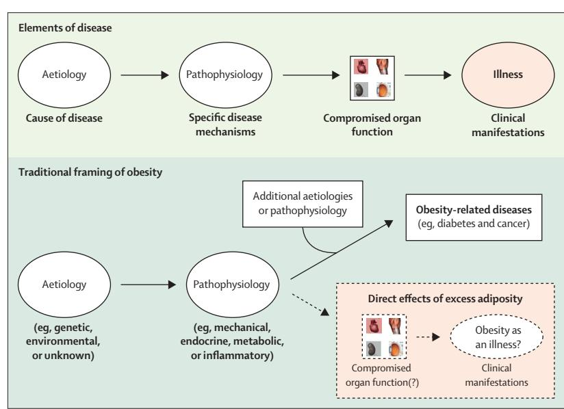
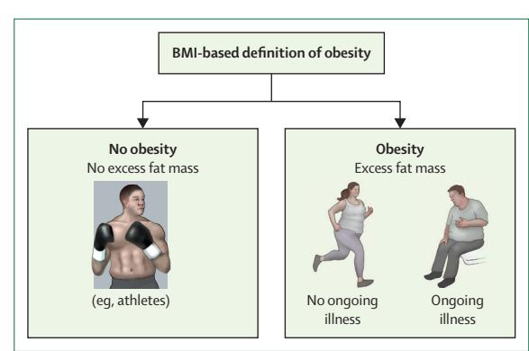
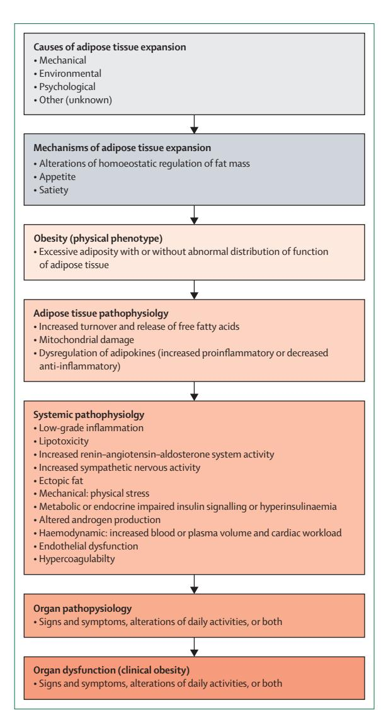
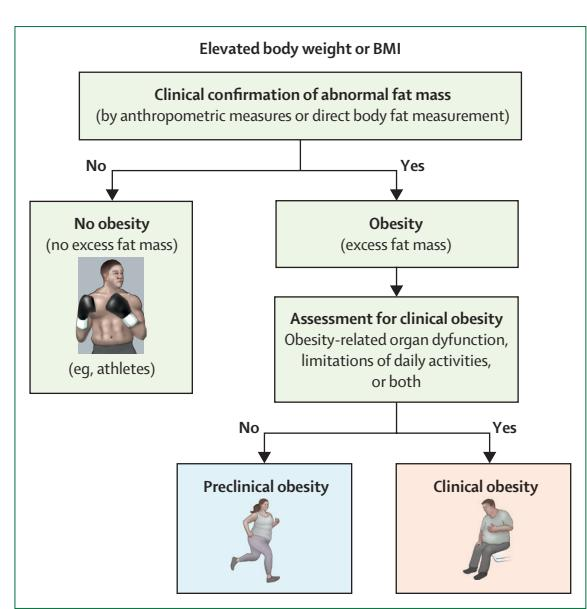
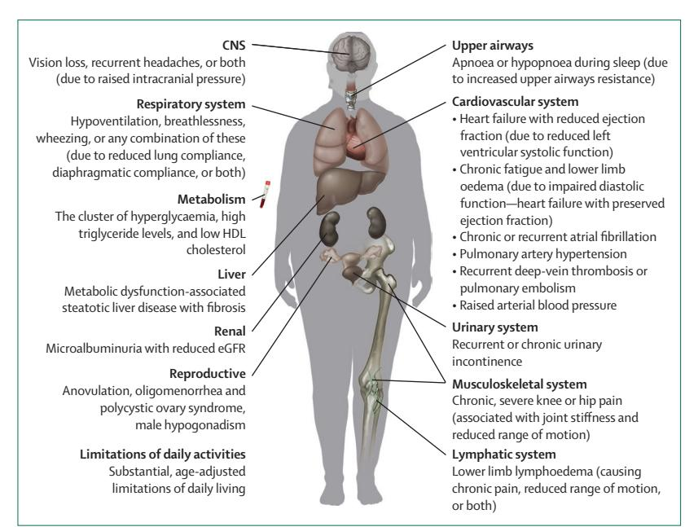
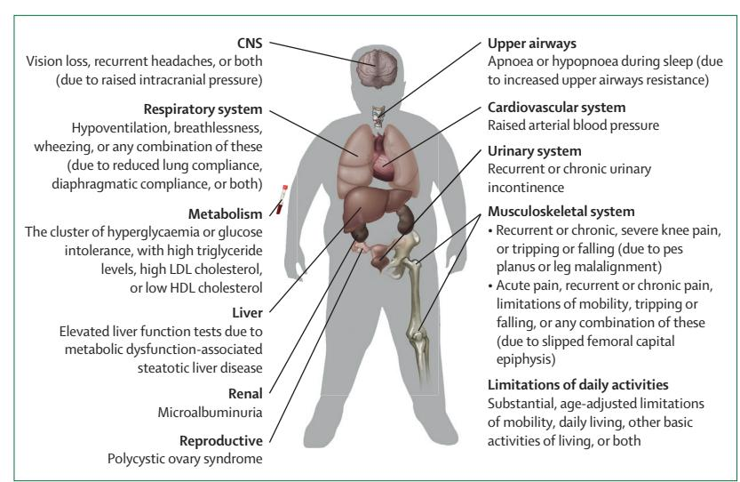
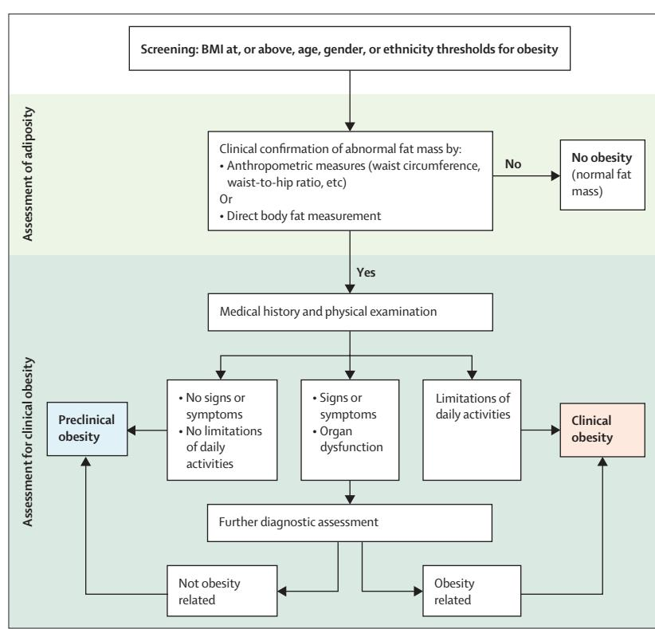
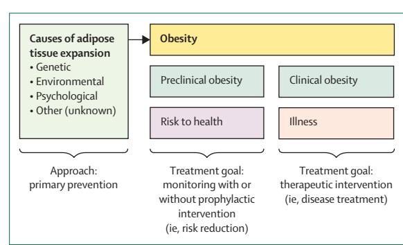

#### *Lancet Diabetes Endocrinol* **2025; 13: 221–62**

Published **Online** January 14, 2025 https://doi.org/10.1016/ S2213-8587(24)00316-4

**This online publication has been corrected. The corrected version first appeared at thelancet.com/ diabetes-endocrinology on February 25, 2025**

For the Arabic, Chinese, French, German, Greek, Hindi, Italian, Japanese, Korean, Polish, Portuguese, Spanish, and Swedish translations of the Executive summary see **Online** for appendix 1

**Metabolic and Bariatric Surgery**  (Prof F Rubino) **and Division of Diabetes & Nutritional Sciences**  (Prof G Mingrone)**, School of Cardiovascular and Metabolic Medicine & Sciences, King's College London, London, UK; King's College Hospital, London, UK** (Prof F Rubino)**; University of Washington, Seattle, WA, USA**  (Prof D E Cummings)**; Veterans Affairs Puget Sound Health Care System, Seattle, WA, USA**  (Prof D E Cummings)**; University of Colorado Anschutz Medical Campus, Aurora, CO, USA**  (Prof R H Eckel)**; Center for the Treatment of Obesity and Diabetes, Hospital Alemão Oswaldo Cruz, São Paulo, Brazil**  (R V Cohen)**; Department of Cardiovascular and Metabolic Medicine, University of Liverpool, Liverpool, UK** (Prof J P H Wilding)**; Monash University Department of Surgery, Central Clinical School, Alfred Health, Melbourne, VIC, Australia** (Prof W A Brown)**; Neuroendocrine Unit, Division of Endocrinology, Department of Medicine, Massachusetts General Hospital and Harvard Medical School, Boston, MA, USA** (F C Stanford MD)**; Division of Endocrinology, Department** 

# **Definition and diagnostic criteria of clinical obesity**

*Francesco Rubino, David E Cummings, Robert H Eckel, Ricardo V Cohen, John P H Wilding, Wendy A Brown, Fatima Cody Stanford, Rachel L Batterham, I Sadaf Farooqi, Nathalie J Farpour-Lambert, Carel W le Roux, Naveed Sattar, Louise A Baur, Katherine M Morrison, Anoop Misra, Takashi Kadowaki, Kwang Wei Tham, Priya Sumithran, W Timothy Garvey, John P Kirwan, José-Manuel Fernández-Real, Barbara E Corkey, Hermann Toplak, Alexander Kokkinos, Robert F Kushner, Francesco Branca, Jonathan Valabhji, Matthias Blüher, Stefan R Bornstein, Harvey J Grill, Eric Ravussin, Edward Gregg, Noor B Al Busaidi, Nasreen F Alfaris, Ebaa Al Ozairi, Lena M S Carlsson, Karine Clément, Jean-Pierre Després, John B Dixon, Gauden Galea, Lee M Kaplan, Blandine Laferrère, Martine Laville, Soo Lim, Jesús R Luna Fuentes, Vicki M Mooney, Joseph Nadglowski Jr, Agbo Urudinachi, Magdalena Olszanecka-Glinianowicz, An Pan, Francois Pattou, Philip R Schauer, Matthias H Tschöp, Maria T van der Merwe, Roberto Vettor, Geltrude Mingrone*

## **Executive summary**

Current BMI-based measures of obesity can both underestimate and overestimate adiposity and provide inadequate information about health at the individual level, which undermines medically-sound approaches to health care and policy. This Commission sought to define clinical obesity as a condition of illness that, akin to the notion of chronic disease in other medical specialties, directly results from the effect of excess adiposity on the function of organs and tissues. The specific aim of the Commission was to establish objective criteria for disease diagnosis, aiding clinical decision making and prioritisation of therapeutic interventions and public health strategies. To this end, a group of 58 experts—representing multiple medical specialties and countries—discussed available evidence and participated in a consensus development process. Among these commissioners were people with lived experience of obesity to ensure consideration of patients' perspectives. The Commission defines obesity as a condition characterised by excess adiposity, with or without abnormal distribution or function of adipose tissue, and with causes that are multifactorial and still incompletely understood. We define clinical obesity as a chronic, systemic illness characterised by alterations in the function of tissues, organs, the entire individual, or a combination thereof, due to excess adiposity. Clinical obesity can lead to severe end-organ damage, causing life-altering and potentially life-threatening complications (eg, heart attack, stroke, and renal failure). We define preclinical obesity as a state of excess adiposity with preserved function of other tissues and organs and a varying, but generally increased, risk of developing clinical obesity and several other non-communicable diseases (eg, type 2 diabetes, cardiovascular disease, certain types of cancer, and mental disorders). Although the risk of mortality and obesity-associated diseases can rise as a continuum across increasing levels of fat mass, we differentiate between preclinical and clinical obesity (ie, health *vs* illness) for clinical and policy-related purposes. We recommend that BMI should be used only as a surrogate measure of health risk at a population level, for epidemiological studies, or for screening purposes, rather than as an individual measure of health. Excess adiposity should be confirmed by either direct measurement of body fat, where available, or at least one anthropometric criterion (eg, waist circumference, waist-to-hip ratio, or waist-to-height ratio) in addition to BMI, using validated methods and cutoff points appropriate to age, gender, and ethnicity. In people with very high BMI (ie, >40 kg/m²), however, excess adiposity can pragmatically be assumed, and no further confirmation is required. We also recommend that people with confirmed obesity status (ie, excess adiposity with or without abnormal organ or tissue function) should be assessed for clinical obesity. The diagnosis of clinical obesity requires one or both of the following main criteria: evidence of reduced organ or tissue function due to obesity (ie, signs, symptoms, or diagnostic tests showing abnormalities in the function of one or more tissue or organ system); or substantial, age-adjusted limitations of daily activities reflecting the specific effect of obesity on mobility, other basic activities of daily living (eg, bathing, dressing, toileting, continence, and eating), or both. People with clinical obesity should receive timely, evidence-based treatment, with the aim to induce improvement (or remission, when possible) of clinical manifestations of obesity and prevent progression to end-organ damage. People with preclinical obesity should undergo evidence-based health counselling, monitoring of their health status over time, and, when applicable, appropriate intervention to reduce risk of developing clinical obesity and other obesity-related diseases, as appropriate for the level of individual health risk. Policy makers and health authorities should ensure adequate and equitable access to available evidence-based treatments for individuals with clinical obesity, as appropriate for people with a chronic and potentially life-threatening illness. Public health strategies to reduce the incidence and prevalence of obesity at population levels must be based on current scientific evidence, rather than unproven assumptions that blame individual responsibility for the development of obesity. Weightbased bias and stigma are major obstacles in efforts to effectively prevent and treat obesity; health-care professionals and policy makers should receive proper training to address this important issue of obesity. All recommendations presented in this Commission have been agreed with the highest level of consensus among the commissioners (grade of

**of Pediatrics, Massachusetts General Hospital and Harvard Medical School, Boston, MA, USA** (F C Stanford)**; International Medical Affairs, Eli Lilly, Basingstoke, UK**  (R L Batterham)**; Diabetes and Endocrinology, University College London, London, UK** (R L Batterham)**; Institute of Metabolic Science and National Institute for Health and Care Research, Cambridge Biomedical Research Centre at Addenbrookes Hospital, Cambridge, UK**  (Prof I S Farooqi)**; Obesity Prevention and Care Program, Department of Medicine, University Hospitals of Geneva, Geneva, Switzerland**  (N J Farpour-Lambert)**; Diabetes Complications Research Centre, University College Dublin, Dublin, Ireland**  (Prof C W le Roux)**; School of Cardiovascular and Metabolic Health, University of Glasgow, Glasgow, UK** (Prof N Sattar)**; Sydney Medical School, The University of Sydney, Sydney, NSW, Australia** (Prof L A Baur)**; Weight Management Services, The Children's Hospital at Westmead, Sydney, NSW, Australia** (Prof L A Baur)**; Centre for Metabolism, Obesity and Diabetes Research, Department of Pediatrics, McMaster University, Hamilton, ON, Canada** (Prof K M Morrison)**; McMaster Children's Hospital, Hamilton, ON, Canada** (Prof K M Morrison)**; Fortis C-DOC Center of Excellence for Diabetes, Metabolic Diseases and Endocrinology, New Delhi, India** (A Misra)**; National Diabetes Obesity and Cholesterol Foundation, New Delhi, India** (A Misra)**; Diabetes Foundation New Delhi, India**  (A Misra)**; Toranomon Hospital, Tokyo, Japan** (T Kadowaki)**; Department of Endocrinology, Woodlands Health, National Healthcare Group, Singapore** (K W Tham)**; Lee Kong Chian School of Medicine, Nanyang Technological University, Singapore** (K W Tham)**; Department of Surgery, School of Translational Medicine, Monash University, Melbourne, VIC, Australia** (P Sumithran)**; Department of Endocrinology and Diabetes, Alfred Health, Melbourne, VIC, Australia**  (P Sumithran)**; Department of Nutrition Sciences, University of Alabama at Birmingham,**  agreement 90–100%) and have been endorsed by more than 75 organisations worldwide, including scientific societies and patient advocacy groups.

## **Introduction**

Obesity was first recognised as a disease by WHO in 1948, and more recently also by several medical societies and countries.1–9 The current WHO International Classification of Disease labels obesity as "a chronic complex disease", and gives it a specific code (5B81).10

The idea of obesity as a standalone disease entity, however, remains controversial, both within and beyond the medical community. Addressing the merit of this idea is a timely and consequential effort because defining obesity as a disease has profound ramifications for clinical practice, public health, and society.

Those who support the recognition of obesity as a disease argue that even people with objective evidence of ill health face substantial barriers to access for healthcare services, in addition to widespread weight-related social stigma.3–6,11 Formally recognising obesity as a standalone disease—according to those who support the idea—would probably provide stronger medical and cultural legitimacy to the condition, increase access to care for those in need, and might reduce societal stigma.

On the other side of the controversy, many assert that defining obesity as a disease could have negative ramifications on afflicted individuals and society overall.12 One argument is that portraying obesity as a disease could reduce attention to the role of individual responsibility,13 thereby encouraging unhealthy behaviours and undermining efforts to address the problem. In our opinion, this argument, to some extent, might reflect intrinsic weight bias and stigma in our society. Other critics point to more objective issues, such as the fact that obesity is a highly heterogenous condition and that many people with excess adiposity have no signs of ongoing illness. Many argue that a risk factor is not a disease, and that BMI provides no information on the health of an individual. In this context, a blanket attribution of disease status to obesity (as currently defined and measured [ie, BMI >30 kg/m², or 27·5 kg/m² for Asian populations]) poses an objective risk of overdiagnosis, resulting in unwarranted use of drugs, technologies, and surgical procedures, with staggering costs for society, and negative ramifications at clinical, economic, and political levels.13–15

With such legitimate, and seemingly irreconcilable, arguments on both sides of the controversy, the debate remains unsettled. This dispute, however, reveals a crucial missing piece in the way obesity is conceptualised: because the illness directly caused by obesity is yet to be defined, obesity lacks a precise clinical identity.

Consistent with its original definition as a condition that poses a risk to health,1,4 obesity has been framed and extensively studied as a harbinger of other diseases. The manifestations of obesity as an illness, however, have not been adequately characterised.

In fact, the phenotype of obesity is still only defined by corpulence, despite evidence that excess adiposity can also have clinical manifestations and cause illness by inducing dysfunction of various organs and tissues. Typically, scoring and staging systems and treatment algorithms for obesity are based on the presence of other diseases (often referred to as comorbidities), rather than clinical manifestations of obesity itself.16–18 Such narratives and practices have further cemented the notion of obesity as a condition of risk, but they do not explain the clinical identity of obesity per se.

Disease states are fundamentally defined by their ability to cause illness, intended as both an objective and subjective human experience of ill health, secondary to ongoing alterations in the functioning of organs and tissues.19–23

With no explicit characterisation of the illness intrinsically induced by obesity, independent of comorbidities—in other words, without a clear subject for disease diagnosis—the question of whether obesity is a disease is objectively unanswerable.

Furthermore, excess adiposity (as obesity is currently defined) can have quite different significance at the individual level, and even be a sign of other diseases (eg, Cushing's syndrome or hypothyroidism). Thus, the current definition of obesity inherently lacks enough sensitivity and specificity for clinical use, justifying concerns about a blanket definition of obesity as a standalone disease state.

However, the inability to recognise obesity as a direct cause of ill health could undermine effective treatment and medically sound policies from regulatory agencies and health insurers. It is common practice to require the presence of another disease (so-called obesity plus criteria) for indication to and coverage of obesity treatment.24,25 Such practices can effectively, and unfairly, deny access to care among many people who already have objectively ill health due to obesity alone.

There is consequently an urgent need to define the illness that obesity specifically induces, intended as a distinct clinical entity in which the risk of ill health associated with excess adiposity has already materialised and can be objectively documented by specific signs and symptoms that reflect ongoing biological alterations of tissues and organs (we define this illness as clinical obesity).

Such reframing can provide a crucial, missing piece in the way we conceptualise and approach obesity, with important ramifications for clinical practice, public health policies, and societal views of obesity.

This Commission was established to identify clinical and biological criteria for the diagnosis of clinical obesity that, akin to diagnostic methods for chronic diseases in other medical specialties, reflect ongoing illness. The overarching aim is to help inform the decision making of

**Birmingham, AL, USA**  (Prof W T Garvey)**; Pennington Biomedical Research Center, Baton Rouge, LA, USA** (Prof J P Kirwan, Prof E Ravussin, Prof P R Schauer)**; CIBER Pathophysiology of Obesity and Nutrition, Girona, Spain** (Prof J-M Fernández-Real)**; Department of Medical Sciences, School of Medicine, University of Girona, Girona, Spain** (Prof J-M Fernández-Real)**; Hospital Trueta of Girona and Institut d'Investigació Biomèdica de Girona, Girona, Spain** (Prof J-M Fernández-Real)**; Chobanian & Avedisian School of Medicine, Boston University, Boston, MA, USA**  (Prof B E Corkey)**; Division of Endocrinology and Diabetology, Department of Medicine, University of Graz, Graz, Austria** (Prof H Toplak)**; First Department of Propaedeutic Internal Medicine, School of Medicine, National and Kapodistrian University of Athens, Athens, Greece** (Prof A Kokkinos)**; Department of Medicine, Northwestern University Feinberg School of Medicine, Chicago, IL, USA**  (Prof R F Kushner)**; Department of Nutrition and Food Safety**  (F Branca)**, Regional Office for Europe** (G Galea)**, World Health Organization, Geneva, Switzerland; Department of Metabolism, Digestion and Reproduction, Faculty of Medicine, Imperial College London, London, UK** (Prof J Valabhji)**; Department of Diabetes and Endocrinology, Chelsea and Westminster Hospital National Health Service Foundation Trust, London, UK** (Prof J Valabhji)**; Helmholtz Institute for Metabolic, Obesity and Vascular Research of Helmholtz Munich, University of Leipzig and University Hospital Leipzig, Leipzig, Germany** (Prof M Blüher)**; Department of Internal Medicine III, Carl Gustav Carus University Hospital Dresden, Technical University Dresden, Dresden, Germany** (Prof S R Bornstein)**; School of Cardiovascular and Metabolic Medicine & Sciences, Faculty of Life Sciences & Medicine, King's College London, London, UK**  (Prof S R Bornstein)**; Institute of Diabetes, Obesity and Metabolism, University of** 

clinicians and policy makers to facilitate identification of priorities for clinical interventions and public health strategies (panels 1, 2).

## **Methods**

## **Conception of the Commission**

The idea and general plan to convene a global expert group for the definition of diagnostic criteria of chronic illness in obesity (clinical obesity) was conceived by FR, and discussed with editors of *The Lancet Diabetes & Endocrinology* journal for consideration as a *Lancet* Commission. The Commission on clinical obesity was organised in partnership with the Institute of Diabetes, Endocrinology and Obesity at Kings Health Partners. Additional scientific input about the programme of the Commission was sought from other obesity experts who served as members of the steering committee (RLB, DEC, ISF, NJF-L, EG, CWlR, and GM).

## **Selection of Commissioners**

Members of the Commission were selected to ensure a balanced representation of relevant medical disciplines and different world regions. Academic clinicians and scientists with important contributions and work in the clinical management of obesity, in the understanding of mechanisms underlying clinical manifestations of the condition, or both, were selected dependent on eligibility in regard to conflicts of interest per the journal's policies for *Lancet* Commissions. 58 international experts were ultimately recruited as commissioners, representing multiple geographic regions and the following medical specialties: obesity medicine, endocrinology, internal medicine, bariatric and metabolic surgery, paediatrics, nutrition, psychology, primary care, gastroenterology, cardiovascular medicine, molecular biology, and public health. The Commission also included people with lived experience of obesity (VMM and JN) as commissioners to ensure consideration of the perspectives of people living with obesity.

Commissioners were required to attend monthly online meetings and offline activities, and participate in mandatory surveys (pre-Delphi) and formal Delphi rounds to generate consensus.

## **Subcommittees**

The steering committee provided general oversight and scientific direction for the programme (eg, subject selection, agenda, and inclusion of external experts) of this Commission. Additional subcommittees were formed to coordinate specific aspects of the work of the Commission (ie, genetics and pathophysiology, clinical signs and symptoms, effects of obesity on health, obesity in children and adolescents, perspectives of people with lived experience, Delphi questionnaire, ethnic-specific cutoffs for BMI and waist circumference, writing group, and communication). Several commissioners participated in one or more subcommittee (each subgroup included five to ten experts). Inclusion in subcommittees was on the basis of voluntary participation and specialised expertise.

Subcommittees were tasked with various additional activities, including further discussion of evidence, analysis of results from online surveys, preparation of pre-Delphi surveys and Delphi questionnaires, initial manuscript drafting, and planning communication. Proposals made by the subcommittees were then discussed with the whole group of commissioners during regular monthly meetings.

## **Monthly, online, whole group meetings**

Between June 20, 2022 and Dec 16, 2024, meetings were held monthly online with the whole group of commissioners to discuss scientific evidence, define a framework for the definition of clinical obesity, identify general principles for the selection of diagnostic criteria, test support for potential conclusions, and facilitate planning of the Commission's manuscript and related communications. Such meetings had a structured agenda including one or more presentations, a group discussion, and real-time voting sessions for pre-Delphi assessment of evidence and identification of suitable subjects for consensus development.

## **Review and discussion of evidence**

Evidence appraised by the commissioners related to a broad range of topics, such as definitions of disease and diagnostic criteria in other medical specialties, biological mechanisms of obesity, effects of obesity on the structure

*Panel 1:* **The problem the Commission sought to address**

### **Background**

Despite evidence that some people with excess adiposity have objectively ill health due to obesity alone, obesity is generally considered a harbinger of other diseases, not a disease in itself.

The idea of obesity as a disease remains highly controversial. The clinical phenotype of obesity is still uniquely defined by BMI, which provides no information about health at the individual level. In this context, a blanket attribution of disease status to obesity (as currently defined and measured) poses an objective risk of overdiagnosis, with potentially negative ramifications at clinical, economic, and political levels.

### **Aim of the Commission**

We sought to define clinical obesity and identify objective and pragmatic criteria for its diagnosis. As for the idea of illness in other medical specialties, clinical obesity is intended as a substantial deviation from the normal functioning of tissues, organs, the organism as a whole, or any combination of these. The objective of this Commission is to inform decision making of clinicians and policy makers and facilitate identification of priorities for clinical interventions and public health strategies.

**Pennsylvania, Philadelphia, PA, USA** (Prof H J Grill)**; School of Population Health, Royal College of Surgeons in Ireland University of Medicine and Health Sciences, Dublin, Ireland**  (Prof E Gregg)**; School of Public Health, Imperial College London, London, UK**  (Prof E Gregg)**; National Diabetes and Endocrine Center, Royal Hospital, Muscat, Oman** (N B Al Busaidi)**; Oman Diabetes Association, Muscat, Oman** (N B Al Busaidi)**; Obesity Endocrine and Metabolism Center, King Fahad Medical City, Riyadh, Saudi Arabia**  (N F Alfaris)**; Clinical Research Unit, Dasman Diabetes Institute, Dasman, Kuwait**  (E Al Ozairi)**; Institute of Medicine, Sahlgrenska Academy, University of Gothenburg, Gothenburg, Sweden** (Prof L M S Carlsson)**; Nutrition and Obesities: Systemic Approaches, NutriOmics Research Group, INSERM, Sorbonne Université, Paris, France** (Prof K Clément)**; Department of Nutrition, Pitié-Salpêtrière Hospital, Assistance Publique–Hospital of Paris, Paris, France** (Prof K Clement)**; VITAM–Research Center on Sustainable Health, Québec, QC, Canada** (Prof J-P Després)**; Iverson Health Innovation Research institute, Swinburne University of Technology, Melbourne, VIC, Australia**  (Prof J B Dixon)**; Section on Obesity Medicine, Geisel School of Medicine at Dartmouth, Hanover, NH, USA**  (Prof L M Kaplan)**; Division of Endocrinology, Columbia University Irving Medical Center, New York, NY, USA**  (Prof B Laferrère)**; Claude Bernard Lyon 1 University, Lyon, France** (Prof M Laville)**; Department of Internal Medicine, Seoul National University College of Medicine and Seoul National University Bundang Hospital, Seoul, South Korea** (Prof S Lim)**; Mexican Society of Obesity, Monterrey, NL, Mexico**  (J R Luna Fuentes)**; European Coalition for people Living with Obesity, Dublin, Ireland** (V M Mooney)**; Obesity Action Coalition, Tampa, FL, USA**  (J Nadglowski Jr)**; Department of Community Health, Alex Ekwueme Federal University Teaching Hospital Abakaliki, Abakaliki, Nigeria**

#### *Panel 2:* **The Commission's recommendations in context**

#### **Our new diagnostic model for obesity**

Although obesity should be biologically conceived of as a continuum, health and illness are typically (and necessarily) defined as distinct, dichotomous conditions at the clinical level. We therefore pragmatically distinguish clinical obesity from preclinical obesity, on the basis of the presence or absence, respectively, of objective clinical manifestations (ie, signs and symptoms) of altered organ function or impairment of an individual's ability to conduct daily activities.

The definition of clinical obesity fulfils an important conceptual gap in the notion of obesity because it provides clinical identity to the characteristic alterations of organ function directly caused by excess adiposity, independent of other obesityrelated diseases. Such reframing provides a medically meaningful mechanism to inform diagnosis, clinical decision making, and health-care policies.

#### **Conceptual implications for care and policy**

Preclinical and clinical obesity pragmatically distinguish conditions where the negative health effect might occur (as in preclinical obesity) or has occurred (ie, clinical obesity). Accordingly, management strategies for preclinical obesity should be aimed at risk reduction (ie, preventative or prophylactic intent), whereas interventions for clinical obesity should have corrective (ie, therapeutic) intent.

#### **Practical recommendations for clinicians**

To mitigate risk of both overdiagnosis and underdiagnosis of obesity, excess adiposity should be confirmed by at least one other anthropometric criterion (eg, waist circumference) or by direct fat measurement when available. However, in people with substantially high BMI levels (ie, >40 kg/m²) excess adiposity can be pragmatically assumed. Confirmation of obesity status defines a physical phenotype, but does not represent a disease diagnosis per se. People with confirmed obesity (that is, with clinically documented excess adiposity) should then be assessed for possible clinical obesity based on findings from medical history, physical examination, and standard laboratory tests or other diagnostic tests as appropriate. As with other chronic illnesses, evidence-based treatment of clinical obesity should be initiated in a timely manner with the aim of improvement (or remission, when possible) of clinical manifestations.

Preclinical obesity does not generally require treatment with drugs or surgery, and might need only monitoring of health over time and health counselling if the individual's risk of progression to clinical obesity or other diseases is deemed sufficiently low. Prophylactic interventions (eg, lifestyle intervention only, drugs, or surgery in specific circumstances) might be necessary, however, in some people with preclinical obesity when risk of adverse health outcomes is higher or when control of obesity is warranted to facilitate treatments of other diseases (eg, transplantation, orthopaedic surgery, or cancer treatment).

#### **Implications for health-care policy**

Our characterisation of preclinical and clinical obesity facilitates policy decision making and prioritisation, especially when

dealing with limited health-care resources. The preclinical and clinical obesity model also objectively distinguishes between scenarios associated with different time frame over which to assess outcomes and cost-effectiveness of antiobesity interventions (eg, longer term for preclinical obesity and shorter term for clinical obesity). As a chronic illness in and of itself, clinical obesity should not require the presence of other diseases to define indication for or coverage of treatment (as in current obesity plus criteria for health insurance coverage).

#### **Obesity as a disease**

A blanket definition of obesity as a disease would entail an unacceptably high risk of overdiagnosis. Our definition of clinical obesity as a systemic, chronic illness directly and specifically caused by excess adiposity provides a more coherent explanation of why obesity can fulfil the generally accepted criteria of a disease state in certain circumstances, but not always. By defining preclinical obesity, we also recognise evidence that excess adiposity can indeed coexist with preserved health.

#### **Clinical or preclinical obesity versus metabolically healthy or unhealthy obesity**

Whereas metabolically unhealthy obesity represents a condition with greater cardiometabolic risk, clinical obesity defines an ongoing illness not a grading of risk. Our model also recognises that obesity can cause illness by altering the function of various organs systems, not only those involved in metabolic regulation. Accordingly, a person with cardiovascular, musculoskeletal, or respiratory signs and symptoms of excess adiposity would have clinical obesity even in the presence of normal metabolic function. Furthermore, a person with a single metabolic alteration (eg, dyslipidaemia) would not meet the metabolic cluster criterion (hyperglycaemia with low HDL and high triglycerides) for the diagnosis of clinical obesity. Such an individual would therefore be classed as having preclinical obesity.

Preclinical obesity is different to metabolically healthy obesity because it is defined by the preserved function of all organs potentially affected by obesity, not only those involved in metabolic regulation.

## **Preclinical obesity versus so-called pre-obesity**

Pre-obesity indicates an earlier stage of obesity across the continuum of increasing adiposity or bodyweight levels, whereas preclinical obesity implies instead an already existing obesity phenotype.

Preclinical obesity can reflect heterogeneous conditions associated with excess adiposity, including a sign of other diseases or side-effects of medications, a paraphysiological adaptation to modern environments (with low or no risk of progression to clinical obesity), or an earlier stage of clinical obesity itself (only in this latter case could it be considered equivalent to a predisease state).

#### (A Urudinachi)**; Health**

**Promotion and Obesity Management Unit, Department of Pathophysiology, Faculty of Medical Science, Medical University of Silesia, Katowice, Poland** 

(M Olszanecka-Glinianowicz)**; School of Public Health, Tongji Medical College, Huazhong University of Science and Technology, Wuhan, China**  (Prof A Pan)**; Translational Research for Diabetes, Lille University, Lille University Hospital, Inserm, Institut Pasteur Lille, Lille, France** (Prof F Pattou)**; Department of General and Endocrine Surgery, Lille University Hospital, Lille, France** (Prof F Pattou)**; Helmholtz Munich, Munich, Germany** (Prof M H Tschöp)**; Technical University of Munich, Munich, Germany**  (Prof M H Tschöp)**; University of Pretoria, Pretoria, South Africa** (Prof M T van der Merwe)**; Nectare Waterfall City Hospital, Midrand, South Africa** (Prof M T van der Merwe)**; Internal Medicine, Center for the Study and the Integrated Treatment of Obesity, Department of Medicine, University of Padova, Padua, Italy** (Prof R Vettor)**; Center for Metabolic and Nutrition Related Diseases,Humanitas Research Hospital, Milan, Italy**  (Prof R Vettor)**; Catholic University of the Sacred Heart, Rome, Italy** (Prof G Mingrone)**; University Polyclinic Foundation Agostino Gemelli IRCCS, Rome, Italy** (Prof G Mingrone)

Correspondence to: Prof Francesco Rubino, Metabolic and Bariatric Surgery, School of Cardiovascular and Metabolic Medicine & Sciences, King's College London, London SE5 9RJ, UK **francesco.rubino@kcl.ac.uk**

and function of tissues and organs, and effects of obesity on daily activities. Evidence about the outcomes of treatments was not formally reviewed by the group because making recommendations for specific treatments is beyond the remit of this Commission.

Evidence on each topic was summarised by individual commissioners or subcommittees and presented to the whole group during monthly online meetings. Additional guest experts who were not involved in the Commission (see Acknowledgments) were occasionally invited to provide further input during these meetings by presenting reviews of evidence on specific topics. However, these experts did not participate in the development of the conclusions for the Commission.

Attendance at online meetings was a mandatory requirement for commissioners, however, when unable to attend, commissioners were asked to review recordings of online meetings and provide feedback or further input as necessary. Written summaries of presentations and discussions, online chats, and copies of presentations of evidence were circulated among the whole group after each online meeting.

Through reviews of subcommittee summaries of evidence, the commissioners sought to define diagnostic criteria on the basis of the effect of obesity on tissues and organs; the clinical manifestations and proposed diagnostic criteria are included in this Commission on clinical obesity.

#### **Consensus development process**

## *Pre-Delphi phase*

This phase sought to investigate prevailing opinions about crucial questions (eg, is obesity a disease?), find agreement regarding which areas and issues should be deliberated, assess strengths and gaps of scientific evidence, and generally serve as a guide for preparation of the Delphi questionnaires.

A series of questionnaires for real-time (during online meetings) and offline surveys were prepared by members of the steering group and other subcommittees. These questionnaires included open-ended questions, agree or disagree options, and multiple choice queries designed to capture the initial orientations of the expert group about various topics relevant to the Commission.

A specific aim of the pre-Delphi phase was to discuss general definitions of disease in medicine and existing criteria for the diagnosis of chronic diseases in other disciplines. The goal of such discussion was to define a suitable model for the definition of illness in obesity, principles to guide the definition of clinical obesity, and identification of its diagnostic criteria. Results from pre-Delphi questionnaires were used by members of the Delphi subcommittee to draft the Delphi questionnaire. These preparatory questionnaires were not a formal part of the Delphi process, and as such are not included here or in the appendices.

### *Delphi-like process*

After analysis of the results of pre-Delphi surveys and review of recorded proceedings from online meetings, a subcommittee of eight commissioners prepared a Delphi questionnaire that was comprised of a set of statements that were believed to reflect available evidence and capture the consensus of the largest majority among the group.

Approximately 3 weeks before the questionnaire was first administered to the commissioners, they were instructed in rules of the Delphi process and the timing of each Delphi round. Commissioners were assured that responses were confidential, with individual responses known only to an impartial, non-voting survey moderator.

The moderator administered the Delphi questionnaire to all 58 commissioners, using an online survey platform (Microsoft Teams Survey) throughout a total of three Delphi rounds. The original Delphi method26 was adapted to the scopes and nature of this Commission; unlike other Delphi studies, in which the first round consists mainly of open-ended questions, we used agree or disagree questions designed by the Delphi subcommittee for the first round, that were based on outcomes from the pre-Delphi phase.

For the first two rounds of the Delphi process, all questions contained a box for optional supplementary comments; commissioners who did not agree with the proposed statements were invited to state their reasons and propose amendments. Each round was conducted over 2 weeks: 1 week for response acquisition (including email reminders before the closing date), plus another week for data analysis and preparation of the subsequent round. A personalised email message was sent by the moderator to any respondent who had disagreed with specific statements or had proposed amendments. The Delphi subcommittee was consulted by the moderator to assist with matters that required medical expertise, while retaining confidentiality of the identity of commissioners who raised questions or who had initially disagreed on proposed statements. Consensus was defined as agreement by a supermajority (ie, >67%), consistent with other medical consensus conferences. After the first two rounds, statements that had unanimous or near-unanimous consensus were considered approved. A third round of Delphi was used to further discuss statements with lower levels of consensus to verify the possibility of increasing support via appropriate amendments to the statements. All commissioners reviewed the results and signed a statement to confirm their agreement with the final recommendations.

As the work of this Commission—including the Delphi process—did not expose commissioners to risk as the activities and questions in the Delphi questionnaires referred to matters that are part of the participants' normal, daily experience, professional

## **The Lancet Diabetes & Endocrinology Commission**

|    | Consensus statement (as agreed by commissioners) Grade of agreement                                                                    |
|----|----------------------------------------------------------------------------------------------------------------------------------------|
| 1  | Obesity is characterized by excessive adiposity, with or without abnormal distribution or function of the adipose tissue U, 100%       |
| 2  | The causes of obesity are multifactorial and still incompletely understood. Genetic, environmental, psychological, nutritional         |
| 3  | Obesity can cause systemic, chronic illness (Clinical Obesity), independent of the development of other medical conditions, by         |
| 4  | Pre-Clinical Obesity is characterized by a state of excess adiposity with preserved function of other tissues and organs. Pre         |
| 5  | Clinical obesity is a chronic, systemic illness characterized by alterations in the function of tissues, organs or the individual, due |
| 6  | Pre-clinical obesity is characterized by excess and/or abnormal adiposity with preserved function of other tissues and organs A, 98%   |
| 7  | Remission of Clinical Obesity: Consistent with the definition of remission used for other disease states, remission of clinical        |
| 8  | Pre-clinical obesity can be a state of remission from clinical obesity, if treatment of clinical obesity induces sustained resolution  |
| 9  | Co-morbidities: The term “co-morbidities” should only be used to refer to diseases and other conditions that incidentally co          |
| 10 | The term “obesity-related diseases/disorders” (or “associated/overlapping diseases/disorders”) should be used for non                 |
| 11 | “Complications”: Clinical obesity may lead to severe organ dysfunction and end-organ damage, causing life-altering and/or              |
| 12 | Obesity-related diseases/disorders (or overlapping diseases/disorders) can co-occur with both clinical and pre-clinical obesity        |
| 13 | Epidemiology of Obesity and Screening. Traditional measures of obesity, exclusively based on BMI (eg, BMI > 30 kg/m², or other         |
| 14 | Clinical Assessment of Obesity. Requires confirmation of excess/abnormal adiposity by one of the following methods:                    |
| 16 | The diagnosis of Clinical Obesity requires:                                                                                            |
| 17 | BMI remains a valuable screening tool to help identify subjects with potential excess/abnormal adiposity. However, clinical            |
| 18 | All people with excess adiposity should be assessed for clinical obesity by evaluation of the person’s medical history, physical       |
| 19 | Standard laboratory tests for assessment of people with confirmed excess adiposity should include at least the following: full         |
| 20 | Specific blood tests may be necessary if clinically indicated to rule out “secondary” forms of obesity (ie, hypothyroidism,            |
| 21 | Additional diagnostic tests should be performed as appropriate if the patient’s medical history or physical exam and/or                |
| 22 | People with both clinical and pre-clinical obesity should be regularly monitored and screened for type 2 diabetes and other            |
| 23 | People with clinical obesity should have access to comprehensive care and evidence-based treatments with the aim to induce             |

experience, or both, ethics approval was not deemed necessary.

## *Descriptors of grade of consensus*

Consistent with previous studies,11 consensus was considered to have been reached when a supermajority (>67%) of the expert group agreed on a given statement. However, language was iteratively modified to maximise agreement, and the degree of consensus for each statement was graded according to the following scale: grade U, 100% agreement (unanimous): grade A, 90–99% agreement; grade B, 78–89% agreement; grade C, 67–77% agreement. This grading scale indicates statements that reflect unanimous or near-unanimous opinions (grades U or A), strong agreement with little variance (grade B), or a consensus statement that reflects an averaging of more and possibly extremely diverse opinions (grade C). We report both the level of consensus and the percentage grade of agreement for each statement (tables 1–3; appendix 2 pp 2–3).

## *Delphi results*

All three rounds of Delphi were accomplished with 100% response rate (58 of 58 commissioners). A total of 82 statements (including definitions and diagnostic criteria) had consensus, of which 49 (60%) were unanimous consensus and 33 (40%) near-unanimous.

We defined 18 criteria for the diagnosis of clinical obesity in adults (range of consensus 90–100%; table 2), plus 13 criteria in children and adolescents (range of consensus 96–100%; table 2).

## *Endorsements by scientific and patients' organisations*

A document describing the methods of the Commission and the conclusions of the consensus development process was submitted to relevant scientific societies and patients' organisations for consideration of formal

|          | Consensus statement (as agreed by commissioners) Grade of agreement                                                                 |
|----------|-------------------------------------------------------------------------------------------------------------------------------------|
| 24       | The choice of intervention for clinical obesity (ie, lifestyle, pharmacological, psychological or surgical) should be based on      |
| 25       | People with pre-clinical obesity should receive science-based health counselling and have equitable access to care where            |
| 26       | Health counselling, level of care and type of intervention for pre-clinical obesity (ie, lifestyle, psychological, pharmacological, |
| 27       | Obesity (Pre-clinical or clinical) can contribute to the development of type 2 diabetes (T2D) and adversely affect diabetes         |
| 28       | Clinical assessment of obesity – as well as related medical advice, interventions, and care – must be provided by qualified         |
| 29       | Weight-based bias and stigma present a major obstacle in efforts to effectively prevent and treat obesity. Tackling stigma is not   |
| 30       | Academic institutions, professional organizations, media, public health authorities, patients’ associations, and governments        |
| 32       | Policymakers and health authorities should ensure that individuals with pre-clinical obesity have adequate and equitable access     |
| 33       | Public health strategies to reduce incidence and prevalence of obesity at population level must be based on current scientific      |
| 34       | The impact of obesity often goes beyond health complications due to the social and emotional impacts as well as the societal        |
| 35       | In making the diagnosis of clinical obesity, providers should recognize the potential past trauma and/or stigma a person with       |
| 36       | Public health strategies to reduce incidence and prevalence of obesity at population level must be based on current scientific      |
| 37       | Although lifestyle choices can contribute to or help alleviate obesity, the prominent problem lies in alterations of the biological |
| Table 1: | Consensusstatements: definitions and recommendations                                                                                |

See **Online** for appendix 2

endorsement of definitions and diagnostic criteria. Organisations that have formalised their endorsement by the end of December, 2024 are acknowledged in appendix 2 (pp 2–3). Feedback from such groups did not change the conclusions of the Commission but has been used to improve the presentation of our findings in this manuscript.

Members of the expert group (commissioners) and endorsing societies represent many countries (including high-income, middle-income, and low-income countries) and account for all continents. The figure in appendix 2 (p 4) shows countries represented by commissioners or endorsing organisations.

## *Writing of the manuscript*

A draft outline of the manuscript was prepared by the steering group, and discussed with the whole group of commissioners, who provided further input. The final outline was established, and a writing subcommittee was formed to prepare the initial draft of the manuscript.

|          | Organ, tissue, or body system | Diagnostic criterion (as agreed by commissioners)                                                  | Grade of agreement |
|----------|-------------------------------|----------------------------------------------------------------------------------------------------|--------------------|
| 1        | CNS                           | Signs of raised intracranial pressure such as vision loss and/or recurrent headaches               | A, 93%             |
| 2        | Upper airways                 | Apnoeas/hypopnoeas during sleep due to increased upper airways resistance                          | U, 100%            |
| 3        | Respiratory                   | Hypoventilation and/or breathlessness and/or wheezing due to reduced lung and/or                   |                    |
| 4        | Cardiovascular (ventricular)  | Reduced Left Ventricular systolic function - Heart Failure with Reduced Ejection Fraction - HFrEF  | A, 96%             |
| 5        | Cardiovascular (atrial)       | Chronic/recurrent atrial fibrillation                                                              | A, 98%             |
| 6        | Cardiovascular (pulmonary)    | Pulmonary artery hypertension                                                                      | A, 96%             |
| 7        | Cardiovascular                | Chronic fatigue, lower limb edema due to impaired diastolic dysfunction– Heart Failure with        |                    |
| 8        | Cardiovascular (thrombosis)   | Recurrent DVT and/or pulmonary thromboembolic disease                                              | A, 90%             |
| 9        | Cardiovascular (arterial)     | Raised arterial blood pressure                                                                     | U, 100%            |
| 10       | Metabolism                    | The cluster of hyperglycaemia, high triglyceride levels, and low HDL cholesterol levels            | U, 100%            |
| 11       | Liver                         | NAFLD with hepatic fibrosis                                                                        | U, 100%            |
| 12       | Renal                         | Microalbuminuria with reduced eGFR                                                                 | A, 96%             |
| 13       | Urinary                       | Recurrent/chronic urinary incontinence                                                             | U, 100%            |
| 14       | Reproductive (female)         | Anovulation, oligo-menorrhea and PCOS                                                              | U, 100%            |
| 15       | Reproductive (male)           | Male hypogonadism                                                                                  | A, 96%             |
| 16       | Musculoskeletal               | Chronic, severe knee or hip pain associated with joint stiffness and reduced range of joint motion | U, 100%            |
| 17       | Lymphatic                     | Lower limbs lymphedema causing chronic pain and/or reduced range of motion                         | A, 98%             |
| 18       | Limitations of day-to-day     |                                                                                                    |                    |
| 1        | CNS                           | Signs of raised intracranial pressure such as vision loss and/or recurrent headaches               | U, 100%            |
| 2        | Upper airways                 | Apnoeas/hypopnoeas during sleep due to increased upper airways resistance                          | U, 100%            |
| 3        | Respiratory                   | Hypoventilation and/or breathlessness and/or wheezing due to reduced lung and/or                   |                    |
| 4        | Cardiovascular                | Raised arterial blood pressure                                                                     | U, 100%            |
| 5        | Metabolism                    | The cluster of hyperglycaemia/glucose intolerance with abnormal lipid profile (high                |                    |
| 6        | Liver                         | Elevated LFTs due to metabolic (dysfunction)-associated fatty liver disease (MAFLD)                | U, 100%            |
| 7        | Renal                         | Microalbuminuria                                                                                   | U, 100%            |
| 8        | Urinary                       | Recurrent/chronic urinary incontinence                                                             | U, 100%            |
| 9        | Reproductive (female)         | PCOS                                                                                               | A, 98%             |
| 10       | Musculoskeletal (alignment)   | Recurrent/chronic pain or tripping/falling due to pes planus or leg malalignment                   | A, 96%             |
| 11       | Musculoskeletal (tibial)      | Recurrent/chronic pain or limitation of mobility due to Tibia vara                                 | U, 100%            |
| 12       | Musculoskeletal (femoral)     | Acute and/or recurrent/chronic pain or limitation of mobility or tripping/falling due to slipped   |                    |
| 13       | Limitations of day-to-day     |                                                                                                    |                    |
| Table 2: | Consensusstatements:          | diagnostic criteria for clinical obesity in adults, adolescents, and children                      |                    |

Subgroups of the writing committee (FR, DEC, RHE, RVC, JPHW, WAB, FCS ISF, NJF-L, CWlR, NS, LAB, KMM, AM, TK, KWT, PS, WTG, JPK, J-MF-R, BEC, HT, AK, RFK, JV, MB, JBD, SRB, HJG, and ER) were tasked with the preparation of distinct chapters of the manuscript. All commissioners were then invited to review the initial draft and provide critical input for further editing of the manuscript (with the exception of RLB, see Acknowledgments), thereby generating its final version. The coauthors of this manuscript, who include all but two of the commissioners (see Acknowledgments), formally approved the final version.

## **Definition and diagnosis of disease and predisease states in medicine**

## **General principles**

Although the notion of disease might seem obvious, a clear definition of disease does not exist. One comprehensive approach to the definition of disease was proposed by Stanley Heshka and David Allison:27 (A) a condition of the body, its parts, organs, or systems, or an alteration thereof; (B) resulting from infection, parasites, nutritional, dietary, environmental, genetic, or other causes; (C) having a characteristic, identifiable, marked group of symptoms or signs; and (D) deviation from normal structure or function (variously described as abnormal structure or function; incorrect function; impairment of normal state; interruption, disturbance, cessation, disorder, or derangement of bodily or organ functions).

Pre-disease describes conditions that are not at the stage or level that would classify them as a disease but, at the same time, are not at a stage or level where people can be declared entirely disease-free.23 Examples of predisease include HIV infection, adenomatous colonic polyps, pre-diabetes, and osteopenia. The hallmark of these conditions is that they could be detected through screening programmes and treated, avoiding the ultimate disease state (eg, AIDS, colon cancer, type 2 diabetes, and osteoporosis, respectively for the aforementioned predisease examples).

Inherent to the notion of disease is a distinct pathophysiology that can cause alterations of either a single organ or multiple organs (systemic diseases). Fundamentally, however, diseases are characterised by their ability to cause illness, intended as an objective and subjective experience of ill health. Illness implies a deviation from the healthy functioning of organs and tissues or the whole individual. It is typically associated with specific clinical manifestations—physical and biochemical—that can be used as criteria for disease diagnosis.19–23

Although a disease process can exist in the absence of manifest illness (eg, a malignancy in its early phases might not yet be associated with signs or symptoms), illness is the distinctive feature of a disease and will occur as a part of the typical evolution of that disease. The specific clinical manifestations of an illness might or might not be unique (pathognomonic) to the disease, but typically cluster in a distinctive clinical phenotype. Illnesses also have a typical evolution in time, with worsening of organ dysfunction and typical complications as a result, ultimately determining the prognosis of that disease. Recognition of the typical clinical manifestations of an illness (physical or biochemical) allows a disease to

|          | Consensus statement (as agreed by commissioners) Grade of                                    |
|----------|----------------------------------------------------------------------------------------------|
| 1        | The prevalence of clinical obesity and the rate of progression from pre-clinical to          |
| 2        | Research is needed to investigate the distinct prognostic value of dysfunctions of           |
| 3        | The development of appropriate staging systems to predict complications and                  |
| 4        | Anthropometric criteria and biomarkers of excess adiposity have been studied as              |
| 5        | Research is needed to identify accurate predicting factors of progression from               |
| 6        | The etiology of obesity and its pathophysiology remain incompletely understood.              |
| 7        | The efficacy of current anti-obesity interventions has been tested mostly in terms of        |
| 8        | Future clinical studies should further define criteria for remission of clinical obesity and |
| 9        | Research is needed to understand the amount of weight loss that is necessary to              |
| 10       | Research is needed to develop ways to reduce the ongoing pandemic of pre-clinical            |
| 11       | Studies to investigate genetic/environmental mechanisms related to the development           |
| 12       | Research is needed to approach the prevention and treatment of pre-clinical and              |
| 13       | The discrepancy between the high prevalence of obesity in families, yet the relatively       |
| 14       | It is plausible that alterations of fat tissue function could significantly impact health    |
| Table 3: | Consensus statements: current gaps in knowledge and future research priorities               |

be detected (ie, diagnosis) and distinguished from others (ie, differential diagnosis).

For example, we recognise diabetes as a disease state (with subtypes) because of its ability to cause a typical illness, characterised by a distinctive cluster of physical signs and symptoms (eg, polyuria, polydipsia, fatigue, or increased hunger) and biochemical alterations (eg, hyperglycaemia, hyperinsulinaemia, or insulin deficiency) that reflect dysfunction of specific organs. Such organ dysfunction can worsen over time with a characteristic evolution, leading to specific end-organ complications (eg, blindness, heart attack, stroke, or renal failure).

Diseases can also have a broader clinical effect, beyond causing specific illness. Due to their underlying pathophysiological mechanisms, diseases can predispose to, facilitate, or exacerbate other diseases, especially those characterised by partly overlapping cause or pathophysiology. Signs and symptoms of a disease can be common to other diseases, frequently posing challenges for differential diagnosis. Often the evolution in time of the illness, with the development of additional and characteristic clinical and biochemical signs, is what facilitates differential diagnosis (panel 3).

Importantly, the diagnostic criteria for a disease must be sufficiently accurate to detect (ie, sensitivity) and distinguish (ie, specificity) diseases from one another. Some ailments, however, have similar pathophysiology and clinical manifestations (eg, lupus and Sjögren's syndrome or Crohn's disease and ulcerative colitis), therefore posing challenges for differential diagnosis.

## **Chronic diseases**

Some chronic diseases might originate in one tissue or organ, but their pathophysiology can directly affect the structure, function, or both, of several other organs and tissues, generating a systemic form of disease with multiple clinical manifestations, and characteristic evolution and prognosis.

Chronic diseases typically advance gradually over an extended period of time, and persist for a year or more23,28 (eg, cardiovascular, rheumatological, neurological, and gastroenterological diseases, and diabetes). These diseases can often coexist with additional health conditions, which compound their effect on quality of life, increase risk of disability and premature mortality.29

#### **Effect of the diagnosis of chronic diseases on the affected individual**

Inherent with the chronic, often incurable, nature of the condition is a sense that the disease will affect all aspects of a person's life. Concerns about the effect of a disease on the ability to conduct normal daily activities and overall quality of life can also cause substantial preoccupation about an individual's ability to work, produce income, and support their family, among other things. People diagnosed with chronic diseases also often worry about premature mortality. Therefore, the diagnosis of a disease has profound psychological effects, which compound the health effects imposed by the disease.

For all these reasons, accurate diagnosis of disease is paramount. Clinicians must ensure that diseases are accurately detected to allow timely access to care. However, clinicians must avoid overdiagnosis of chronic diseases, as this could have considerable and unnecessary consequences for the affected individual, plus society at large.

#### **Criteria for the diagnosis of disease in medical specialties other than obesity**

Looking at the definitions and diagnoses of chronic diseases in other medical specialties can highlight differences to obesity that hinder its conceptualisation as a disease. This exercise can also facilitate the development of appropriate diagnostic models for obesity.

### *Immune-mediated diseases*

Many immune-mediated diseases (eg, rheumatological diseases) typically cause chronic, systemic illness. These diseases originate in or initially affect the connective tissue, inducing structural and functional alterations of several organs, including the joints, tendons, ligaments, bones, muscles, heart, and lungs. Rheumatological diseases can result from autoimmune causes, but their exact cause is often unknown. Clinical manifestations reflect structural and functional alterations of joints and other organs, with signs of tenderness, erythema, swelling or oedema, altered range of motion, impaired function, and reduced quality of life.

Although various immune-mediated diseases can have overlapping clinical manifestations, differences in the onset, site, and timing of symptoms, the absence or presence of distinct biological alterations, and their typical evolution in time, inform differential diagnosis. For example, the two most common forms of arthritis (rheumatoid arthritis and osteoarthritis) both present

*Panel 3:* **Definition of disease and illness in medicine** Diseases are characterised by:

- A distinct pathophysiology that can cause alterations of either a single organ or multiple organs (systemic diseases)
- The ability to cause a specific illness, intended as an objective and subjective experience of ill health What is an illness?
- Illness implies a deviation from the normal functioning of organs and tissues or the whole individual, and is typically associated with specific clinical manifestations—physical and biochemical—that can be used as criteria for disease

diagnosis

classic signs of arthropathy, so further diagnostic investigations, including blood tests and x-rays, are often necessary to help to distinguish one from the other.30,31

## *Mental health conditions*

Mental disorders are characterised by alterations in cognition, emotional regulation, and behaviour.27,32 Several types of mental disorders are defined according to specific criteria in the Diagnostic and Statistical Manual of Mental Disorders. The diagnosis of these conditions requires identification of symptoms and signs, indicating the presence of internal dysfunction.33 Typically, several signs and symptoms among a set of characteristic clinical manifestations need to be present to confirm diagnosis. A thorough examination of these signs and symptoms is essential to ensure an accurate diagnosis.

## **Commissioners' views on obesity as a disease**

The idea of obesity as a disease was a controversial subject also within this Commission. Initial opinions diverged substantially, clearly indicating that a consensus would not be reached on a blanket definition of obesity as a disease, at least as currently defined. A specific pre-Delphi survey on the question of whether obesity is a disease showed that more than half of the commissioners rejected the all-or-nothing scenario implied in the question, but supported the view that obesity is a risk factor for other diseases and sometimes a disease itself. Only about a third supported the idea of obesity as a disease, and the rest of the commissioners did not consider obesity to be a disease.

The main arguments cited in support of obesity as a disease included evidence that excess adiposity is associated with the following: clear pathogenetic mechanisms (eg, inflammation, hormonal imbalances, alterations of appetite or satiety regulation, and insulin resistance); increased risk of mortality; persistence and recidivism despite treatment, consistent with a chronic, relapsing disease process; and the clear association of excess adiposity with complications or related diseases that impair health.

Those who did not support the idea of obesity as a disease, at least as currently defined, cited the following arguments: some people with BMI levels at or above traditional obesity thresholds do not have excess adiposity (eg, athletes and people with higher-than-average lean mass); a substantial number of individuals with excess adiposity show no obvious signs of ongoing illness; and although there is a clear relationship between BMI, adiposity, and prevalence of disease at population levels, BMI and fat mass provide no information about health at the individual level. Because of these reasons, the current definition of obesity and the BMI-centric methods used for its detection could overdiagnose disease in otherwise healthy individuals (figure 1).

The objective evidence and logic behind both perspectives suggest fundamental issues in the current framing of obesity and in the methods used for its diagnosis.

The aforementioned examples of other chronic diseases show that the notion of disease in medicine fundamentally implies an ability of the disease to cause illness, intended as a human experience of ill health, characterised by distinct clinical manifestations secondary to ongoing alterations in the functioning of organs, tissues, or both.

In contrast with such generally adopted medical principles, the current definition of obesity provides no clear characterisation of the illness induced by obesity itself. The narrative of the clinical effect of obesity focuses instead on adiposity-related risks of developing other diseases—that is, distinct clinical entities with their own pathophysiology, clinical manifestations, evolution, and prognosis.

The lack of a clearly identifiable illness caused by obesity provides no subject for accurate disease diagnosis, thus representing a major stumbling block for the consideration of obesity as a disease (panel 4).

An in-depth analysis of limitations regarding the current framing of obesity and methods used for its diagnosis is warranted to address issues that hinder the debate around obesity.

#### *Figure 1:* **Illness is the missing piece in the traditional framing of obesity**

Diseases are typically characterised by a cause (or set of causes) that initiates the pathogenetic process; a distinct pathophysiology (the mechanisms by which the disease process leads to alterations of either a single organ or multiple organs [systemic diseases]) resulting in a distinct (single) illness, characterised by specific clinical manifestations with a typical evolution in time (ie,complications, end-organ damage, and mortality). Illness is the clinical manifestation of a disease state and its clinical and biological features can be used as criteria for disease diagnosis and differential diagnosis. Obesity has traditionally been conceptualised as a harbinger of other diseases. Accordingly, the health effect of obesity is typically described by a broad and heterogeneous set of so-called complications of excess adiposity, including conditions that are diseases themselves, with their own pathophysiology and distinct clinical manifestations. This characterisation does not define a distinct illness (eg, a single illness, distinguishable from others); hence, it provides no explanation for obesity as a specific disease entity. Despite evidence that excess adiposity alone can affect the functioning of multiple organs and tissues, the illness caused by obesity itself (ie, distinct clinical manifestations, beyond mere corpulence) has not been yet characterised. Items within the dashed rectangle indicate elements missing from the traditional framing of obesity.

#### **Limitations of the current framing of obesity Conceptual and practical issues in the current definition of obesity**

Obesity is currently conceived and defined as a condition of excess adiposity that presents a "risk to health".34 The current diagnosis of obesity worldwide is based on BMI, calculated as weight in kilograms divided by height in metres squared. According to WHO, an adult with a BMI of 30 kg/m² or higher is considered to have obesity.

This definition has been widely adopted and used in epidemiological studies, clinical practice, and public health policy.35 However, several studies have shown that BMI does not reflect body fat distribution or metabolic health, and alternative measures such as waist circumference or body fat percentage could be more appropriate.36 Nonetheless, BMI remains the most commonly used measure of obesity worldwide, and helps identification of individuals at risk of obesity-related comorbidities.

In a survey of commissioners' initial opinions, a large majority of the group (~70%) agreed that the current definition of obesity ("abnormal or excessive fat accumulation that presents a risk to health")34 is not consistent with the notion of a standalone disease state.

This assessment was based primarily on two arguments. First, the exclusive focus on risk in the definition of obesity inherently implies that ill health has not yet materialised (and might, at least theoretically, never materialise). This possibility is objectively true for some people with obesity, who appear to be able to live a relatively healthy life for many years, or even a lifetime. In fact, one can legitimately argue that a risk factor is not necessarily a disease, and that a disease should be diagnosed when it occurs, not before.

Many conditions can predispose one to future disease, yet are not considered diseases themselves. For example, although monoclonal gammopathy of uncertain significance can be a precursor of multiple myeloma, it is not deemed a disease itself.37

Second, the risk associated with obesity does not refer to a specific illness, but to a broad number of other ailments, including type 2 diabetes, cancer, and mental disorders. Regardless of the causality of such associations, these conditions are diseases in their own right and cannot be configured as expressions of a single disease process.

Thus, if obesity were only a condition of risk to health (as per its current definition) it would be difficult to understand why it should be considered a disease.

However, there is ample evidence that excess adiposity itself can directly induce structural and functional alterations in multiple tissues and organs (eg, liver, heart, lungs, kidneys, and musculoskeletal system), causing objectively ill health, independent of the onset of other diseases. Thus, a more accurate definition of obesity—consistent with evidence that risk for other diseases and ongoing illness can both be associated with excess adiposity—is necessary to explain the full effect of obesity on health.

The Commission also identified other limitations in the current definition of obesity. One important limitation is the lack of clarity on whether abnormal function (metabolic, endocrine, or both) of adipose tissue and excess adipose tissue mass should both be present to define obesity. There was general agreement among commissioners that abnormal function of adipose tissue results in several perturbances of physiology, such as insulin resistance, thereby crucially contributing to metabolic consequences of obesity. However, alterations of adipose tissue function are not always necessary for the effect of obesity on health, as this can also occur through other mechanisms. In fact, physical effects of excess fat mass on organs (eg, restrictive lung capacity and musculoskeletal complications) or the whole individual can affect health in the absence of functional alterations. By contrast, dysfunctional adipose tissue can induce insulin resistance and metabolic alterations in the absence of excess adiposity (eg, lipodystrophy). Accordingly, an accurate definition of obesity should make it clear that excess fat mass is the fundamental characteristic of obesity, whereas abnormal function of adipose tissue might or might not be part of obesity (ie, obesity should be defined by excess fat mass, with or without abnormal function).

## **The BMI issue**

The current definition of obesity on the basis of BMI has several limitations.38,39

### *Panel 4:* **Disease or no disease? It is not all or nothing**

As currently defined and measured, obesity does not have the same meaning in all affected individuals. In this context, the question of whether obesity is a disease is illconceived because it presumes an implausible all-or-nothing scenario, where obesity is either always a disease or never a disease.

### In fact:

- Some people with obesity have objective ill health due to obesity alone (ie, severe symptoms or limitations of daily activities due to effects of obesity on pulmonary, cardiovascular, or musculoskeletal systems)
- Other people with obesity might be able to maintain normal function of organs and substantially preserved health, long term
- Excess adiposity can also be a sign of other diseases or a side effect of numerous medications
- BMI and other anthropometric measures can underestimate and overestimate excess adiposity and provide no information about the functioning of organs and tissues

#### Implications:

- Obesity is a heterogeneous condition, and an obesity phenotype does not necessarily reflect ongoing illness
- BMI-based metrics of obesity can misclassify excess adiposity and could both underdiagnose and overdiagnose disease
- A clinically relevant definition of obesity is warranted to facilitate a more rational debate around obesity as a disease

BMI does not differentiate between fat and lean mass or account for differences in body fat distribution. As a result, some individuals with a BMI in the so-called normal or overweight range (eg, 18·5–29·9 kg/m² in individuals of European descent) could have excess body fat and be at increased risk of obesity-related morbidity. For example, BMI can underestimate fat mass in the elderly, in individuals who have lost bone or muscle mass, and in people of certain ethnicities (eg, Asian populations), leading to underdiagnosis of obesity.35,40

Conversely, some individuals with a BMI in the range currently defining obesity (>30 kg/m² in individuals of European descent) do not have excess fat mass and are not at increased risk of morbidity or mortality.41 For example, in people with more bone or skeletal muscle mass, such as athletes, BMI can overdiagnose obesity; famous examples of such misclassifications are legendary boxers and US National Football League quarterbacks.42

The association between BMI-based obesity and mortality is actually U-shaped, with factors such as smoking history, occult disease, recent unintentional weight loss, weight variability, and body fat distribution pattern influencing the shape of the BMI versus mortality curve.43 Furthermore, overall diet quality and physical activity or fitness level are potent modulators of the risk associated with any BMI value, regardless of body composition.44 However, eliminating individuals from the analysis on the basis of such factors can plausibly create biases.45,46

Alternative measures, such as waist circumference or body fat percentage, might be more accurate for the detection of excess adiposity and, therefore, as measures of obesity-related health risks.47 For example, many population studies have shown that within every BMI category considered, the larger the waist circumference, the greater the morbidity or mortality risk.36

In addition to potentially misclassifying excess adiposity itself, BMI provides no information about the functional status of tissues and organs, or the ability of an individual to conduct normal daily activities, which are two fundamental criteria for assessment of a person's health.

Thus, the current BMI-based definition of obesity can either underestimate or overestimate both adiposity and illness (figure 2).

The risk of underdiagnosis can delay or even prevent access to care; however, the risk of overdiagnosing obesity is particularly concerning for its potential negative ramifications on health-care systems and society. One practical consequence of defining obesity as a disease, under its current BMI-based definition, is that approximately 30–40% of people in some countries would be diagnosed as having this disease right now and would be rendered eligible, overnight, for claims of disability or expensive (and potentially unnecessary) treatments. Such claims would effectively make obesity a financially and socially intractable issue.

Although not appropriate for use as a clinical parameter, BMI remains a universally accepted measure of obesity at the individual level. In fact, BMI thresholds are routinely used in clinical practice to rank the severity of obesity (class 1, 2, or 3 [eg, BMI of 30–34·9 kg/m², 35–39·9 kg/m², or >40 kg/m², respectively, for individuals of European descent]), establish indications for therapeutic interventions, or decide insurance coverage of obesity treatments. Most crucially, BMI has become an integral part of the current definition of obesity, as most health-care services, medical organisations, and public health agencies recommend use of a BMI threshold (ie, 30 kg/m² in individuals of European descent) to diagnose obesity.

For all these reasons, using BMI for the diagnosis of obesity represents a major barrier for both the understanding and acceptance of obesity as a disease.

Several professional organisations, including the American Association of Clinical Endocrinology and the European Association for the Study of Obesity have recommended consideration of pathophysiological abnormalities in the mass, distribution, and function of adipose tissue as more appropriate than BMI-centric criteria to assess the effect of excess adiposity on health.48,49

There was strong agreement among commissioners (98%) that the use of BMI should be restricted to the screening of patients with potential obesity (table 1), whereas additional measures of adiposity are essential to confirm obesity status (ie, excess adiposity) at the clinical level. In addition to these additional measures, objective and clinically meaningful criteria for obesity should be used for assessment of an individual's health or illness.

*Figure 2:* **Limitations of the BMI-based definition of obesity** The current BMI-based definition of obesity (eg, BMI >30 kg/m²) can both underestimate and overestimate adiposity and underdiagnose and overdiagnose illness. BMI does not differentiate between fat and lean mass and does not account for differences in fat distribution. As a result, some individuals with a BMI in the non-obesity range (eg, BMI <30 kg/m² for Europeans) might actually have excess body fat. Conversely, in people with increased skeletal muscles mass, such as athletes, BMI can overdiagnose obesity. Furthermore, BMI provides no information about the functional status of tissues and organs, or the ability of an individual to conduct normal daily activities, two fundamental criteria to assess the presence of an illness.

#### **Limitations of other anthropometric measures of adiposity**

Other anthropometric measures, such as waist circumference, waist-to-hip ratio, and weight-to-height ratio have been suggested as alternative methods to BMI for diagnosis of obesity. However, these anthropometric measures also have notable limitations.45

Measurements of waist circumference and waist-to-hip ratio can vary across populations and between sexes. These measurements might not accurately reflect subcutaneous and visceral fat accumulation, which is closely associated with an increased risk of metabolic diseases.2 Also, persons matched for visceral adiposity can show differences in their risk-factor profile. Other ectopic fat depots, including liver fat, also contribute to variations in health risk.50

Although using anthropometric measures as alternatives or in addition to BMI could improve detection of excess adiposity and prediction of cardiometabolic risk, akin to BMI they are not a robust measure of ongoing illness.

Anthropometric measures have been extensively studied as predictors of metabolic risk, but much less so as a sign of ongoing organ dysfunction caused by obesity. Thus, as for BMI, diagnostic methods exclusively based on anthropometric measures can underdiagnose or overdiagnose illness.

Adding biochemical markers, such as plasma triglyceride levels, to the measurement of waist circumference—a phenotype described as hypertriglyceridaemic waist—has been suggested as a useful method for identification of individuals with excess visceral adipose tissue and ectopic fat.51 Again, this approach might increase accuracy in identifying individuals with greater risk of developing cardiovascular diseases in the future, but concerns remain for its validity as a measure of ongoing disease.52

Without a clear definition of the illness caused by obesity, it is not possible to establish which biomarkers, and with what specific thresholds, have objective clinical validity as measures of disease in obesity. Additionally, the availability and cost of biochemical tests can limit their widespread implementation in clinical practice, especially in the context of variable reliability.

## **Current clinical characterisation of obesity**

The traditional narrative about the health effect of obesity emphasises associations between excess adiposity and numerous diseases and conditions.53,54 Although such a narrative has merit to alert clinicians, policy makers, patients, and the public about the need to take obesity seriously, it could contribute to misconceptions in the way obesity is approached clinically, compared with other chronic diseases.

Describing the health effect of obesity through other diseases inherently implies that the onset of other diseases is necessary for obesity to cause ill health. Consistently, scoring and staging systems of obesity, and policies for coverage of treatments, estimate the clinical effect of obesity on the basis of the presence of other diseases, often referred to as comorbidities.16–18

Such practices effectively lead to a paradox whereby people with objective ill health due to obesity alone (ie, severe symptoms or limitations of daily activities due to effects of obesity on pulmonary, cardiovascular, or musculoskeletal systems) can be denied access to care due to lack of supposed comorbidities. This paradox is evident in current regulatory and insurance policies for antiobesity drugs and bariatric or metabolic surgery that require the presence of one or more comorbidities for indication to, and coverage of, treatment.

The conventional narrative about the health effects of obesity might also contribute to controversy about the idea of obesity as a disease. Supporters of the notion of obesity as a disease consider the strong and possibly causative links between obesity and type 2 diabetes or cancer as a sufficiently reasonable demonstration that obesity itself is a disease. Critics of the notion, however, argue that if the onset of another disease, with its own pathophysiology and clinical manifestations, is necessary for obesity to cause illness, then the idea of obesity as a standalone disease is flawed on logical, pathophysiological, and clinical grounds.

These seemingly irreconcilable arguments result from a narrative that highlights only partial, indirect evidence of the negative effects of excess adiposity on health, and fails to recognise direct consequences of obesity itself on tissues and organs, with resulting illness (figure 1).

#### **Views and attitudes about obesity among patients, health-care professionals, and policy makers**

The debate around the idea of obesity as a disease elicits polarising and often emotional reactions, often based on non-medical considerations.

Those who support the idea often cite the fact that such a move would minimise weight-based stigma and discrimination, as it shifts focus away from blaming the individual. This outcome is plausible and indeed desirable, but is arguably not a reason why a medical condition should be considered a disease. Critics of the idea are concerned that defining obesity as a disease might encourage individuals living with obesity to perceive themselves as victims and absolve them of taking personal responsibilities for managing their weight, such as lifestyle choices and healthy behaviours.55,56 This argument also should not be a reason for not considering obesity a disease if medical evidence shows otherwise. In fact, many chronic diseases are substantially influenced by lifestyle choices (eg, type 2 diabetes, cancer, and chronic obstructive pulmonary disease [COPD]), yet their disease status is not under discussion.

Whether obesity is a disease or not is quintessentially a medical question. As such, it should be addressed with the rigour of scientific inquiry, using arguments grounded in clinical and biological evidence. The response to the question should therefore be objective, consistent with the rest of medicine, and not driven by the pursuit of other objectives, no matter how noble, well intended, or desirable.

That said, this Commission discussed medical and non-medical perspectives around obesity and its consideration as a disease, which are summarised herein.

## **Views of people with obesity**

A belief held by most people with obesity is that weight loss is their responsibility.57 This view could contribute to delays in seeking medical care for obesity.57,58 Research surveys also suggest that only about half of people with obesity believe that an individual's weight could negatively affect future health, considerably fewer than reported by health-care professionals.57

The most cited perceived barriers to successful management of obesity are lack of exercise and motivation. However, some research studies have called into question the role of sedentary lifestyle as a cause of obesity in modern societies.59

People with obesity report not initiating conversations about their weight primarily because of the belief that weight management is their own responsibility and that they already know what is needed to be successful.57 Once conversations regarding obesity treatment do occur during patient consultations, follow-up care is not routine. In one study of 2545 participants in Canada, only 28% of people with obesity reported that a follow-up appointment was scheduled.58 When ascertaining perceived treatment effectiveness, lifestyle interventions (eg, healthy eating and physical activity) are considered more useful than medical management among people with obesity.57 These attitudes and behaviours towards obesity and its care appear to be widely shared by people with obesity across different regions globally.60–62

#### **Health-care professionals' views and attitudes about obesity**

Biased views toward patients living with obesity are common among clinicians and other health-care professionals, often resulting in detrimental effects on patient care.11,63 In 2003, Foster and colleagues used a questionnaire to examine how physicians felt about patients living with obesity, including causes and treatment.64 Although overeating and a high-fat diet were considered important, physical inactivity was listed by responders as the most salient cause for obesity. Patients living with obesity were described as unattractive, awkward, and non-compliant. Moreover, those who responded stated that the treatment of obesity was less effective than for nine of ten other chronic conditions. The majority (75%) of physicians felt that a 10% weight reduction was sufficient to improve obesity-related health complications, but claimed that insufficient reimbursement limited their ability to treat obesity adequately. Although Foster and colleagues' study was conducted many years ago, similar biases among healthcare professionals still persist.11

A 2022 meta-analysis of studies about weight bias among health-care professionals found that physicians, nurses, dietitians, psychologists, physiotherapists, occupational therapists, speech therapists, podiatrists, and exercise physiologists all held implicit or explicit (or both), weight-biased attitudes toward people with obesity.65

Another multidisciplinary group of international experts found that people living with obesity are frequently confronted with biases or stigma that extend from their social interactions to the workplace and to health-care settings, causing psychological and physical harm.11 The purpose of the document published by this group was to inform professional organisations, media, public health authorities, academic institutions, and governments about such stigma, seeking to stimulate related education to correct this deficiency in clinical evaluation and care.

The clinical assessment of patients living with obesity and related complications is also fraught with bias and difficulty. Specific examples include gaps in referral to bariatric or metabolic surgery,66 with only <1% of qualified surgical candidates being referred for such operations,67 and inadequate referrals for non-instrumented lumbar spinal surgery,68 inadequate indication and referral for liver transplantation,69 racial or ethnic issues related to health-care access,70 prostate cancer risk, recurrence, and survival,71 cardiac resuscitation,72 minimally invasive gynaecological cancer surgery,73 tension headaches,74 total hip arthroplasty,75 and haemodialysis.76 A systematic review reported barriers to cancer screening, including reluctance of physicians to perform cervical smears on women with obesity, citing technical difficulties and lack of speculums of appropriate size. Additionally, the same systematic review reported that physicians found it difficult to perform breast examinations and mammograms in people living with obesity due to challenges in examining these people and technical issues with mammogram screening.77

#### **Consequences of misconceptions and negative attitudes about obesity**

Perceptions and attitudes towards obesity among patients, health-care professionals, and policy makers are glaringly inconsistent with the consideration and approach typically reserved for other chronic diseases. The widespread idea of obesity as a matter of personal responsibility can only in part explain the underappreciation of clinical urgency, as the same problem does not appear to affect other chronic diseases (eg, lung cancer) that might also be linked to personal lifestyle.

The lack of a defined clinical identity of obesity as a disease provides no clear target, and hence no urgency, for clinical intervention and supports the idea of weight loss as merely a means to prevent future diseases. In this context, it is perhaps not surprising that strategies better suited for primary prevention are often used instead of treatment, even in people who have already developed severe obesity (eg, BMI >40 kg/m²) and have compromised health.

A reframing of the clinical effect of obesity is warranted, to explain how obesity can be both a risk factor for other diseases and a direct cause of illness.

The definition of clinical obesity therefore addresses a gap in the characterisation of obesity as a direct cause of ill health, and can be an effective way to address widespread misperceptions and bias that misguide decision making among patients, health-care professionals, and policy makers.

### **Reframing obesity and its clinical characterisation**

Obesity can increase risk for other illnesses and premature mortality, induce illness on its own, or both. A better aetiological, pathophysiological, and clinical characterisation of obesity is therefore warranted.

## **Types of obesity**

## *Classification by cause*

Depending on the cause of excess adiposity, this Commission distinguishes between primary, secondary, and genetic categories of obesity.

Genetic obesity refers to known genetic disorders that are characterised by hyperphagia, other abnormal eating behaviours, and early onset of excess adiposity, usually in the first years of life or during childhood. Genetic forms of obesity include, for example, Prader–Willi syndrome, congenital leptin deficiency, and melanocortin receptor 4 mutations.

Secondary forms of obesity are associated with various diseases and conditions (eg, Cushing's syndrome and hypothyroidism), and medications (eg, steroids, antidepressants, and antipsychotics). In these cases, excess adiposity is associated with other typical signs and symptoms of the responsible disease or condition.

Primary obesity results from unknown causes and is the most prevalent form.

## *Phenotypic classification*

Obesity can present with a primarily android phenotype (predominantly central or visceral fat deposition) or a gynoid phenotype (fat stored primarily around the hips and thighs). Central adiposity (android phenotype) and dysfunction of adipose tissue have been associated with greater risk of future metabolic disease and mortality.78

## **Diagnosis of obesity status**

To mitigate the risk of misclassification, as BMI does not directly reflect fat mass, clinical assessment of obesity should ideally include additional measures of adiposity (other anthropometric measures or direct measurement of adipose tissue mass) to confirm obesity status (ie, excess adiposity). Thresholds specific to age, sex, and ethnicity or country should be used for all anthropometric measures (for ethnicity-specific and paediatric thresholds see appendix 2 pp 11–15).

#### **Pathogenesis of obesity-related diseases versus obesityinduced illness**

The pathogenetic mechanisms leading to the accumulation of excess adiposity are discussed in the section Mechanistic Evidence of Disease in Obesity. Once developed, obesity can have negative effects on health by increasing the likelihood of developing numerous diseases and conditions (eg, type 2 diabetes, cancer, and cardiovascular disease). Such obesity-related diseases have partly overlapping pathophysiology with obesity, or can be facilitated by one or more underlying mechanisms of obesity (eg, insulin resistance, hyperinsulinaemia, low-grade inflammation, and ectopic fat deposition). Obesity-related diseases, however, are diseases in their own right, requiring further causal factors and pathogenetic mechanisms to occur; these diseases also have their own specific cluster of clinical manifestations and evolution in time.

Various pathophysiological mechanisms resulting from excess adiposity can also directly cause structural and functional alterations of other tissues and organs. Such alterations do not require additional pathogenetic mechanisms to occur, beyond those characteristics of obesity itself, and can therefore develop independently of the presence of other obesity-related diseases. Mechanisms responsible for alterations of tissues and organs directly caused by obesity include inflammation, fibrosis, ectopic fat deposition, haemodynamic and mechanical pressure directly exerted on organ systems, and limitations imposed by excess body weight on the whole individual (figure 3).

Alterations in the normal functioning of tissues and organs result in clinical manifestations, including various signs, symptoms, and biochemical alterations that are typically reported in people with obesity. Over time, worsening organ dysfunction or end-organ damage can lead to further clinical deterioration, resulting in specific and potentially fatal complications (figure 4).

#### **Conceptual framework for clinical and preclinical obesity**

Although a precise definition of disease does not exist, the most common description of disease is a "harmful deviation from the normal structural or functional state of an organism, associated with specific signs and symptoms and limitations of daily activities".79

Obesity status alone, whether measured by excess weight, BMI, or other anthropometric measures, provides no information about the presence of a "harmful deviation" from the normal state of the organism or its organs. Furthermore, obesity status implies no specific signs or symptoms, other than just corpulence, and might or might not be associated with limitations of daily activities for the affected individual. For all these reasons, the commissioners agreed that a diagnosis of illness due to obesity cannot coincide with excess adiposity alone.

A pre-Delphi questionnaire was used to develop a working definition of clinical obesity for the Commission, intended as an objective state of chronic illness directly caused by excess adiposity. In line with the general definition of disease in medicine, commissioners agreed that clinical obesity should be defined by the combination of excessive fat accumulation with specific signs and symptoms of ongoing organ dysfunction, reduced ability to conduct daily activities, or both.

Such a framework recognises that two conditions must be met for the definition of clinical obesity (figure 5): excessive accumulation of fat (an anthropometric component), and the effects on abnormal adiposity on health (a clinical component).

Commissioners also agreed that obesity should be characterised as either clinical obesity or preclinical obesity, on the basis of the presence (ie, clinical obesity) or absence (ie, preclinical obesity) of functional alterations of organs and tissues. Such differentiation recognises that the development of clinical signs and symptoms (implied in the definition of clinical obesity and other chronic diseases) requires a substantial deviation from normal organ function. Although obesity can also render changes in the structure of organs (eg, fatty liver or other ectopic fat deposition), it was agreed that such structural changes alone would generally not be sufficient to cause major clinical manifestations if normal organ function is preserved (figure 4).

Such pragmatic distinction between preclinical and clinical obesity discriminates between individuals with preserved health (ie, preclinical obesity) and those who already have illness due to obesity alone (ie, clinical obesity). This reframing identifies patients with objectively different health status, risk of disease progression, prognosis and, therefore, different needs and urgency of care (panels 5 and 6).

Even though obesity exists on a biological continuum, health and illness are dichotomous conditions that can be objectively distinguished and intuitively understood by both clinicians and patients. Distinguishing between preclinical and clinical obesity is a practical and medically meaningful approach to simplify an otherwise complex, perhaps intractable, health problem.

*Figure 3:* **Pathophysiology of clinical obesity**

| Preclinical obesity | Clinical obesity                 |
|---------------------|----------------------------------|
| (BMI)               | (Waist circumference, etc)       |
| Clinical            | Complications                    |
|                     | (BMI) (Waist circumference, etc) |

*Figure 4:* **Clinical and preclinical obesity**

Mechanisms of pathophysiology, clinical manifestations, and methods of detection and diagnosis.

#### **Model for the diagnosis of clinical obesity Anthropometric versus clinical model**

Although alternative anthropometric measures and biomarkers have been suggested as possible replacements for BMI as diagnostic tools or to inform decisions about treatment, they have not been used as a measure of health in individual patients and would have insufficient diagnostic accuracy as a measure of ongoing illness.

The diagnosis of disease in other areas of medicine is generally based on the detection of signs and symptoms induced by dysfunction of organs or the whole organism (see section Chronic diseases). As the illness specifically caused by obesity has not been clinically characterised before this Commission, there are currently no available anthropometric measures or biomarkers that have sufficiently robust diagnostic accuracy to conceive a single-criterion, diagnostic model of clinical obesity (as there is for diabetes).

Consistent with the definition of clinical obesity as an ongoing illness, the commissioners agreed that its diagnosis should be based on objective clinical manifestations of obesity-related organ dysfunction or alterations of daily activities (figure 5). Thus, the diagnosis of clinical obesity, similar to that of other chronic diseases, requires assessment of a patient's medical history, a physical examination, and appropriate laboratory tests or imaging as needed. Consistent with the rest of medicine, the diagnosis of clinical obesity should be made by medical professionals and in a clinical setting. Depending on the patient, the diagnosis can be made at primary-care level or require specialised care.

## **Principles for the identification of diagnostic criteria**

The commission agreed that suitable diagnostic criteria of clinical obesity should reflect organ or tissue dysfunctions, related signs or symptoms, or both, that: frequently occur in obesity, although they are not exclusive to obesity (ie, clinical rationale); are clearly linked to pathophysiological mechanisms of obesity, including metabolic, hormonal, inflammatory, or psychological mechanisms (ie, pathophysiology rationale); and substantially contribute to the effect of obesity on the physical health, mental health, or both, of the individual (ie, health impact rationale).

#### **Assessing the effect of obesity on tissues or organs and daily activities**

Evidence of obesity's specific effect on tissues and organs was reviewed and presented by members of the group and invited guest experts (see Acknowledgments) during online meetings. Various available methods to evaluate the ability of an individual to conduct daily activities were reviewed for suitability as assessments of the effect of obesity on the individual as a whole. We present a summary of this evidence in the Clinical manifestations of organ dysfunction directly caused by obesity in adults section, and the equivalent section for children and adolescents.

#### **Mechanistic evidence of disease in obesity Causes of obesity**

The causes of obesity are multifactorial and incompletely understood.2,5,80 Genetic, environmental, psychological, nutritional, and metabolic factors can induce alterations of the biological mechanisms that maintain normal mass, distribution, and function of adipose tissue, thus contributing to obesity. The accrual of body fat occurs as a function of positive energy balance, whereby the rate of appearance of macronutrients exceeds that of disappearance. Although often attributed to overeating and gluttony, the causes responsible for such energy imbalance are not clear. Once developed, excess adiposity can affect the structure and function of multiple organs (ie, cause illness) and also predisposes individuals to obesity-related diseases and conditions that contribute to an increased risk of morbidity, mortality, and impaired quality of life. The global rise in the prevalence of obesity is driven by social and environmental factors, in particular easy access to energy-dense, heavily marketed, processed foods that are palatable and inexpensive.81 Environmental pollutants might also contribute to obesity, although those mechanisms are largely undefined.82,83 As communities become more urbanised and less physically active, energy intake can exceed energy expenditure, contributing to the rise of obesity in modern times. However, studies over the past decade or

*Figure 5:* **Diagnostic model of clinical obesity**

The diagnostic model of clinical obesity includes an anthropometric component (to confirm excess adiposity or obesity status) and a clinical component to verify presence (clinical obesity) or absence (preclinical obesity) of clinical manifestations of organ dysfunction or limitations of an individual's ability to conduct daily activities.

more have questioned the role of sedentary lifestyle as an explanation for increased obesity rates in extant societies.84 This state of positive energy balance maintained over a prolonged period—or energy burden—drives adipocyte hypertrophy and, to a lesser extent, hyperplasia, as well as weight gain.85,86 Although the case for physical inactivity as a cause of obesity is weak,84 there is clear evidence that it contributes to adverse metabolic effects associated with obesity.

The biological process of fat storage, largely as triglycerides, is evolutionarily conserved to prevent starvation. The body responds to weight loss induced by hypocaloric diets through a robust defensive mechanism, which increases hunger and the desire to eat while decreasing energy expenditure.87 This mechanism seems to be mediated in part by gut hormonal responses and reductions in the fat-derived hormone leptin, which interact with regulatory regions within the brain to establish a set-point of equilibrium body adiposity.87,88 The equilibrium body weight is fiercely defended by the brain, regardless of whether this set point represents a so-called healthy weight or an

## *Panel 5:* **Definition and diagnosis of clinical obesity**

### **What is clinical obesity?**

Clinical obesity is a chronic illness that results from alterations in the function of organs or the whole organism, directly induced by excess adiposity, independent of the presence of other adiposity-related diseases. It can lead to life-altering or life-threatening complications.

## **What characterises clinical obesity?**

A combination of an obesity phenotype with signs, symptoms, limitations of daily activities, or any combination of these.

#### **Is clinical obesity the same as metabolically unhealthy obesity?**

No: clinical obesity is not a measure of cardiometabolic risk, but an ongoing illness directly caused by excess adiposity. Clinical obesity can result from alterations of organs not involved in metabolic regulation. Accordingly, a person with musculoskeletal or respiratory signs and symptoms due to excess adiposity has clinical obesity even in presence of normal metabolic function.

### **How to diagnose clinical obesity?**

The diagnosis of clinical obesity requires fulfilment of both of the following two main criteria:

- Anthropometric criterion
  - Confirmation of excess body fat by at least one other anthropometric criterion (eg, waist circumference) or by direct fat measurement, if available, in addition to BMI. Pragmatically, however, it is reasonable to assume the presence of excess adiposity in people with very high levels of BMI (eg, >40 kg/m²)
- Clinical criteria (includes one or both of the following)
  - Signs or symptoms of ongoing dysfunction of organ systems (see table 2)
  - Age-adjusted limitations of mobility or other basic activities of daily living (eg, bathing, dressing, toileting, continence, and eating)

#### **How should clinical obesity be managed?**

People with clinical obesity should have timely access to comprehensive care and evidence-based treatments, as appropriate for individuals with a chronic and potentially lifethreatening or life-altering disease.

## *Panel 6:* **Definition of preclinical obesity**

### **What is preclinical obesity?**

Preclinical obesity is essentially a physical phenotype, characterised by excess adiposity and absence of major signs and symptoms of organ dysfunctions due to obesity.

### **Is preclinical obesity a pre-disease state?**

No, preclinical obesity is a highly heterogeneous condition: in some people it might represent an earlier stage of clinical obesity (in which case it could be a pre-disease state), whereas in other people it can be a phenotype with lower tendency to directly affect organ function, or a sign of other diseases or side effects of medications.

**Is preclinical obesity the same as overweight or pre-obesity?** No, the definition of preclinical obesity actually implies confirmation of obesity-levels of excess adiposity (not merely an overweight level of BMI) plus a clinical assessment of preserved organ function.

#### **Is preclinical obesity the same as metabolically healthy obesity?**

No, obesity can induce illness by affecting multiple organs, not just those involved in metabolic regulation. Accordingly, preclinical obesity indicates preserved function of all organs potentially affected by obesity, not only those involved in metabolic regulation.

## **What are the clinical implications of preclinical obesity?**

People with preclinical obesity should be considered as having a variable, but generally increased, risk (depending on age, ethnicity, familial predisposition, body fat distribution, etc) to develop obesity-related diseases, clinical obesity itself, or both.

### **How should preclinical obesity be managed?**

People with preclinical obesity should undergo appropriate screening and monitoring in time to ensure early diagnosis of possible clinical obesity and other adiposity-related diseases. Some individuals with preclinical obesity should also have access to appropriate treatment when needed to reduce a substantially elevated risk of developing clinical obesity and other obesity-related diseases and conditions, or when reducing obesity can facilitate the management of other diseases (eg, transplantation, orthopaedic surgery for other conditions, and treatment of certain cancers).

excessive degree of body fat in people with overweight or obesity.89

Within a shared environment (eg, cohabitation or living within the same neighbourhood), there is considerable variation in body weight: some people develop severe obesity, and others maintain a healthy weight. Evidence from studies of families, twins, and adopted children shows that at least 40–70% of the variation in body weight is explainable by genetic factors (heritability).90–92 Interactions between genetic susceptibility, the environment, and sociocultural factors account for a wide variation in BMI within populations and an increase in the average BMI (with a positively skewed distribution) in the context of obesogenic environmental changes.

Genome-wide association studies have identified several hundred common variants that influence food intake, basal metabolic rate, and the energy used during a fixed amount of exercise.92–94 Although each variant has only a small effect on BMI, people with obesity tend to have more obesity-susceptibility variants than people who have healthy weight or underweight (BMI 18·5–24·9 kg/m² or <18·5 kg/m², respectively, per historic criteria). In addition, there are rare genetic variants that exert a larger effect on BMI. The cumulative burden of common and rare genetic factors can be estimated by calculating a polygenic risk score. Research is ongoing to test whether such scores could be useful predictors for the risk of obesity or severe obesity at an individual rather than population level.

Mutations in single genes, chromosomal regions, and copy number variants can cause severe obesity, pointing to biological pathways that regulate energy intake, energy expenditure, and body weight. Current clinical guidelines recommend diagnostic genetic testing in people with severe obesity of childhood-onset because positive findings have implications for counselling of families and increasingly for treatment. In particular, disruption of genes in the leptin-melanocortin pathway alters eating behaviour by increasing hunger, decreasing satiety, activating food reward cues, and increasing the preference for dietary fat. These findings show that eating is both an innate (hard-wired) and learned behaviour.93

## **Distinct pathophysiology of obesity**

When the rate of appearance of metabolic substrates exceeds the capacity for storage of triglycerides in adipose tissue, fat molecules are stored in metabolically active cells, tissues, and organs (including skeletal muscle, heart, liver, kidney, pancreas, brain, and the intestinal tract), triggering local adaptation to a lipid-rich environment. Hence, the pathophysiology of obesity not only involves an increase in total body fat, with preferential distribution to the intra-abdominal compartment in the presence of insulin resistance, but also ectopic lipid accrual into non-adipose tissues, especially in the liver, skeletal muscle, and the pancreas.95

### **Excessive adipose tissue expansion**

The expansion of adipose tissue to support fat storage is an evolutionarily conserved process designed to maintain a readily available pool of substrate in the form of triglycerides for use during periods of high energy demand. Endogenous triglycerides are also formed de novo within adipose tissue from biosynthetic precursors.

Storing excess energy in adipocytes is associated with ischaemia and hypoxia, apoptosis, fibrosis, and a decrease in capillary density. Consequently, there is an influx of monocytes that settle in the adipose tissue stroma, causing inflammation. Both macrophages and adipocytes secrete proinflammatory cytokines such as TNFα, interleukin (IL)-6, and IL-1β. In addition, there are changes in the secretion of adipokines, including decreased synthesis and release of the insulin-sensitising hormone, adiponectin.59 Inflammation and hormonal dysfunction of adipose tissue exacerbates insulin resistance in most, but not all, people with obesity.95

The pathophysiology of the excess accumulation of adipose tissue also involves complex interactions among various brain regions, including subcortical areas. These subcortical brain areas play a crucial role in regulating the desired adipocyte mass. If the individual's adipocyte mass is either below or above the desired level, then appetitive behaviour, hunger, satiety, and energy expenditure can be altered to restore the balance. Brain regions most often identified as treatment targets are the same regions that have been associated with changing the desired adipocyte mass when they become diseased, and are thus associated with the development and maintenance of obesity.

When an individual is not at a homoeostatic body weight, alterations of energy balance manifest as dysregulation of appetitive behaviour, hunger, satiety, and energy expenditure. The better understanding of monogenic forms of obesity, such as leptin deficiency and melanocortin pathway mutations, and syndromic forms (eg, Prader–Willi syndrome and Bardet-Biedl syndrome) has increased our understanding of common obesity. These insights are paving the way to specific targeted treatments. The development of genome-wide association study approaches will certainly help to decipher the complexity of common obesity for the most frequent cases of polymorphisms, probably highlighting the importance of genes expressed in the brain. In addition to genetic factors, the influence of epigenetics adds to the complexity of obesity.

The CNS is crucial in food-intake control, fuel storage, and metabolism. We briefly discuss the most recognised brain regions involved in the pathophysiology of obesity in the following subsections. There is general agreement among obesity scientists that multiple, spatially distributed brain regions interact anatomically and functionally to regulate body weight. The subcortical brain regions interact with higher cortical brain areas and hormonal signals (eg, leptin and gut hormones such as GLP-1) to regulate adipocyte mass. Dysregulation in these neural circuits can lead to an imbalance between energy intake and expenditure, promoting uncontrolled fat accumulation, weight gain, and the development of obesity.93 Understanding the intricacies of the brain's role in obesity pathophysiology can help inform future targeted interventions for obesity prevention and management.

## *Hypothalamus*

The hypothalamus is a crucial subcortical brain region that serves as a key control centre for regulating adipocyte mass.93 It contains specialised groups of neurons, including the arcuate nucleus that houses two distinct populations of neurons: orexigenic (appetite-stimulating) neurons that produce neuropeptide Y (NPY) and agouti-related peptide (AgRP), and anorexigenic (appetite-suppressing) neurons that produce proopiomelanocortin (POMC) and cocaine-regulated and amphetamine-regulated transcript (CART). When adipocyte mass is below the level that is physiologically desired, then there is often dysfunction of these hypothalamic circuits. Increased levels of NPY and AgRP promote overeating and decreased energy expenditure, whereas decreased expression of POMC and CART result in reduced satiety and increased food intake. This dysregulation promotes weight gain until such time as the physiologically defended adipocyte mass has been reached.93

## *Nucleus of the solitary tract (NTS)*

Situated in the hindbrain, these neurons receive vagal sensory information that informs the brain of the presence of ingested food in the gastrointestinal tract. NTS neurons uniquely express proglucagon gene for GLP-1 expression and transmit that peptide to multiple sites in the brain that express GLP-1 receptor. NTS neurons express receptors for multiple satiety peptides such as leptin, melanocortin, and GLP-1, and are key contributors to satiety control.93

## *Nucleus accumbens (NAc)*

The NAc is a subcortical structure associated with the brain's reward system, which plays a role in reinforcing behaviours related to food intake. In obesity, there can be changes in dopamine signalling within the NAc, leading to altered reward processing and an increased desire for highly palatable, calorie-dense foods. Thus, if the body's adipocyte mass is below the physiological desired level, then the NAc can contribute to an individual preferring calorie-dense foods, or even making previously less palatable food desirable.93

## *Ventral tegmental area (VTA)*

The VTA is involved in the brain's reward system and is responsive to sensory features of diet that produce pleasure and can drive overeating. It contains dopaminergic neurons that project to the NAc and other brain regions including prefrontal cortex. In obesity, there can be dysregulation in the VTA's dopaminergic signalling, contributing to the reinforcement of overeating behaviours.93

#### *Amygdala*

The amygdala is involved in processing emotions, including those related to food. In people with obesity, there can be altered amygdala responses to food cues, leading to an increased emotional drive to eat, even in the absence of perceived physiological hunger. When effective obesity treatments are applied, patients often report that they have a reduction in emotional eating.93

### *Hippocampus*

The hippocampus is associated with memory and spatial learning. If a patient has obesity, this can change the hippocampus, affecting food-related memory and cognitive processes, potentially influencing eating behaviours.93

## *Prefrontal cortex*

A brain region broadly viewed as associated with, and important to, executive control. This region is crucial for cognitive-based inhibitory control of food intake.93

### **Ectopic lipid accumulation**

Multiple organs can accrue excess lipid both interstitially and intracellularly in response to prolonged energy burden. The liver and skeletal muscle are primary sites of ectopic lipid accumulation. An increase in ectopic lipids can be observed within hours of exceeding the rate of adipose tissue incorporation, and can be diminished relatively quickly under hypocaloric conditions. Ectopic lipid is generally associated with the onset and progression of both insulin resistance and inflammation. Importantly, the genetic factors that help determine fat distribution are largely distinct from those that affect overall adiposity as estimated by BMI.78,94

## **Insulin resistance**

Obesity is neither sufficient nor necessary for the development of insulin resistance and the progression of cardiometabolic disease. Lean individuals can be insulinresistant and, conversely, people with obesity can be insulin-sensitive without an increased risk of future diabetes or cardiovascular disease.96 However, a clear majority of people with obesity suffer varying degrees of insulin resistance. The development of excess adiposity exacerbates insulin resistance in individuals predisposed to the adverse effects of obesity on insulin sensitivity and cardiometabolic disease. For someone with insulin resistance, the effects can be subclinical over much of their lifespan, but eventually give rise to clinical manifestations such as prediabetes, dyslipidaemia, hypertension, metabolic syndrome, and hepatic steatosis, contributing to the development of type 2 diabetes, cardiovascular disease, and metabolic dysfunctionassociated steatotic liver disease (MASLD). Afflicted individuals usually have dysfunctional inflamed adipose tissue, ectopic fat accumulation, haemodynamic stresses, and endothelial dysfunction. Insulin resistance in adipose tissue promotes increased lipolysis and release of free fatty acids. Free fatty acid accumulation in hepatocytes causes hepatic insulin resistance, hepatic steatosis, and increased gluconeogenesis and hepatic glucose production, contributing to increased fasting blood glucose. Excess free fatty acid accumulation in skeletal muscles also contributes to localised insulin resistance, with a shift toward free fatty acid oxidation and away from glucose metabolism, contributing to systemic impaired glucose tolerance. Initially, as a compensatory mechanism, pancreatic β cells secrete an increased amount of insulin (ie, hyperinsulinaemia). Individuals predisposed to glucotoxicity and lipotoxicity of β cells have a gradual decline in insulin secretion, which becomes insufficient for normal metabolism of glucose, proteins, and lipids.97 Such patients are at high risk of developing overt type 2 diabetes.97 Hyperinsulinaemia, however, can contribute to certain obesity complications or related diseases, including hormonal disorders related to sex hormones and cancer (ie, mitogenic effect of insulin).98,99

## **Inflammation and gut microbiota**

Gut microbiota composition and functionality are altered in obesity, skewing towards increased abundance of Proteobacteria and Firmicutes.100 Increased intestinal permeability to bacterial products such as lipopolysaccharide (a potent inflammatory stimulus) also occurs more frequently in people with obesity.100 Under all these circumstances, the inflammatory stimulus is constant, resulting in chronic recruitment and activation of mononuclear leukocytes to restore tissue function and contain damage. Nutrient excess can also autonomously mediate cell inflammation via activation of transcriptional loops such as IKKb–NFκB.95 Consequently, obesity functions as a chronically inflamed state that originates from adipose tissue but also occurs systemically.

### **Clinical manifestations of organ dysfunction directly caused by obesity in adults**

Obesity can directly cause organ dysfunction via several pathophysiological mechanisms, including the physical effect of increased adipose tissue mass, the presence of ectopic fat within tissues and organs, metabolic effects, inflammatory mechanisms, and psychological consequences (figure 3). The development of organ dysfunction and obesity complications, whether cardiometabolic or biomechanical, can arise at different levels of adiposity in different individuals. Moreover, the severity of symptoms and complications vary among individuals at any given BMI, and not all people are susceptible to the same symptoms and complications. As with other chronic disease processes, the presence and severity of various complications are determined by overlapping and separate subsets of genes; those causing excess adiposity itself, together with interactions involving distinct environmental and behavioural determinants under the influence of excess adiposity.98 The social and cultural context of obesity is also important and can act as a modifier for these pathological processes. These predispositions to organ dysfunction and complications are integral to the pathophysiology and natural history of clinical obesity.

In this section we review key manifestations of clinical obesity, describing how excess adiposity affects major organs, tissues, and body systems to cause ill health. These clinical manifestations are responsible for conferring morbidity, mortality, and impaired quality of life in people with obesity.

## **Musculoskeletal**

Osteoarthritis, particularly affecting large, weightbearing joints such as the hips and knees, develops as a direct effect of increased body size on these joints. Weight-related metabolic and inflammatory factors contribute to the direct mechanical burden. Osteoarthritis compounded by excess body weight is associated with discomfort and pain, restricting mobility, which in turn contributes to further weight gain. A decline in activities of daily living can occur, due to restrictions in movement and deconditioning of skeletal muscle, leading to obesityrelated sarcopenia.101

## **Upper airways**

Upper airway obstruction caused directly by obesity results in development of sleep disordered breathing, which exists on a spectrum, from snoring with increased upper airways resistance, to obstructive sleep apnoea and obesity hypoventilation syndrome.102 Increased fat mass, particularly in the neck, directly affects airway function, leading to repeated apnoeic episodes during sleep, which can be exacerbated by reduced chest wall lung compliance that leads to increased work of breathing. Recurrent hypoxia and associated activation of the sympathetic nervous system and other stress responses can contribute to higher rates of hypertension, metabolic syndrome, and type 2 diabetes in people with obesity and sleep disordered breathing.102

### **Respiratory**

The physical effects of increased intra-abdominal and central adiposity on diaphragmatic compliance and lung function can also contribute to breathlessness, especially during periods of increased oxygen requirements such as physical activity, or during respiratory infection (including COVID-19). Wheezing can exist as an isolated symptom or exacerbate pre-existing respiratory diseases such as asthma and COPD.103

### **Lymphatic**

Lymphoedema of the lower limbs is strongly associated with severe obesity, particularly in women, which develops due to mechanical compression of lymphatic vessels and reduced drainage, with feelings of pain, tightness, or both, resulting in decreased range of motion. Lymphoedema can also lead to severe infections, ulcer formation, psychosocial morbidity, and malignant transformation.104,105 Lipoedema is a painful disorder characterised by symmetrical accumulation of subcutaneous fatty tissue in the legs, occurring almost exclusively in women. The mechanism of lipoedema is poorly understood, but inflammatory pathways might play a role in progression of the condition. In its advanced phase, lipoedema can be accompanied by lymphoedema.106

## **Cardiovascular**

The relationship between obesity and cardiovascular disease is not well understood, due to the presence of multiple overlapping risk factors. However, there is emerging consensus—based on epidemiological, genetic (mendelian randomisation studies),107 and pathophysiological studies—that aggregated exposure to excess weight can, over many years, lead to atherosclerotic cardiovascular disease (ie, myocardial infarction, stroke, and peripheral arterial disease) via the established causal risk factors of hypertension, dyslipidaemia, and diabetes.108,109 However, epidemiological, genetic, and trial evidence support stronger links of obesity with incident heart failure than with atherosclerotic cardiovascular disease. Evidence in the past several years shows relatively rapid and sizeable improvements in major heart failure symptoms with drug-induced and lifestyleinduced weight loss among people with heart failure with preserved ejection fraction.110,111 Obesity probably accelerates heart failure via effects on haemodynamic, metabolic, cellular, inflammatory, and mechanical pathways,112 but the relative contributions of each pathway are not well established. Epidemiological studies suggest traditional cardiovascular risk factors explain most of the association between BMI and risk of atherosclerotic cardiovascular disease, but only half of the association of BMI with incident heart failure.113 Obesity is also causally associated with atrial fibrillation, with preliminary evidence of reduced incident atrial fibrillation from large weight loss (eg, >10% of total body mass).114 Obesity increases risk of thromboembolism, which has also been confirmed genetically.107 This increased risk is probably via both mechanical effects influencing blood flow in lower limbs and increased circulating concentrations of prothrombotic factors, some of which are secreted by the increased visceral adipose tissue.

## **Metabolic**

Hyperglycaemia results from complex mechanisms that include the development of insulin resistance, combined with relative β-cell dysfunction. Higher levels of adiposity worsen insulin resistance, increasing β-cell demand, particularly when fat is deposited ectopically in the liver and muscle. Emerging evidence supports the concept that deposition of ectopic fat within pancreatic islets, possibly inside β cells themselves, contributes to progressive impairment of β-cell function (which is reversible with weight loss)115 in individuals who are genetically susceptible.116–118

The dyslipidaemia associated with obesity or ectopic fat is characterised by: excessive and prolonged postprandial chylomicronaemia; high concentrations of plasma triglycerides and large VLDL particles; low HDL cholesterol concentration; and increased small dense LDL particle concentration (and thus the number of pathogenic apolipoprotein-B containing particles), not necessarily accompanied by a rise in LDL cholesterol.119 The increase in the concentration of circulating large triglyceride-containing VLDL molecules found in obesity is due to greater hepatic production driven by increased fatty acid flux to the liver (often linked to excess liver fat) and reduced clearance due to decreased lipoprotein lipase. In line with such interactions, many people with obesity present with raised triglycerides, surrogate evidence of excess liver fat, and often with reduced HDL cholesterol and elevated blood glucose and HbA1c concentrations.120

## **Reproductive**

Both men and women can have gonadal dysfunction resulting from complex hormonal adaptations to obesity. Obesity can be a cause of impaired fertility.98,121,122 In women, hormonal dysfunction of adipose tissue and hyperinsulinaemia (which can act as a gonadotrophin) from insulin resistance constitute the main links to development of functional hyperandrogenism or polycystic ovary syndrome.98 The clinical symptoms of these disorders are menstruation disturbances (due to impaired ovulation), hirsutism, acne, and impaired fertility.98 In men, obesity is a cause of hypogonadotropic hypogonadism resulting in spermatogenesis disturbances and erectile dysfunction.121–123 Hypogonadism can have adverse effects on lean body or fat mass ratios, thereby worsening existing obesity.121,122

## **Liver**

Deposition of ectopic fat in the liver among susceptible individuals can lead to the development of MASLD.124 Once MASLD progresses beyond steatosis to steatohepatitis with fibrosis, there is substantial risk of cirrhosis, liver failure, and hepatocellular carcinoma.124,125 The presence of MASLD is also associated with a higher risk of type 2 diabetes (and is present in ~70% of people with type 2 diabetes) and cardiovascular disease.125 Fibrosis is considered a crucial pathogenetic step and predictor of progression toward cirrhosis; hence, it has great clinical relevance.

### **Renal and urinary**

The development of obesity-related glomerulopathy is well recognised and can lead to end-stage kidney disease. The cause is complex, and appears to be related to metabolic or hormonal (ie, increased sympathetic activity, activation of the renin-angiotensin system, and insulin resistance), haemodynamic, and inflammatory processes that develop as a result of increased fat mass.126

Urinary incontinence is common in women with obesity and develops due to high intra-abdominal pressure combined with pelvic floor dysfunction.127 Men with obesity have elevated rates of erectile dysfunction and lower urinary tract symptoms.123

## **CNS**

Idiopathic intracranial hypertension, which typically presents with progressive and severe headaches, visual loss due to papilloedema, or both, is a less common but serious consequence of obesity.128 Idiopathic hypertension usually occurs in young women of reproductive age and has a strong association with obesity. Diagnosis is based on clinical features, exclusion of other causes by MRI, and evidence of increased intracranial pressure during lumbar puncture.128 Obesity can also contribute to the development of peripheral neuropathy, independent of glycaemic status.129,130

## **Effect of obesity on daily activities**

Obesity often generates disability that restricts routine activities of daily living, including aspects of its management, such as physical activity, meal preparation, and access to care.131 Physical restrictions can limit mobility, balance, and range of motion, impairing self-care activities including personal hygiene, bathing, toileting, dressing, and skin or foot care. Risks of falls causing injury are higher, related to poor mobility and postural stability, especially in people with class 2 or 3 obesity. Adipose distribution does not appear to influence lower limb function, but fall injuries are more often reported in older men with obesity than older men without obesity.132 Peripheral neuropathy and chronic pain are related to clinical obesity and can contribute to functional impairment.132

#### **Broader clinical effect of obesity in adults (due to obesity-related diseases or conditions)**

*Obesity and cancer*

Cancer is a leading cause of death globally. Obesity is associated with increased risk for 13 types of cancer that account for more than 40% of cancer diagnoses annually.99,133,134 Obesity increases cancer risk by stimulating anabolic signalling pathways, altering hormone regulation, increasing inflammation, inducing DNA damage, and impairing DNA repair mechanisms, although specific mechanisms of action remain somewhat unclear.133 Diagnosis of some cancers can be slowed by obesity, due to impairments of imaging quality and some biomarker tests. Obesity is associated with increased risk of mortality in patients with cancer due to altered drug metabolism, chemotherapy resistance, accelerated carcinogenesis, or a combination of these.134

## *Mental health, including eating disorders*

A major contributor to obesity is psychological stress, which can lead to uncontrolled eating.134 Psychological stress changes not only the amount of the food ingested but also shifts eating patterns away from recommended diets to sweeter and fattier foods. Such behaviours result in partly unconscious uptake of excess calories. There is a strong association of disordered eating with lack of exercise, which can exacerbate stress levels, additionally causing increased food intake.

Obesity and depression have bidirectional relationships with increasing prevalence and share a range of putative pathogenetic pathways. Potential pathways include genetic risk, the hypothalamic– pituitary–adrenal axis, neuroinflammatory activation, and interaction between the neurohormone homoeostatic regulation of food intake (eg, appetite or food craving) and central circuitry controlling mood (eg, reward system). Also, it is well established that developmental trauma and childhood adversity are associated with a higher likelihood of developing obesity in adulthood.135,136 Obesity-related conditions (including sleep disturbance, eating behaviours and disorders, disability, weight stigma, low self-esteem, and psychosocial impairment) act to impair quality of life with both conditions. Associations between obesity and anxiety are unclear, as positive, negative, and null relationships are reported.137–139

Although this Commission recognises that obesity facilitates the development of several mental disorders, the mechanisms behind such associations are complex and not fully understood. In this context, there was no consensus that mental disorders can be directly caused by obesity, independently of other causal factors. Hence, they do not fulfil principles for diagnostic criteria of clinical obesity. However, mental disorders should be considered obesity-related diseases or disorders for people with obesity.

Unfortunately, many medications used to treat mental disorders promote weight gain, exacerbating obesity. These risks should be disclosed to patients by healthcare professionals when considering such drugs.

Eating disorders are common among people living with obesity, especially binge eating disorder and night eating syndrome.140 The links here might be bidirectional, as these syndromes could be both causes and consequences of obesity.141

## *Alterations of other cognitive domains in obesity*

Executive functions are crucial to maintaining long-term goals in everyday life. Detrimental effects of excess weight on executive functions determine peoples' ability to break ingrained actions, such as unhealthy eating and physical exercise habits in obesity.142

#### *Skin*

Skin integrity is compromised by obesity. Most problems are found in areas of skin-on-skin contact, including under breasts and in axillae, groin, thighs, and the lower abdomen. Skin-on-skin rubbing and excessive moisture damage skin, causing inflammation and rash (eg, intertrigo), which predispose skin to fungal and bacterial infections. Problems are exacerbated by difficulties reaching and cleaning at-risk areas, and immobility of heavy skin (ie, secondary skin folds that are heavy proportional to the high weight of the person) on contact areas where pressure injury can occur. Skin integrity is also compromised by lower-limb venous insufficiency, lymphoedema, and lipoedema, with increased risk of cellulitis. Excess adiposity intensifies many common inflammatory skin disorders through adipocyte-generated metabolic and inflammatory pathways.143

Taken together these physical conditions have an effect on psychosocial and socioeconomic wellbeing.

### *Stigma of obesity*

Weight stigma, bias, and discrimination are pervasive global issues that can affect the lived experience of individuals with obesity. Weight discrimination is reported by 19–42% of adults with higher BMI, particularly women.11 There is increased prevalence (40–50%) of internalised (ie, self-directed) weight stigma, especially among people trying to lose weight. The media provides a regular source of weight bias through images and stories that frame obesity as a problem of failed personal responsibility. Interventions for obesity, such as pharmacotherapy and metabolic or bariatric surgery, can themselves be subject to stigmatising views, limiting their use.143 Health-services professionals are a common source of weight bias, which can lead to avoidance or delay in people seeking advice from health-care professionals. Weight bias in society at-large and among health-care professionals can undermine access to evidence-based therapies.144

Weight stigma adversely affects mental and physical health beyond that of obesity itself through internalised stigma, stress, social isolation, low self-esteem, anxiety, depression, and substance abuse. Paradoxically, weight stigma can exacerbate disordered eating, binge eating, emotional overeating, the choice of unhealthy diets, avoidance of physical activity, and encouragement of sedentary behaviour. Weight discrimination can cause people to have higher levels of weight gain, cardiometabolic risk, obesity-related complications, and increased mortality.11 Subgroups more vulnerable to stigma include younger people with obesity, individuals seeking bariatric or metabolic surgery, and patients with psychiatric disease. Thus, weight stigma can serve as a psychosocial contributor to obesogenic behaviours.145 Compounding the adverse effects of weight stigma is internalised weight bias, which can negatively affect health-care interactions and access to health care.146 Societal change is needed to address these adverse effects of stigma on the health and care of people living with obesity.

## **Obesity in children and adolescents**

Child and adolescent obesity has become a major health, societal, and economic burden worldwide.147 Among children and adolescents aged 5–19 years, the prevalence of overweight and obesity has risen substantially, from just 4% in 1975 to more than 18% in 2016. In this age group, the worldwide prevalence of obesity increased from 1% in 1975 to 7% (6% of girls, 8% of boys) in 2016, with more than 124 million children and adolescents having the disease. Obesity can develop early in life: in 2019, an estimated 38·2 million children younger than 5 years had overweight or obesity.

There is increasing evidence that child and adolescent obesity lays the foundation for other non-communicable diseases, such as type 2 diabetes, coronary heart disease, hypertension, stroke, certain types of cancer, and pulmonary or renal diseases, which are among the leading causes of death and disability. The higher the childhood BMI,148 the higher the risk of developing obesity-related non-communicable diseases in adulthood.149,150 Since 2021, research in a large US paediatric health-care system reported that children and adolescents with obesity were 22–104% more likely to be diagnosed with two or more obesity-related diseases as primary diagnoses, depending upon the severity of obesity, compared with people classified as without obesity.151

As with adults, childhood obesity can directly cause organ dysfunction via several pathophysiological mechanisms, ranging from the physical effects of increased adipose tissue mass (eg, obstructive sleep apnoea, genu valgum, or pes planus), the presence of ectopic fat within tissues and organs, metabolic effects, and inflammatory mechanisms, to psychological effects. The presence and severity of obesity-related organ dysfunction vary among children and adolescents, and not all people are susceptible to the same complications. It is common during childhood to observe only preclinical signs of organ dysfunction, which is probably due to the early stage of disease progression, shorter exposure to obesity-related stressors, and greater capacity for repair and compensation.

Early diagnosis and treatment of obesity in children and adolescents is essential because they are likely to develop short-term or medium-term diseases or disorders, and to continue to have obesity in adulthood, putting them at risk for developing clinical obesity and other non-communicable diseases. About half of children with obesity will have obesity throughout their lives, with considerable effects on adult morbidity. A 2018 study has shown that remitting from overweight by late adolescence can reduce the risk of type 2 diabetes.152 Thus, child and adolescent obesity should be a top priority for health-care systems, to prevent noncommunicable diseases and reduce the burden of obesity on individuals, societies, and economies.

#### **Clinical manifestations of organ dysfunction directly caused by obesity in children and adolescents**

This section reviews key manifestations of clinical obesity in children and adolescents, describing how excess adiposity affects major organs, tissues, and body systems to cause ill health. As in adults, however, obesity can also facilitate development of obesity-related diseases or disorders that increase risk of morbidity, mortality, and impaired quality of life in childhood, and in adulthood if obesity remains untreated.

## **Musculoskeletal**

Leg and postural malalignment, and consequent altered physical function, are commonly associated with obesity in children and adolescents.153 A 2021 meta-analysis showed that, compared with their peers without obesity, children and adolescents with obesity have 1·4 times the risk of presenting with lumbar hyperlordosis, 5·9 times the risk for genu valgum, 1·5 times the risk of flatfoot, and 1·7 times the risk of presenting with any kind of postural alteration.153 Malalignments can contribute to recurrent or chronic pain, tripping, and falling. Children with obesity might have increasing levels of knee valgus across adolescence, further aggravating alignment problems.

Obesity is also strongly associated with slipped femoral capital epiphysis,154 especially in boys. Hip pain is the most frequent symptom, followed by limping, and the most frequent clinical sign is restriction of medial internal rotation. Childhood obesity is also associated with increased risk of fractures. Obesity at age 4 years is associated with 70% and 20% excess risk of lower and upper limb fractures, respectively, during childhood. A 2014 systematic review showed that children with overweight or obesity are at 26% higher risk of having musculoskeletal pain,155 and are more predisposed to develop osteoarthritis in adulthood, compared with children of normal weight.156

#### **Upper airways**

As in adults, there is evidence among children and adolescents for upper airway obstruction caused directly by obesity and resulting in development of sleep disordered breathing, especially obstructive sleep apnoea syndrome.157 Sleep apnoea syndrome exists on a spectrum from snoring to recurrent partial (ie, hypopnoeas) or complete (ie, apnoeas) obstruction of the upper airway. Recurrent hypoxia, with associated activation of the sympathetic nervous system and other stress responses, might contribute to greater risk of endothelial dysfunction and systemic hypertension during childhood and adulthood.158

### **Respiratory**

As for adults, the physical effects of increased intraabdominal and central adiposity on diaphragmatic compliance and lung function can contribute to breathlessness, especially during physical activity or respiratory infection. In children and adolescents, asthma and obesity can co-occur due to common pathogenetic factors, such as environmental contributors (eg, air pollutants, tobacco smoking, diet, and low levels of vitamin D), genetic factors, lung growth, microbiome, oxidative stress, and immunological components.159

## **Cardiovascular**

There is a large body of evidence linking childhood obesity to future adult cardiovascular disease. Endothelial dysfunction, which is the first step in the development of atherosclerosis, can already be present before puberty in children with obesity. Beyond a direct effect of excessive adiposity to accelerate development of atherosclerotic cardiovascular disease, the clustering of cardiometabolic risk factors, such as systemic hypertension, insulin resistance, dyslipidaemia, and type 2 diabetes, compounds cardiac disease risk.160,161 In fact, 70% of children with obesity have at least one cardiovascular disease risk factor, and 39% have two or more.162 There is strong evidence that increased arterial blood pressure is more prevalent among children and adolescents who have overweight or obesity, compared with those with normal weight status.163,164

## **Metabolic**

The metabolic manifestations of obesity described for adults are also present with obesity in childhood. Prediabetes is relatively common among children with obesity, found in 25% of children and adolescents in a population-based study in the USA, and in 25% of adolescents and 14% of children with overweight or obesity in a study in Italy.165,166 Type 2 diabetes is less common in children than adults, although studies suggest the incidence is increasing, particularly among Hispanic and non-Hispanic Black adolescents.167 Furthermore, in a 2022 systematic review, 75% of children diagnosed with type 2 diabetes had obesity at the time of diagnosis.168

The dyslipidaemia associated with obesity is similar among both children and adults, with a similar pathophysiology. Elevated triglyceride and low HDL levels are commonly observed in the paediatric population with obesity,169 with higher prevalence among those with severe obesity.170

#### **Reproductive**

As with adults, reproductive dysfunction has been described in adolescents with obesity.171 Among adolescent females, the neuroendocrine effects of obesity manifest as earlier onset of puberty and menarche, hyperandrogenism leading to irregular or absent menses, abnormal uterine bleeding, polycystic ovary syndrome, and higher rates of dysmenorrhoea and premenstrual disorders.172,173

## **Liver**

As in adults, deposition of ectopic fat in the liver is noted among children with obesity, leading to development of MASLD,174 which is the most common cause of liver disease among children in many parts of the world. For example, it is estimated that 38% of children with obesity in the USA have MASLD.175 MASLD presents across a spectrum during childhood, from steatosis, to steatohepatitis with fibrosis, to cirrhosis.176 In a 2023 multiorganisation consensus statement, criteria for MASLD in the paediatric population included the presence of steatosis identified with imaging or biopsy and evidence of cardiometabolic disturbance including at least one of obesity, dysglycaemia, hypertension, or dyslipidaemia (eg, elevated fasting triglyceride or low HDL cholesterol), with no other evident cause of steatotic liver disease.174,177

## **Renal and urinary system**

Obesity-related glomerulopathy is reported among children and adolescents with similar clinical presentation and pathophysiology as for adults.178 As in adults,179 obesity-related glomerulopathy is often diagnosed among individuals with elevated BMI for age and sex, with no other primary kidney disease or cause of kidney disease.180,181

Obesity is associated with nocturnal enuresis in adolescents.182

### **CNS**

As in adults, idiopathic intracranial hypertension can present with signs and symptoms of headache, nausea, or vomiting, or visual symptoms such as transient loss of vision, visual field impairment, photopsia, double vision, and eye pain.183

## **Effect of obesity on daily activities**

Children and adolescents with obesity have higher risks of physical impairments and activity limitations than those without obesity, which restrict active physical participation, and they usually face a vicious cycle of physical inactivity and loss of physical function. Physical barriers that limit access to school settings, work places, and recreational facilities might deter active participation in everyday life.184 In addition, the negative attitudes of peers, teachers, and health-care professionals contribute to the reduction of physical activity and self-esteem. The risks of trips, slips, and falls causing injury are higher in children and adolescents with obesity than those without and are related to lower mobility and postural stability.185

#### **Broader clinical effect of obesity in children and adolescents**

#### *Weight stigma*

Weight bias is pervasive in many cultures and can result in children and adolescents experiencing stigma and being bullied, excluded, and discriminated against within the home, school, the general community, and healthcare settings.186 Weight bias and stigma can negatively affect self-esteem, mental health, school performance, social involvement, eating disorders or disordered eating, and unhealthy weight-control behaviours.187 Psychosocial impairments related to weight stigma can delay obesity treatment, creating a negative feedback loop of stigma and weight gain.

## *Mental health, including eating disorders*

In adolescents, as with adults, there is a bidirectional relationship between obesity and depression, with the effect being more pronounced among females.188 Compared with a matched group from the general paediatric population, there is an increased risk of physician-diagnosed anxiety and depression in children and adolescents seeking treatment for obesity, independent of other risk factors.189 Globally, self-esteem and health-related quality of life are consistently reduced among children and adolescents with obesity, with lower scores reported especially for social functioning, physical competences, and appearance.190 An association between adverse childhood experiences and the development of obesity has also been shown in children and adolescents.191

Obesity in adolescents can be associated with disordered eating and eating disorders, resulting in potentially poorer physical and psychological health outcomes.192 Binge-eating disorder is the most common of the eating disorders associated with adolescent obesity, with bulimia nervosa, and less commonly, atypical anorexia nervosa, also reported.193

#### **Commission recommendations: definitions and diagnostic criteria of clinical obesity**

The conclusions and recommendations of this Commission were reached through extensive discussion of evidence and viewpoints, plus a formal consensus development process to generate recommendations backed by the strongest majority within the expert group. All definitions, recommendations, and diagnostic criteria were agreed by either unanimous or near-unanimous level of consensus within the expert group. All consensusbased conclusions and recommendations, each with its related grade of agreement, are presented in tables 1–3. Diagnostic criteria of clinical obesity in adults and children and adolescents are synoptically presented in figures 6 and 7.

The conclusions of this Commission have also been reviewed and endorsed by numerous organisations worldwide, representing diverse medical specialties and patient groups (appendix 2 pp 2–3).

Here we discuss the implications of these conclusions and recommendations for clinical practice and policy.

### **Obesity as a disease**

The work of this Commission focused on a practical (and solvable) question: can obesity directly cause chronic illness, independent of the presence of other obesityrelated diseases? To establish whether obesity is a disease in itself, one would first need to know whether excess adiposity can directly induce organ dysfunction, and what the resulting illness looks like.

## **Defining illness in obesity**

There is objective evidence that obesity can cause illness by directly inducing dysfunction of several organs and tissues. However, we recognise that obesity does not have the same meaning in all affected individuals. Not every person with excess adiposity has ongoing illness; some people with obesity might be able to maintain normal function of organs and substantially preserved health, long term. Furthermore, excess adiposity can be a sign of other diseases or a side effect of numerous medications. Obesity is therefore a heterogeneous condition, and an obesity phenotype does not necessarily reflect ongoing illness. BMI and anthropometric measures do not provide information about organ function or limitations in the activities of normal living; hence, they do not allow discrimination between health and illness at the individual level. For this reason, anthropometric measures of obesity can only be used as measures of risk for future obesity-related diseases or mortality, not ongoing illness. With current knowledge, illness due to obesity can only be defined by the presence of clinical manifestations of abnormal organ function.

The commissioners therefore agreed that a reframing of obesity is necessary to reflect the complex and heterogeneous nature of this condition and provide a better characterisation of its effect on health, including the ability of obesity to cause illness as a direct result of excess or abnormal adiposity. We define such illness as clinical obesity, and propose objective criteria for its diagnosis.

#### **General definitions of obesity and causes, and health effect**

The optimised definition of obesity proposed by this Commission—obesity is characterised by excessive adiposity, with or without abnormal distribution or function of the adipose tissue (table 1)—clarifies that excessive adiposity is the necessary condition for the presence of obesity. Abnormalities of body-fat distribution, function, or both, can be part of obesity and play major roles in identifying the effect of obesity on health, particularly due to their association with metabolic dysfunction. The presence of these alone, however, is not sufficient to meet the definition of obesity in the absence of excess adiposity. However, obesity can exist in absence of abnormalities of fat distribution or adipose tissue function. Hence, abnormal fat distribution and function can characterise subtypes of obesity, but obesity (ie, excess adiposity) can also exist despite normal fat distribution and function.

This clarification allows us to distinguish obesity from other disorders of the adipose tissue, such as lipodystrophies, in which abnormalities of adipose tissue function and deposition can cause metabolic disease in

*Figure 6:* **Diagnostic criteria for clinical obesity in adults** eGFR=estimated glomerular filtration rate.

*Figure 7:* **Diagnostic criteria for clinical obesity in children and adolescents**

absence of obesity. The Commission also recognises that the causes of obesity are multifactorial, acknowledging that they remain incompletely understood, which reflects scientific evidence of complex causation and pathophysiology, in contrast to the widespread, simplistic notion of obesity as a mere lifestyle issue.

## **Definitions of clinical and preclinical obesity**

Excess adiposity can directly induce illness (ie, clinical obesity), in addition to being a harbinger of other diseases and conditions (ie, a risk to health). Akin to other chronic illnesses, clinical obesity results from alterations in the function of organs, the whole organism, or both, directly induced by excess adiposity.

This definition of clinical obesity (table 1) fulfils an important conceptual gap and provides a distinct nosological identity to obesity, defined by objective evidence of illness, not just a physical phenotype.

Although obesity should be biologically conceived of as a continuum, health and illness are typically (and necessarily) defined as distinct, dichotomous conditions at the clinical level. We therefore pragmatically distinguish clinical obesity from preclinical obesity, on the basis of the presence or absence, respectively, of symptomatic alterations in organ function or impairment of an individual's ability to conduct daily activities. Practically, such reframing provides a medically meaningful mechanism to inform diagnosis, clinical decision making, and, importantly, health-care policies.

A diagnosis of clinical obesity should have the same implications as other chronic disease diagnoses. Patients diagnosed with clinical obesity should, therefore, have timely and equitable access to comprehensive care and evidence-based treatments.

The characterisation of preclinical and clinical obesity in this Commission is not meant to draw an exact line between a disease state and a non-disease state or between different biological stages of the same disease process (ie, predisease and disease). Thus, although the term clinical obesity identifies an illness and can be considered as a disease state, preclinical obesity is not equivalent to a predisease state in the same way as, for example, prediabetes. This difference is because preclinical obesity (an obesity phenotype) is a heterogeneous condition: it might represent an earlier stage of clinical obesity (and in that case could be a predisease state), a physical phenotype with lower tendency to directly affect organ function, or a sign of other diseases or side-effects of medications. The likelihood and rate of progression from preclinical obesity to clinical obesity is unknown and requires investigation. Preclinical obesity therefore confers a variable risk (depending on age, ethnicity, familial predisposition, body fat distribution, etc) to develop obesity-related diseases, clinical obesity itself, or both. For this reason, people with preclinical obesity warrant monitoring of their health status over time and might require appropriate intervention to reduce individual risk (see Management of preclinical obesity section).

Importantly, the meaning of preclinical obesity does not coincide with the terms overweight or preobesity (defined as a BMI of 25·0–29·9 kg/m²). In fact, the definition of preclinical obesity implies confirmation of excess adiposity (not merely an overweight level of BMI) plus a clinical assessment of preserved organ function. However, as BMI can underestimate excess adiposity, some individuals traditionally classified as having overweight or preobesity might have either preclinical or clinical obesity.

Because health or illness is not solely defined by metabolic abnormalities, preclinical and clinical obesity do not coincide with the previously proposed distinctions of metabolically healthy or metabolically unhealthy obesity. On one hand, preclinical obesity is, in fact, defined by the absence of any substantial organ dysfunction (not just metabolic abnormalities). On the other hand, clinical obesity can exist in the absence of metabolic dysfunction, for example if other nonmetabolic dysfunctions such as cardiovascular, respiratory, or musculoskeletal dysfunctions are present.

#### **Definitions of comorbidities, complications, and obesity-related diseases**

The terms comorbidities, complications, and obesityrelated diseases are often inappropriately considered as synonyms when used in relation to obesity. To facilitate standardisation of language and consistency with use of such nomenclature in other areas of medicine, we distinguish comorbidities from complications and obesity-related diseases or disorders (table 1). The term comorbidities should be used only to refer to diseases and conditions that incidentally coexist with obesity, and can therefore complicate patient management but are not caused or facilitated by obesity. We define obesityrelated diseases as other conditions for which there is a plausible cause–effect relationship, or at least a clear pathophysiological overlap or interaction (eg, type 2 diabetes and certain forms of cancer). Although the term complications broadly refers to any further adverse event that complicates a disease or intervention, in the context of an illness the term most commonly indicates worsening of the dysfunction of an organ or organ system. For example, pneumonia can be a complication of alterations in the upper respiratory system caused by influenza, and blindness can be a complication of retinopathy caused by diabetes. Similarly, we propose that complications of clinical obesity should refer to the worsening of organ dysfunction or end-organ damage (eg, heart attack, stroke, and renal failure).

## **Remission of clinical obesity**

Our definition of remission of clinical obesity is conceptually similar to the idea of clinical remission for other diseases (table 1) and closely resembles the current definition of diabetes remission.194

Clinical obesity is defined by the presence of clinical manifestations; accordingly, remission should be defined by the resolution of such manifestations. It is plausible to assume that resolution of manifestations of clinical obesity (ie, restoring normal organ function) should have a positive effect on an individual's experience of illness and on quality of life. Whether remission of clinical obesity also coincides with a reduced likelihood of future progression toward end-organ damage or complications of clinical obesity remains unknown. Studies are needed to investigate the likelihood and frequency of remission in response to various obesity treatments and its meaning for prognosis. It is important to note that, as for type 2 diabetes and other chronic illnesses, remission of clinical obesity does not equate with cure.

Remission or improvement of clinical obesity should, however, represent a new type of treatment outcome in obesity, which is arguably more meaningful than weight loss itself.

## **Clinical assessment of obesity status**

Obesity is defined by excess adiposity. Hence, verification of excess adiposity is necessary to confirm obesity status for the purpose of clinical assessment. As BMI can overestimate and underestimate the presence of excess adiposity, especially at levels around the traditional thresholds used for the definition of obesity, we recommend that obesity status should be verified by at least one additional anthropometric measure (eg, waist circumference, waist-to-hip ratio, or waist-toheight ratio), or, where available, direct fat mass measurement (eg, by DEXA or bioimpedance; table 1). This approach strongly reduces, although does not eliminate, the risk of misclassification and both overdiagnosis and underdiagnosis of obesity status.

In practice, in people with a BMI screening yielding values that are at or above accepted age, gender, or country cutoffs for obesity, obtaining at least one other anthropometric measure of excess adiposity mitigates the risk of overdiagnosis of obesity, especially in athletes or persons with increased lean mass. However, for people with a BMI value near but below cutoffs for obesity, direct fat measurement (where available) or the use of two other anthropometric measures consistent with excess adiposity can confirm obesity status, regardless of BMI. Similarly, individuals who present with typical manifestations of clinical obesity might have BMI values below recommended cutoffs, and should be diligently assessed for the presence of excess adiposity with alternative measurements.

For all anthropometric measures, as for BMI, we recommend use of validated methods and cutoff points appropriate to age, sex, and ethnicity or country (see appendix 2 pp 13–15).

Although the risk of misclassification of obesity is less relevant in people with very high BMI (eg, >40 kg/m²), it is difficult, with current knowledge, to recommend specific BMI thresholds for verification of excess adiposity across individuals of different ages, ethnicities, or fitness levels. Obesity status, however, can be reasonably assumed in people with very high BMI, pragmatically obviating the need for time-consuming assessment of multiple anthropometric measures.

## **Principles for the diagnosis of clinical obesity**

The definition of clinical obesity implies the combination of an obesity phenotype with objective and specific evidence of ongoing illness due to obesity (table 1). Accordingly, the diagnosis of clinical obesity requires confirmation of obesity status through fulfilment of anthropometric criteria (an anthropometric component) plus signs or symptoms of abnormalities in the function of one or more tissue or organ systems, substantial (ageadjusted) limitations of daily activities, or both (a clinical component). Limitations of daily activities should reflect the specific effect of obesity on mobility, other basic activities of daily living (eg, bathing, dressing, toileting, continence, and eating), or both. Age-adjusted limitations of activities of daily living require a process of differential diagnosis, by assessing the relative role of obesity and other causes, including age itself.

## **Diagnostic criteria for clinical obesity**

Proposed diagnostic criteria for clinical obesity in adults and in children and adolescents are detailed in table 2 and synoptically presented in figures 6 and 7.

Importantly, all diagnostic criteria of clinical obesity assume exclusion of obvious other causes of organ dysfunction or signs and symptoms. Akin to the diagnosis of other chronic diseases, diagnostic criteria for clinical obesity do not include all possible clinical manifestations or complications of clinical obesity.

This approach is aimed at providing robust sensitivity for detection of illness (ie, abnormal physiological functioning of one or more organs) and specificity of such illness, as being caused by obesity (by ruling out obvious other causes).

Similar to principles used in the diagnosis of other diseases, this Commission's diagnostic criteria for clinical obesity only include individual alterations of organ function, not diseases in their own right. The criteria recommended in this Commission are a key difference to methods traditionally used to assess the effect of obesity on health. Traditional grading and scoring systems of obesity and health insurance policies typically include a mix of individual alterations of organ structure or function (eg, MASLD) and diseases in their own right (eg, type 2 diabetes, osteoarthritis, and cancer)—all incorrectly referred to as comorbidities or complications. Although these methods have merit, as they reflect the overall health of an individual and the risk of future mortality, they implicitly lack specificity as diagnostic methods of obesity as a disease in itself. Every disease is characterised by its distinct pathophysiology, clinical manifestations, evolution, and prognosis. Hence, using a disease state as a diagnostic criterion for another disease would be contradictory on logical grounds, and would also undermine differential diagnosis, as it would make diseases indistinguishable from one another.

This issue was an important discussion point for the commissioners, especially regarding consideration of type 2 diabetes as a possible diagnostic criterion for clinical obesity. Type 2 diabetes is strongly associated with obesity, it has been traditionally used as a marker of the clinical effect and severity of obesity, and it is a criterion used in treatment algorithms of obesity and in policies for access to obesity care. Type 2 diabetes, however, is different from hyperglycaemia, which is one of the components of the metabolic cluster we propose as diagnostic of clinical obesity.

Although the diagnosis of type 2 diabetes is currently based on hyperglycaemia as a single biomarker (HbA1c or glycaemia), this diagnosis reflects a disease state characterised by its own pathophysiology and distinct clinical manifestations (eg, fatigue, polyuria, and polydipsia). Importantly, however, type 2 diabetes is a highly heterogeneous disease (some studies suggest multiple subtypes might exist),195 and its pathophysiology might therefore include mechanisms of disease additional to those directly associated with obesity. In this context, inclusion of type 2 diabetes (as a disease) in the diagnostic criteria for clinical obesity would reduce specificity and potentially include subtypes of diabetes that cannot be entirely justified as related to excess or abnormal adiposity.

Coherent with the above principles, the effects of excess adiposity on the organ systems involved in metabolism can be pragmatically detected, with sufficient specificity, by a cluster of biochemical alterations that reflect downstream effects of insulin resistance and ectopic fat accumulation—typical pathogenetic mechanisms of obesity. The cluster of metabolic criteria recommended in this Commission for diagnosis of obesity includes both diabetic and non-diabetic levels of hyperglycaemia, high triglyceride concentrations, and low HDL cholesterol.

As for any other chronic illness, not all possible clinical manifestations of clinical obesity occur in the same individual, and different clinical manifestations have distinct effects on quality of life and prognosis. Thus, clinical obesity is a systemic and heterogeneous illness with a broad range of severity and prognosis. Staging of clinical obesity, to reflect the relative effect of diagnostic criteria on quality of life and prognosis, was beyond the scope of this Commission. Future development of specific staging systems for clinical obesity can further inform clinical decision making and prioritisation of treatment.

## **Recommendations for clinical practice**

People with confirmed excess adiposity should be assessed for clinical obesity to rule out ongoing illness (panel 7). Assessment for clinical obesity should include, in the first instance, a thorough evaluation of the person's medical history, a physical examination, and standard laboratory tests (including full or complete blood count, glycaemia, lipid profile, and renal and liver function tests). The medical history and physical examinations should include a review of systems to investigate the presence of signs or symptoms that might suggest clinical obesity. Additional diagnostic tests should be performed as appropriate if the patient's medical history, physical exam, or standard laboratory tests, or any combination thereof, suggest the possibility of one or more obesity-induced organ or tissue dysfunction (figure 8; appendix 2 pp 27–39).

The methods for assessment of clinical obesity represent typical activities of clinical practice, which should be feasible in primary-care settings, but could require specialised consultation when appropriate. Because obesity can cause illness, assessment of

## *Panel 7:* **Recommendations for clinical practice**

A diagnosis of clinical obesity should have the same implications of other chronic disease diagnoses

### **Clinical Assessment**

People with confirmed excess adiposity should be assessed for clinical obesity. This assessment should include:

- A person's medical history
- A physical examination
- Standard laboratory tests, including full or complete blood count, glycaemia, lipid profile, and renal and liver function tests
- Additional diagnostic tests as appropriate if the patient's medical history or physical examination, or standard laboratory tests, or both suggest the possibility of one or more obesity-induced organ or tissue dysfunction (for diagnostic criteria see table 2, and figures 6 and 7)

#### **Goals of treatment in clinical obesity**

- Improvement (or remission when possible) of the clinical manifestations of obesity
- Prevention of progression to further complications or end-organ damage

#### **Desirable treatment outcomes (for practice and clinical trials)**

- Objective improvement, remission, or both, of clinical manifestations (rather than surrogate measures of risk or weight reduction per se)
- Plausibly, different clinical manifestations of clinical obesity (eg, cardiovascular, metabolic, or musculoskeletal) might require different intensity of treatment, respond to different degrees of weight reduction, or both

#### **Interventions for clinical obesity (principles)**

- The choice of the intervention for clinical obesity (ie, lifestyle, pharmacological, psychological, or surgical) should be based on:
  - Individual risk–benefit assessment
  - Available clinical evidence that the intervention has reasonable chances to improve clinical manifestations and quality of life or reduce risk of disease progression and mortality

obesity—and any medical advice for its management should always be provided by qualified health-care professionals.

Clinicians should be aware of the risk of misdiagnosis of clinical obesity. The conditions indicated here as diagnostic criteria represent alterations of organ function that are not exclusive of clinical obesity and might be caused by other diseases and conditions. It should be emphasised that the criteria for the diagnosis of clinical obesity are only met when one can plausibly exclude other causes. This problem needs to be addressed by the process of differential diagnosis, which applies not only to clinical obesity but to all other diseases.

## **Goals for treatment of clinical obesity**

Recommendations about specific indications for treatments of clinical obesity, or obesity in general, are beyond the remit of this Commission.

However, the definition of clinical obesity has practical implications for treatment and is expressly designed to facilitate clinical decision making and policies. The distinction between clinical and preclinical obesity is pragmatically based on the presence or absence of ongoing evidence of illness. Accordingly, the aims of treatment and measures of treatment outcomes should reflect such distinction. Clinical decision making, however, is always an individualised choice; hence, the care of clinical and preclinical obesity should be part of a broader assessment of individual patients, as for any other illness.

People with clinical obesity should have timely access to comprehensive care and evidence-based treatments. The goal of therapy in clinical obesity should be improvement (or remission when possible) of the clinical manifestations of obesity and prevention of progression to further complications or end-organ damage. With current knowledge, it is not possible to identify the amount of weight loss necessary to reach such goals, and it is plausible that different clinical manifestations of clinical obesity (eg, cardiovascular, metabolic, and musculoskeletal) might require different intensity of treatment, respond to different degrees of weight reduction, or both.

As for any disease treatment, successful treatment of clinical obesity should be defined on the basis of actual improvement of clinical manifestations, rather than surrogate measures of risk or weight reduction per se. Choices regarding the types of intervention for clinical obesity (ie, lifestyle, pharmacological, psychological, or surgical) should be individualised decisions, and should be based on individual risk–benefit assessments and available clinical evidence that any intervention has reasonable chances to improve clinical manifestations and quality of life or reduce risk of disease progression and mortality.

Staging systems for clinical obesity, reflecting the effect of illness on quality of life and prognosis, are necessary to facilitate treatment choices and should be the focus of future work.

## **Management of preclinical obesity**

People with preclinical obesity should receive evidencebased health advice and have equitable access to health care when needed to reduce an individual's risk of developing clinical obesity and other obesity-related diseases and conditions (figure 9). Health counselling, level of care, and type of intervention for preclinical obesity (ie, lifestyle, pharmacological, psychological, or surgical) should be based on individual risk–benefit assessment, considering the severity of excess or abnormal adiposity and the presence or absence of other risk factors and coexisting obesity-related diseases or disorders that are likely to benefit from a specific treatment.

Preclinical obesity identifies people with a variable level of health risk but with substantially preserved health at present. Therefore, the approach to care of preclinical obesity should be to aim for risk reduction (ie, prophylactic intent). Since the individual level of risk varies substantially with several factors (eg, ethnicity, family history, or fat distribution), the prophylactic intervention of choice should be decided based on the individual's risk–benefit profile. For example: when an individual's risk is deemed sufficiently low, people with preclinical obesity do not require treatment with drugs or

*Figure 8:* **Clinical assessment of obesity**

surgery; appropriate counselling should be given to provide reassurance and advice about healthy lifestyle, and health indicators should be monitored over time.

For some people with preclinical obesity and higher overall health risk, other interventions (pharmacological or surgical) might be warranted, proportional to the level of risk and the presence of other conditions that could benefit from reduction of weight or adiposity. In this case, the care of preclinical obesity might require use of medications prophylactically (as in dyslipidaemia and hypertension), or sometimes even surgery, where a rapid risk reduction is necessary to expedite or facilitate other treatments (eg, transplantation, orthopaedic surgery, or cancer treatments).

Although these clinical decisions must be based on individuals' characteristics, preclinical obesity generally will require a lower urgency and intensity of care compared with clinical obesity. Consistently, treatment outcomes for preclinical obesity should be based on measures of risk reduction, whereas objective improvement of clinical manifestations should be considered appropriate treatment outcomes in clinical obesity. This distinction has crucially important implications for both clinical practice and clinical trials.

Specific scoring or grading systems for preclinical obesity should also be developed to objectively assess risk and assist clinical decision making or the choice of treatment when active intervention is warranted to reduce risk.

## **Recommendations for policy**

The recognition of clinical obesity as a chronic illness should facilitate a more rational use of prevention versus treatment strategies, resulting in more appropriate and cost-effective allocation of resources. The conclusions of this Commission have a specific aim for facilitation of health-care policies (panel 8).

Our characterisation of preclinical and clinical obesity provides a medically meaningful, pragmatic framework to simplify understanding of the scope and relative urgency of interventions for obesity, therefore facilitating policy decision making and prioritisation, especially when dealing with limited health-care resources (table 1).

The distinction between preclinical and clinical obesity is, in fact, similar to the conceptual framework of risk versus issue, used to facilitate problem management. Akin to these notions of risk and issue, preclinical and clinical obesity distinguish conditions where the negative event (in this case, negative health effect on the individual) can occur (as in risk, or preclinical obesity) or has occurred (as in issue, or clinical obesity).

Accordingly, management strategies for preclinical obesity should be aimed at risk reduction, whereas interventions for an ongoing issue, such as clinical obesity, should have a so-called corrective (therapeutic) intent. Thus, the preclinical–clinical obesity model allows to objectively and pragmatically distinguish scenarios that require substantially different timing and intensity of intervention; these scenarios are also associated with different time frames over which to assess health outcomes and cost-effectiveness of such interventions (eg, longer term for preclinical obesity, shorter term for clinical obesity).

Given these implications of clinical and preclinical obesity, it is important that policy makers and health authorities should ensure adequate and equitable access to available evidence-based treatments for clinical obesity,

*Figure 9:* **Goals of treatment in preclinical and clinical obesity**

## *Panel 8:* **Recommendations for health-care policy and medical education**

Implementation of the recommendations of this Commission requires concerted actions by health-care professionals, medical organisations, academic institutions, health insurers, and regulatory agencies

- Recommendations for policy makers and regulators
  - Individuals with clinical obesity should have timely and equitable access to comprehensive care, including available evidence-based treatments, as appropriate for people with a chronic and potentially life-threatening illness
  - Individuals with preclinical obesity should have access to counselling, screening, and monitoring of health over time, and appropriate care when needed, to reduce a substantially elevated risk of clinical obesity and other adiposity-related diseases
  - Use of diagnostic criteria for clinical obesity should become a requirement in the assessment of obesity in clinical practice
  - Documented improvement or remission of manifestations of clinical obesity should be considered as appropriate treatment outcomes in future clinical trials of existing and novel antiobesity interventions
- Recommendations for professional organisations and academic institutions
  - International and country-specific professional societies and academic institutions should engage in educational initiatives for health-care professionals to facilitate implementation of diagnostic criteria for clinical obesity into clinical practice
  - Education of health-care and public health professionals about weight bias and modern science of obesity should be a key priority
- Recommendations for public health
  - Public health strategies to address obesity at the population level must be based on current scientific evidence rather than assumptions that blame individual responsibility for the development of obesity
  - The recognition of clinical obesity as a chronic illness should facilitate a more rational use of prevention versus treatment strategies, and result in more appropriate and cost-effective allocation of resources

as appropriate, for people with a chronic and potentially life-threatening illness.

For people with preclinical obesity, policy makers should ensure adequate and equitable access to diagnostic assessment of health risk, monitoring of health status over time, and appropriate treatment when necessary due to an individual's elevated health risk, presence of other risk factors and conditions that would benefit from weight-loss interventions, or both. Strategies for management of preclinical obesity should, therefore, have the intent to reduce the risk of developing clinical obesity and other associated diseases and conditions.

## **Patients' perspectives and the impact of weight bias**

To ensure consideration of patients' perspective, this Commission included two patient representatives (VMM and JN) and reached out to patient organisations for feedback and endorsement of our conclusions (appendix 2 pp 2–3). Obesity exerts a substantial and broad effect on people's lives, beyond just health. Social, financial, and emotional effects of obesity (especially experience of societal stigma) compound the health effect of excess adiposity.

Our proposed clinical reframing of obesity, and its focus on the diagnosis of illness, allows objective assessment of the health effect of obesity on an individual, and should address concerns about potential negative consequences of overdiagnosis, otherwise associated with a blanket definition of obesity as a disease.

Our definition of clinical obesity actually emphasises illness, which is objective, rather than risk, which is highly variable among individuals of different age, gender, and ethnicity. This approach could plausibly reduce risks of inequality or discrimination pertaining to access to care for obesity.

Individuals with obesity face a pervasive form of social stigma. Such stigma reflects widespread beliefs favouring personal responsibility as the major determinant of obesity and a naive idea that reversing obesity, no matter how severe, is always a matter of choice.196

It is possible that this new clinical framing of obesity that recognises the direct consequences of excess adiposity on organs and tissues can facilitate a better understanding of the biological underpinnings of obesity, thereby addressing misconceptions about reversibility and hopefully improving empathy, to reduce stigma. Weight stigma is shamefully prevalent among healthcare professionals, including obesity specialists.11 Education of health-care and public health professionals about weight bias and modern science of obesity remains therefore a key priority.

## **Current gaps in knowledge and future research**

Although obesity is arguably one of the most prevalent disorders worldwide, much remains unknown about its cause, pathophysiology, management, and societal effect. Crucial gaps in the current framework of obesity have been identified through the work of this Commission. Consensus statements on knowledge gaps and research priorities are presented in table 3. A more in-depth analysis of knowledge gaps and future research priorities is presented in appendix 2 (pp 16–26).

## **Strengths and limitations of this Commission**

We acknowledge several limitations in the work of this Commission.

A Delphi-like method was used to achieve shared conclusions among commissioners. The iteration characteristics of the Delphi technique have intrinsic limitations and might lead to groupthink, where participants might conform to dominant opinions of the group, which could affect objectivity.197 However, the extensive use of live and offline pre-Delphi surveys, and discussions within smaller subgroups (subcommittees), provided ample opportunities for dissenting opinions to be heard and considered before developing a Delphi questionnaire.

Despite efforts to ensure a broad and balanced representation of multiple stakeholders among commissioners, there is an inevitable risk of bias in this group, as in any selection of experts. Most of the commissioners were, inevitably, from high-income countries, reflecting the availability of resources and expertise in those regions. Although we acknowledge this issue, we believe that this Commission was inclusive of many relevant medical specialties and achieved sufficiently broad geographical representation to align with the intended global outreach of the initiative. The matter at the core of this Commission was inherently clinical; however, experts from non-clinical disciplines and patient representatives provided input to enrich the perspectives included. Although efforts were made to involve diverse voices, the Commission acknowledges the limitation of having a very small number of patient representatives and representatives from low-income and middle-income countries, despite being geographically diverse. This lack of broader representation underscores the ongoing challenge of ensuring inclusivity in global health initiatives, and highlights an area for improvement in future efforts. Furthermore, we specifically sought feedback from the broader medical community before publication of this Commission. Our conclusions and recommendations were submitted to numerous professional societies and underwent internal review by many scientific committees for consideration of potential endorsement. Feedback from such groups has been used to improve the presentation of our findings, and their endorsement supports the validity of our conclusions for a broad group of stakeholders.

Our appraisal of evidence included a broad range of topics related to obesity, but relied on narrative reviews and experts' assessment of evidence, rather than on systematic reviews and meta-analyses. Our methods were designed to address the nature of the questions addressed by this Commission, which required expert interpretation of existing evidence and insights rather than a focus on quantitative data analysis.

We acknowledge that our proposed reframing of obesity has both strengths and limitations, many of which have been discussed. As defined, clinical and preclinical obesity are likely to be very heterogeneous conditions. Future research is therefore needed for further characterisation and to develop staging and scoring systems to help prognostic assessment guide treatment. We recognise that a medically or diagnostically based approach to defining clinical obesity could present challenges, such as inconsistencies in clinical practice, limited access to diagnostic tools, and variability in interpreting symptoms. However, the use of diagnostic criteria is a well established approach for identification of many chronic illnesses. Further research is essential to improve the selection of diagnostic criteria for clinical obesity and to develop reliable biomarkers that could simplify and standardise the diagnostic process in the future.

Cultural, social, and political factors influence how obesity is perceived, managed, and prioritised within each country, leading to country-specific challenges in addressing the condition. We acknowledge this Commission had a relative preponderance of experts from high-income countries, particularly the USA and Europe, which could have shaped the perspectives represented. Also, we recognise that weight-related stigma differs in regions with culturally distinct aesthetic standards, such as those that value overweight.

We are conscious that widespread weight bias, stereotypes, and stigma contribute towards a pejorative connotation to various terms related to excess adiposity, including the name obesity itself. For this reason, this Commission might have been expected to take the opportunity of proposing a change in the conceptual and clinical framework of obesity to also suggest a more radical change of its name. Our definitions of clinical and preclinical obesity might, in fact, carry over much of the stigma and bias currently associated with the term obesity. However, the history of obesity in medicine gives us some good lessons about the difficulty of introducing new terms. Attempts in the past centuries (eg, polysarcie and corpulence) and more recently (eg, an adiposity-based chronic disease49) have not succeeded in erasing the name obesity from medical, scientific, or common, everyday vernacular use. Although changing the name obesity is difficult, the potential implications of introducing new names are also unclear. New terms might bring about other shortcomings, while still carrying over bias and prejudice associated to excess adiposity. It is clear that the issue of weight bias is complex, and has deep and incompletely understood causes that pertain perhaps more to our misunderstanding of mechanisms of regulation of adipose tissue mass and causes of obesity, rather than names, per se.

Our view is that the term clinical obesity communicates that obesity can be a serious illness, not a mere lifestyle choice. We hope this term can not only facilitate practice and policy changes around obesity, but also contribute to eradicating misconceptions and misperceptions that promote stigma.

## **Conclusion**

The idea of obesity as a disease is at the centre of one of the most controversial and polarising debates in modern medicine, with broad and far-reaching implications for people affected and the society as a whole.

Consistent with its original definition as a "condition that poses a risk to health",4 obesity has been framed and extensively studied as a harbinger of other diseases. The manifestations of obesity as an illness, however, have not been adequately characterised. Such lack of clinical characterisation has so far hindered acceptance of obesity as a disease state, while also undermining rational approaches to care and policy.

Evidence shows, however, that excess adiposity can also exert direct and negative effects on the functioning of organs, the whole individual, or both, producing the typical clinical manifestations of an illness.

This Commission defines clinical obesity as a condition where the risk to health associated with excess adiposity has already materialised and can be objectively documented by specific signs and symptoms that reflect biological alterations of tissues and organs, consistent with extant illness. Preclinical obesity is defined as excess adiposity with preserved organ and tissue function, accompanied by an increased risk of progression to clinical obesity or other non-communicable diseases.

Although a blanket consideration of obesity as a disease can raise legitimate concerns about the risk of overdiagnosis, with detrimental consequences on both individuals and society, clinical obesity objectively reflects ongoing illness, therefore providing a rational and medically meaningful target for diagnosis and treatment prioritisation.

It is our hope that such reframing can inform public health policies, facilitate identification of appropriate targets for prevention versus treatment strategies, and contribute to overcoming misconceptions that reinforce weight-based bias and stigma.

**Contributors**

FR conceived the idea and general plan to convene a global expert group for the definition of diagnostic criteria of chronic illness in obesity (clinical obesity) and served as Commission chair. FR, RLB, DEC, ISF, NJF-L, EG, CWlR, and GM served as members of the steering committee. All commissioners participated in monthly live meetings, various subcommittees meetings, and in all the three rounds of the Delphi-process. RLB's active involvement in the Commission ceased on May 1, 2023; however, to comply with authorship requirements, RLB read and approved the final draft (see Acknowledgements for details). FR coordinated the writing of the report. FR, DEC, RHE, RVC,

JPHW, WAB, FCS, ISF, NJF-L, CWlR, NS, LAB, KMM, AM, TK, KWT, PS, WTG, JPK, J-MF-R, BEC, HT, AK, RFK, JV, MB, JBD, SRB, HJG, and ER participated in various writing subcommittees and contributed content for the first draft of the manuscript, and FR, DEC, RHE, and RCV were involved in revision of subsequent drafts. All authors critically reviewed the final draft manuscript for important intellectual content and agreed to be accountable for all aspects of the work and ensure that the report accurately reflects the work and conclusions of the Commission. All authors have seen and approved the final manuscript.

#### **Declaration of interests**

FR declares research grants from Ethicon (Johnson & Johnson), Novo Nordisk, and Medtronic; consulting fees from Morphic Medical; speaking honoraria from Medtronic, Ethicon, Novo Nordisk, Eli Lilly, and Amgen; has served (unpaid) as a member of the scientific advisory board for Keyron, and a member of data safety and monitoring board for GI Metabolic Solutions; is president of the Metabolic Health Institute (non-profit); and is sole director of Metabolic Health International and London Metabolic and Bariatric Surgery (private practice). JRLF declares personal consulting or speaker fees from Novo Nordisk, IFA Celtics, Eli Lilly, and Merck. PS declares research grants (paid to institution) from the National Health and Medical Research Council; coauthorship of manuscripts with medical writing assistance from Novo Nordisk and Eli Lilly; and an unpaid position in the leadership group of the Obesity Collective. WAB declares research grants from Johnson & Johnson, Medtronic, Gore, Applied Medical, Novo Nordisk, National Health and Medical Research Council, Myerton, and the Australian Commonwealth Government; and personal consulting fees for lectures and advisory boards from Johnson & Johnson, Gore, Novo Nordisk, Pfizer, Medtronic, Eli Lily, and Merck Sharp & Dohme. GM declares consulting fees from Novo Nordisk, Boehringer Ingelheim, Eli Lilly, Medtronic, Fractyl, and Recor; and is a scientific advisor for Keyron, Metadeq, GHP Scientific, and Jemyll. MB declares personal honoraria as a consultant and speaker from Amgen, AstraZeneca, Bayer, Boehringer Ingelheim, Daiichi Sankyo, Eli Lilly, Novo Nordisk, Novartis, Pfizer, and Sanofi. ML declares personal consulting fees from, and has served on scientific boards for, Novo Nordisk, Pfizer, and Eli Lilly. LMSC declares consultancy fees from Antaros Medical. MTvdM declares past consulting fees from Netcare PTY and Novo Nordisk. RVC declares research grants from Johnson & Johnson and Medtronic; honoraria for lectures and presentations from Johnson & Johnson, Medtronic, and Novo Nordisk; and serving on scientific advisory boards for Morphic Medical, Johnson & Johnson, and Medtronic. AM declares research grants from USV (India) and AstraZeneca; honoraria for lectures from USV (India), Eli Lilly, Lupin, Boehringer Ingelheim, Janssen, Cipla, AstraZeneca, Glenmark, Zydus, Novo Nordisk, Sanofi, Danone, Abbott, and the Almond Board of California; support for attending meetings or travel from USV (India), Eli Lilly, Boehringer Ingelheim, AstraZeneca, Lupin, and the Almond Board of California. KC is a primary investigator for Rhythm Pharmaceuticals, Bioprojects, and Integrative Phenomic (SME) trials; declares support for attending meetings or travel from Rhythm Pharmaceuticals and Novo Nordisk; and received research grants or support from Rhythm Pharmaceuticals to conduct research or deliver lectures via Institutions (Assistance Publique-Hôpitaux de Paris, Sorbonne Université). RFK declares consulting fees from Novo Nordisk, Weight Watchers, Eli Lilly, Boehringer Ingelheim, Altimmune, Structure, and Regeneron. JN has no personal relationships with industry; is an employee of the Obesity Action Coalition, which receives unrestricted support from a wide variety of companies and organisations interested in obesity care including, from the pharmaceutical industry (NovoNordisk, Eli Lilly, Boehringer Ingelheim, Pfizer, Amgen, Genentech, Regeneron, Wave Life Sciences, Zealand Pharma, KVKTech, Madrigal Pharmaceuticals, Structure Therapeutics, Biohaen Pharmaceuticals, and Currax), surgical industry (Intuitive, Ethicon, Medtronic, and Boston Scientific), behavioural care (WW International and WondrHealth), and not-for-profit medical societies (American Society for Metabolic and Bariatric Surgery, the Obesity Society, and the Obesity Medicine Association); and is president and chief executive officer for the Obesity Action Coalition. NS declares consulting or speaker honoraria from Abbott, Amgen, AstraZeneca, Boehringer Ingelheim, Eli Lilly, Hanmi Pharmaceuticals, Janssen, Merck Sharp & Dohme, Novartis, Novo Nordisk, Pfizer, Roche Diagnostics, and Sanofi;

and grants (paid to institution) from AstraZeneca, Boehringer Ingelheim, Novartis, and Roche Diagnostics. WTG declares consulting fees as a member of advisory boards for Boehringer Ingelheim, Eli Lilly, Novo Nordisk, Pfizer, Fractyl Health, Alnylam Pharmaceuticals, Inogen, Zealand Pharma, Allurion, Carmot Therapeutics (Roche), Regeneron, and Merck; research grants as a site principal investigator for multicentre clinical trials sponsored by his university and funded by Novo Nordisk, Eli Lilly, Epitomee, Neurovalens, and Pfizer; has served as a consultant on an advisory board for the non-profit Milken Foundation; and is a member of the data monitoring committee for phase 3 clinical trials conducted by Boehringer Ingelheim and Eli Lilly. BL declares research grants from US National Institutes of Health (not related to this Commission); and personal consulting fees from UpToDate. RHE declares consulting fees from Novo Nordisk, The Healthy Aging Co, and WW International. AK declares research grants from Novo Nordisk, ELPEN Pharma, and Pharmaserve–Lilly; serving on scientific advisory boards for Novo Nordisk, Pharmaserve–Lilly, Sanofi, and Boehringher Ingelheim; and honoraria for lectures by Novo Nordisk, Pharmaserve–Lilly, AstraZeneca, MSD, Sanofi, Bausch Health, Ethicon, Galenica Pharma, Epsilon Health, and Winmedica. J-PD declares grants from the Canadian Institutes of Health Research; and personal consulting fees from INVERSAGO Pharma as a member of the advisory board. KWT declares speaker honoraria or consulting fees from Novo Nordisk, Eurodrug Laboratories, iNova Pharmaceuticals, and DKSH; travel support from Novo Nordisk; and serving on advisory boards of Novo Nordisk, DKSH (representing Eli Lilly), Abbott Nutrition, and Boehringer Ingelheim. ER declares research grants from Eli Lilly and Novo Nordisk; and consulting fees from Energesis Pharmaceuticals, Eli Lilly, Amway, Kintai Therapeutics, YSOPIA Bioscience (previously LNC Therapeutics), CINFINA Pharmaceuticals, and Boehringer Ingelheim. JBD declares personal consulting fees from Reshape Lifescience, and Nestle Health Science Australia; serving on advisory boards and speaker panels for Reshape Lifescience, Nestle Health Science Australia, Novo Nordisk, Eli Lilly, and I-nova; and speaker fees from HealthED and Eurodrug Laboratories. FP declares personal consulting fees from Medtronic, Ethicon, Novo Nordisk, and Eli Lilly. DEC declares serving on scientific advisory boards for GI Dynamics, Gila Therapeutics, and Endogenex. TK declares research grants from Nippon Boehringer Ingelheim and Sumitomo Pharma; consulting fees from Taisho Pharmaceutical, Eli Lilly Japan, and Novo Nordisk; and honoraria for lectures from Nippon Boehringer Ingelheim, Sumitomo Pharma, Teijin Pharma, MSD, Eli Lilly Japan, Mitsubishi Tanabe Pharma Corporation, Taisho Pharmaceutical, and Novo Nordisk. NBAB declares research grants from NovoNordisk and AstraZeneca; and honoraria for lectures and presentations from Novo Nordisk, Boehringer Ingelheim, AstraZeneca, Merck, MSD, Sanofi, and Servier. JV was national clinical director for diabetes and obesity at NHS England from April, 2013, to September, 2023; declares funding support from the North West London National Institute for Health and Care Research Applied Research Collaboration, CW+ (the official charity of Chelsea and Westminster Hospital NHS Foundation Trust), European Commission Horizon Europe 2022, and UK Research and Innovation Horizon Europe. CWlR declares grants from the Irish Research Council, Science Foundation Ireland, Anabio, and the Health Research Board; serving on advisory boards and speakers panels for Novo Nordisk, Herbalife, GI Dynamics, Eli Lilly, Johnson & Johnson, Glia, Irish Life Health, Boehringer Ingelheim, Currax, Zealand Pharma, Keyron, and Rhythm Pharmaceuticals; was the chief medical officer and director (unpaid) of the Medical Device Division of Keyron in 2021; was a previous investor in Keyron, which develops endoscopically implantable medical devices intended to mimic the surgical procedures of sleeve gastrectomy and gastric bypass (no patients have been included in any of Keyron's studies and they are not listed on the stock market); was gifted stock holdings in September, 2021, and divested all stock holdings in Keyron in September, 2021; continues to provide scientific advice (unpaid) to Keyron; and provides (unpaid) obesity clinical care in the Beyond BMI clinic (Dublin, Ireland), and is a shareholder in the clinic. NJF-L declares personal consulting fees from WHO and the European Commission (Best Re-MaP joint action [a project aimed to develop and implement policy proposals in nutrition for children]). NFA declares personal consulting fees from Ethicon and Eli Lilly; and serving on scientific

advisory boards for Novo Nordisk and Eli Lilly. ISF declares personal consulting fees from Rhythm Pharmaceuticals, Eli Lilly, Novo Nordisk, SV Health, Nodthera Therapeutics, and Goldman Sachs. VMM declares personal consulting fees from Boehringer Ingelheim and Novo Nordisk. JPK declares research grants from the US National Institutes of Health (grants U54, U01, and U54 GM104940 that could be indirectly linked to the work of this Commission); and honoraria for serving on scientific advisory boards of Novo Nordisk and the Annual Reviews of Nutrition. KMM reports serving on scientific advisory boards for Novo Nordisk and Rhythm Pharmaceuticals; and is a member of a drug safety and monitoring board for Novartis. PRS declares research grants from Ethicon and Medtronic; personal consulting fees or honoraria from GI Dynamics, Keyron, Persona, Mediflix, Metabolic Health International, Eli Lilly, Heron, Novo Nordisk, and Klens; serving on scientific advisory boards for SE Healthcare Board of Directors, GI Dynamics, Keyron, Persona, and Mediflix; and has ownership interest in SE Healthcare, Mediflix, and Metabolic Health International. HT declares research grants from Amgen, Boehringer Ingelheim, Daiichi Sankyo, Novartis, and Novo Nordisk; serving on advisory boards for Novo Nordisk, Daiichi Sankyo, and Novartis; and speakers fees from Daiichi Sankyo, Novartis, and Novo Nordisk. MHT declares participation in a scientific advisory board meeting of ERX Pharmaceuticals (Cambridge, MA, USA) in 2019; was a member of the Research Cluster Advisory Panel of the Novo Nordisk Foundation between 2017 and 2019; funding for research projects from Novo Nordisk (2016–20) and Sanofi-Aventis (2012–19); consulted twice for Boehringer Ingelheim (2020 and 2021); delivered scientific lectures for Sanofi-Aventis (2020), Boehringer Ingelheim (2024), and AstraZeneca (2024); is cofounder of the biotech startups Ghrelco and Bluewater Biotech (2024); is chief executive officer and chief scientific officer of Helmholtz Munich, and is co-responsible for countless collaborations of the employees with a multitude of companies and institutions worldwide (in this capacity, discusses potential projects with and signs contracts for the centres institutes related to research collaborations worldwide, including, but not limited to, pharmaceutical corporations such as Boehringer Ingelheim, Novo Nordisk, Roche Diagnostics, Arbormed, Eli Lilly, and SCG Cell Therapy, and as chief scientific officer is responsible for commercial technology transfer activities); and is a former member of the scientific advisory board of ERX, which is developing the drug celastrol, but has no current competing interests. JPHW declares consultancy or advisory board work for the pharmaceutical industry contracted via the University of Liverpool (no personal payment) for Altimmune, Amgen, AstraZeneca, Boehringer Ingelheim, Eli Lilly, Napp, Novo Nordisk, Menarini, Pfizer, Regeneron, Rhythm Pharmaceuticals, Sanofi, Saniona, Tern, Shionogi, and YSOPIA Bioscience; research grants for clinical trials from AstraZeneca and Novo Nordisk; personal honoraria or lecture fees from AstraZeneca, Boehringer Ingelheim, Medscape, Napp, Novo Nordisk, and Rhythm Pharmaceuticals; is past president of the World Obesity Federation; and was national lead for the Metabolic and Endocrine Speciality Group of the National Institute of Health and Reasearch Clinical Research Network from 2010–24; and is a member of the Rank Prize Funds Nutrition Committee and a past member of the RCP committee on nutrition, weight, and health. FCS declares personal consulting fees from Eli Lilly, Novo Nordisk, Boehringer Ingelheim, Pfizer, Gelesis, Currax, and Rhythm Pharmaceuticals; and has served on scientific advisory boards for Eli Lilly and Novo Nordisk. LAB declares serving on scientific advisory board for Novo Nordisk (for the ACTION Teens study) and Eli Lilly; and speaker fees (paid to institution) from Novo Nordisk. LMK declares participation on advisory boards for Boehringer Ingelheim and Eli Lilly; and consulting fees from Altimmune, Amgen, AstraZeneca, Boehringer Ingelheim, Cytoki, Ethicon, Glyscend, Kallyope, Eli Lilly, Neurogastrx, Novo Nordisk, Optum Health, Perspectum, Pfizer, Sidekick Health, Xeno Biosciences, and Zealand Pharma. RLB declares research grants from the Sir Jules Thorn Trust, National Institutes for Health and Care Research, Rosetrees Trust, and Novo Nordisk; personal consulting fees from Eli Lilly, Novo Nordisk, Gila Therapeutics, Epitomee Medical, Medscape, ViiV, and International Medical Press; serving on scientific advisory boards for Eli Lilly, Novo Nordisk, Pfizer, ViiV, and International Medical Press; leadership or fiduciary roles (unpaid) in other board, society, committee, or advocacy groups for the Royal College of Physicians; is a committee

member of the British Obesity and Metabolic Surgery Society and the National Bariatric Surgery Registry; is scientific chair of the International Federation for the Surgery of Obesity, European Chapter; is a trustee for the Association for the Study of Obesity and the Obesity Empowerment Network UK; is a member of the Obesity Guideline Update Committee for the National Institutes for Health and Care Excellence; and, since May 15, 2023, is senior vice president for Eli Lilly and holds shares in Eli Lilly, and as a result has had no active involvement in this Commission since May 1, 2023 (however, to comply with authorship requirements, RLB read and approved the final draft [see Acknowledgements for details]). RV declares research grants from Pfizer; fees for educational purposes from Novo Nordisk, AstraZeneca, and Eli Lilly; and serving on scientific advisory boards for Eli Lilly and Novo Nordisk. MO-G declares research grants from Adamed Poland; personal consulting fees from Baush Health, Novo Nordisk, and Promed Poland; and serving on scientific advisory boards for Baush Health, Novo Nordisk, and Boehringer Ingelheim. HJG declares consulting fees from Gila Pharmaceuticals and Pfizer. SL declares research grants from Merck Sharp & Dohme, Novo Nordisk, and LG Chem; and honoraria as a consultant or speaker for AstraZeneca, Boehringer Ingelheim, Abbott, LG Chem, Daewoong Pharmaceutical, Chong Kun Dang Pharmaceutical, and Novo Nordisk. All other authors have no competing interests.

#### **Acknowledgments**

The Lancet Diabetes & Endocrinology Commission on Clinical Obesity was organised in partnership with by the Institute of Diabetes, Endocrinology and Obesity at King's Health Partners. King's Health Partners provided logistic and administrative support for organisation of online meetings, internal communication and the consensus development process. We would like to acknowledge the invaluable support of the Institute of Diabetes, Endocrinology and Obesity at King's Health Partners. In particular, we thank the following King's Health Partners members for their personal support: Jill Lockett, Rachael Jarvis, Christin Marshall-Hall, Isabel Rockingham (Delphi moderator), Rebecca Newman, Hayley Ormandy, Yash Raju, Christie Norris, and the King's Health Partners Communications Team. We thank Luca Busetto (University of Padua, Padua, Italy) and Dror Dicker (Tel Aviv University, Tel Aviv, Israel) for their contributions to the discussions and the Delphi process; although they approved the results of the consensus development process, they voluntarily decided to not be included in the authorship of this Commission because they serve as main coauthors of another manuscript that proposes alternative diagnostic models of obesity. We would also like to thank Megan Rojas and Giulia Angelini for their skillful assistance with the original illustrations produced for this manuscript. We are grateful to the following guest experts who gave invited presentations to the group during our monthly online meetings (webinars): Donna Ryan (USA), Arya Sharma (Germany), Sophia Steer (UK), Khalida Ismail (UK), Richard Barnes (UK), and William Alazawi (UK). We also thank people living with obesity who have reviewed this manuscript and provided useful advice. The chair (FR), members of the Steering Committee (RLB, DEC, ISF, NJF-L, EG, CWlR, and GM), and all other commissioners agreed to volunteer their time for this initiative and received no compensation for their participation. There was no funding source for this study. King's Health Partners (London, UK) hosted the initiative and provided logistical and personnel support to facilitate administrative work and the Delphi process (without remuneration). Discretionary educational funds from an institutional account of FR at King's College Hospital (London, UK) were used to pay the artist's fees for the original illustrations produced for this manuscript. No one (commissioners, guest experts, or King's Health Partners) received compensation for their work in this Commission or invited presentations to this Commission. The opinions, findings, and conclusions or recommendations expressed in this Commission do not necessarily reflect the view of WHO.

*RLB disclosure and timeline of contributions—*RLB was contacted by FR regarding the Commission on May 15, 2021, and accepted to be a member of the steering group. At that time, RLB was a full-time employee of University College London (London, UK), and a consultant physician at University College London Hospital (London, UK). The whole of RLB's contribution to this Commission (including roles in the

steering group, conception and planning of the outline content of the manuscript, attendance of whole group and subcommittee meetings, participation in webinar group discussions, steering committee meetings, and all three rounds of the Delphi process), and coauthorship on a *Lancet Diabetes & Endocrinology* Comment published in April, 2023 (https://doi.org/10.1016/S2213-8587(23)00058-X), that framed the Commission, was provided while holding the full-time academic and clinical role as an employee of University College London, and before joining Eli Lilly. On May 1, 2023, RLB stepped down from the steering group and has not participated in any meetings and further activities of the Commission (with the exception of reading and approving the final manuscript), but remained a full-time academic clinician at University College London until May 14, 2023. On May 15, 2023, RLB took up the position of senior vice president for (and became a shareholder in) Eli Lilly, and has continued to abstain from involvement in the Commission (eg, has not participated in regular webinars of the commission, discussions of communication strategies, or any further drafting or editing of the manuscript), with the exception that—to fulfil the Commission authorship requirement—RLB had the opportunity to review and approve the final version of the manuscript; specifically, RLB was not involved in any step of the writing process, and was not allowed to propose changes to any part of the content of the manuscript. RLB continues to hold an honorary professorial position within the Department of Medicine at University College London, continuing to supervise PhD students and undertaking and publishing academic research, and also holds an honorary consultant appointment with University College Hospital London. Editorial note: The Lancet Group takes a neutral position with respect to territorial claims in published maps and tables. **References** 1 WHO Expert Consultation. Appropriate body-mass index for Asian populations and its implications for policy and intervention strategies. *Lancet* 2004; **363:** 157–63. 2 WHO. Obesity: preventing and managing the global epidemic. Report of a WHO consultation. WHO technical report series 894. World Health Organisation, 2000. 3 Carruba MO, Busetto L, Bryant S, et al. The European Association for the Study of Obesity (EASO) endorses the Milan Charter on Urban Obesity. *Obes Facts* 2021; **14:** 163–68. 4 American Society for Metabolic and Bariatric Surgery. Consensus statement on obesity as a disease. https://asmbs.org/resources/ consensus-statement-on-obesity-as-a-disease/ (accessed Dec 6, 2023). 5 Bray GA, Kim KK, Wilding JPH. Obesity: a chronic relapsing progressive disease process. A position statement of the World Obesity Federation. *Obes Rev* 2017; **18:** 715–23. 6 Rathbone JA, Cruwys T, Jetten J, Banas K, Smyth L, Murray K. How conceptualizing obesity as a disease affects beliefs about weight, and associated weight stigma and clinical decision-making in health care. *Br J Health Psychol* 2023; **28:** 291–305. 7 Kim B-Y, Kang SM, Kang J-H, et al. 2020 Korean Society for the Study of Obesity guidelines for the management of obesity in Korea. *J Obes Metab Syndr* 2021; **30:** 81–92. 8 Mechanick JI, Garber AJ, Handelsman Y, et al. American Association of Clinical Endocrinologists' position statement on obesity and obesity medicine. *Endocr Pract* 2012; **18:** 642–48. 9 Eisenberg D, Shikora SA, Aarts E, et al. 2022 American Society of Metabolic and Bariatric Surgery (ASMBS) and International Federation for the Surgery of Obesity and Metabolic Disorders (IFSO) indications for metabolic and bariatric surgery. *Obes Surg* 2023; **33:** 3–14. 10 International Classification of Diseases. ICD-11 for mortality and morbidity statistics: 5B81 obesity. https://icd.who.int/ browse/2024-01/mms/en#149403041 (accessed Dec 18, 2023). 11 Rubino F, Puhl RM, Cummings DE, et al. Joint international consensus statement for ending stigma of obesity. *Nat Med* 2020; **26:** 485–97. 12 Vallgårda S, Nielsen MEJ, Hansen AKK, et al. Should Europe follow the US and declare obesity a disease?: a discussion of the so-called utilitarian argument. *Eur J Clin Nutr* 2017; **71:** 1263–67. 13 Rosen H. Is obesity a disease or a behaviour abnormality? Did the AMA get it right? *Mo Med* 2014; **111:** 104–08. 14 Katz DL. Perspective: obesity is not a disease. *Nature* 2014; **508:** S57–57. 15 Luli M, Yeo G, Farrell E, et al. The implications of defining obesity as a disease: a report from the Association for the Study of Obesity 2021 annual conference. *EClinicalMedicine* 2023; **58:** 101962. 16 Sharma AM, Kushner RF. A proposed clinical staging system for obesity. *Int J Obes* 2009; **33:** 289–95. 17 Aasheim ET, Aylwin SJB, Radhakrishnan ST, et al. Assessment of obesity beyond body mass index to determine benefit of treatment. *Clin Obes* 2011; **1:** 77–84. 18 Wharton S, Lau DCW, Vallis M, et al. Obesity in adults: a clinical practice guideline. *CMAJ* 2020; **192:** E875–91. 19 Scully JL. What is a disease? *EMBO Rep* 2004; **5:** 650–53. 20 Boyd KM. Disease, illness, sickness, health, healing and wholeness: exploring some elusive concepts. *Med Humanit* 2000; **26:** 9–17. 21 Cambridge Dictionary. Illness. https://dictionary.cambridge.org/ dictionary/english/illness (accessed Dec 7, 2023). 22 Farre A, Rapley T. The new old (and old new) medical model: four decades navigating the biomedical and psychosocial understandings of health and illness. *Healthcare* 2017; **5:** 88. 23 Centers for Disease Control and Prevention. Chronic disease. https://www.cdc.gov/chronicdisease/ (accessed Dec 7, 2023). 24 Gebran SG, Knighton B, Ngaage LM, et al. Insurance coverage criteria for bariatric surgery: a survey of policies. *Obes Surg* 2020; **30:** 707–13. 25 National Institute for Health and Care Excellence. Semaglutide for managing overweight and obesity. Sept 4, 2023. https://www. nice.org.uk/guidance/ta875 (accessed Dec 7, 2023). 26 Gordon TJ. The real-time Delphi method. The Millenium Project, Futures Research Methodology V3.0. https://millennium-project. org/wp-content/uploads/2022/01/05-Real-Time-Delphi.pd f (accessed June 10, 2022). 27 Heshka S, Allison DB. Is obesity a disease? *Int J Obes (Lond)* 2001; **25:** 1401–04. 28 Bernell S, Howard SW. Use your words carefully: what is a chronic disease? *Front Public Health* 2016; **4:** 159. 29 Ng R, Sutradhar R, Yao Z, Wodchis WP, Rosella LC. Smoking, drinking, diet and physical activity-modifiable lifestyle risk factors and their associations with age to first chronic disease. *Int J Epidemiol* 2020; **49:** 113–30. 30 Aletaha D, Smolen JS. Diagnosis and management of rheumatoid arthritis: a review. *JAMA* 2018; **320:** 1360–72. 31 Deane KD, Holers VM. Rheumatoid arthritis pathogenesis, prediction, and prevention: an emerging paradigm shift. *Arthritis Rheumatol* 2021; **73:** 181–93. 32 WHO. Mental disorders. June 8, 2022. https://www.who.int/ news-room/fact-sheets/detail/mental-disorders (accessed Dec 7, 2023). 33 Viera AJ. Predisease: when does it make sense? *Epidemiol Rev* 2011; **33:** 122–34. 34 WHO. Obesity. https://www.who.int/health-topics/obesity (accessed Dec 7, 2023). 35 Romero-Corral A, Somers VK, Sierra-Johnson J, et al. Accuracy of body mass index in diagnosing obesity in the adult general population. *Int J Obes (Lond)* 2008; **32:** 959–66. 36 Ross R, Neeland IJ, Yamashita S, et al. Waist circumference as a vital sign in clinical practice: a consensus statement from the IAS and ICCR Working Group on Visceral Obesity. *Nat Rev Endocrinol* 2020; **16:** 177–89. 37 Landgren O, Hofmann JN, McShane CM, et al. Association of immune marker changes with progression of monoclonal gammopathy of undetermined significance to multiple myeloma. *JAMA Oncol* 2019; **5:** 1293–301. 38 Blüher M. Obesity: global epidemiology and pathogenesis. *Nat Rev Endocrinol* 2019; **15:** 288–98. 39 Bray GA. Beyond BMI. *Nutrients* 2023; **15:** 2254. 40 Sperrin M, Marshall AD, Higgins V, Renehan AG, Buchan IE. Body mass index relates weight to height differently in women and older adults: serial cross-sectional surveys in England (1992–2011). *J Public Health* 2016; **38:** 607–13.

41 Després J-P. BMI versus obesity subtypes in the era of precision medicine. *Lancet Diabetes Endocrinol* 2023; **11:** 382–84. 42 Armstrong G-FGB. Is BMI an accurate way to measure body fat? Scientific American, June 22, 2019. https://www. scientificamerican.com/article/is-bmi-an-accurate-way-tomeasure-body-fat/ (accessed Dec 7, 2023). 43 Flegal KM, Kit BK, Orpana H, Graubard BI. Association of allcause mortality with overweight and obesity using standard body mass index categories: a systematic review and meta-analysis. *JAMA* 2013; **309:** 71–82. 44 Després J-P, Carpentier AC, Tchernof A, Neeland IJ, Poirier P. Management of obesity in cardiovascular practice: JACC Focus seminar. *J Am Coll Cardiol* 2021; **78:** 513–31. 45 Stanaway JD, Afshin A, Gakidou E, et al. Global, regional, and national comparative risk assessment of 84 behavioural, environmental and occupational, and metabolic risks or clusters of risks for 195 countries and territories, 1990–2017: a systematic analysis for the Global Burden of Disease Study 2017. *Lancet* 2018; **392:** 1923–94. 46 Stanford FC, Lee M, Hur C. Race, ethnicity, sex, and obesity: is it time to personalize the scale? *Mayo Clin Proc* 2019; **94:** 362–63. 47 Wildman RP, Muntner P, Reynolds K, et al. The obese without cardiometabolic risk factor clustering and the normal weight with cardiometabolic risk factor clustering: prevalence and correlates of 2 phenotypes among the US population (NHANES 1999–2004). *Arch Intern Med* 2008; **168:** 1617–24. 48 Mechanick JI, Hurley DL, Garvey WT. Adiposity-based chronic disease as a new diagnostic term: the American Association of Clinical Endocrinologists and American College of Endocrinology position statement. *Endocr Pract* 2017; **23:** 372–78. 49 Frühbeck G, Busetto L, Dicker D, et al. The ABCD of obesity: an EASO position statement on a diagnostic term with clinical and scientific implications. *Obes Facts* 2019; **12:** 131–36. 50 Tejani S, McCoy C, Ayers CR, et al. Cardiometabolic health outcomes associated with discordant visceral and liver fat phenotypes: insights from the Dallas Heart Study and UK Biobank. *Mayo Clin Proc* 2022; **97:** 225–37. 51 Lemieux I, Pascot A, Couillard C, et al. Hypertriglyceridemic waist: a marker of the atherogenic metabolic triad (hyperinsulinemia; hyperapolipoprotein B; small, dense LDL) in men? *Circulation* 2000; **102:** 179–84. 52 Sinaga M, Worku M, Yemane T, et al. Optimal cut-off for obesity and markers of metabolic syndrome for Ethiopian adults. *Nutr J* 2018; **17:** 109. 53 Powell-Wiley TM, Poirier P, Burke LE, et al. Obesity and cardiovascular disease: a scientific statement from the American Heart Association. *Circulation* 2021; **143:** e984–1010. 54 Sarwer DB, Polonsky HM. The psychosocial burden of obesity. *Endocrinol Metab Clin North Am* 2016; **45:** 677–88. 55 Kyle TK, Dhurandhar EJ, Allison DB. Regarding obesity as a disease: evolving policies and their implications. *Endocrinol Metab Clin North Am* 2016; **45:** 511–20. 56 Flint SW, Colosio A. Reframing obesity health care from policy to practice: a call for papers. *EClinicalMedicine* 2022; **43:** 101256. 57 Kaplan LM, Golden A, Jinnett K, et al. Perceptions of barriers to effective obesity care: results from the national ACTION study. *Obesity* 2018; **26:** 61–69. 58 Sharma AM, Bélanger A, Carson V, et al. Perceptions of barriers to effective obesity management in Canada: results from the ACTION study. *Clin Obes* 2019; **9:** e12329. 59 Rimbach R, Yamada Y, Sagayama H, et al. Total energy expenditure is repeatable in adults but not associated with shortterm changes in body composition. *Nat Commun* 2022; **13:** 99. 60 Caterson ID, Alfadda AA, Auerbach P, et al. Gaps to bridge: misalignment between perception, reality and actions in obesity. *Diabetes Obes Metab* 2019; **21:** 1914–24. 61 Lee PC, Ganguly S, Tan HC, et al. Attitudes and perceptions of the general public on obesity and its treatment options in Singapore. *Obes Res Clin Pract* 2019; **13:** 404–07. 62 Tham KW, Ahmed A, Boonyavarakul A, et al*.* Action APAC: understanding perceptions, attitudes and behaviours in obesity and its management across south and Southeast Asia. *Clin Obes* 2024; **14:** e12644. 63 Nadolsky K, Addison B, Agarwal M, et al. American Association of Clinical Endocrinology consensus statement: addressing stigma and bias in the diagnosis and management of patients with obesity/adiposity-based chronic disease and assessing bias and stigmatization as determinants of disease severity. *Endocr Pract* 2023; **29:** 417–27. 64 Foster GD, Wadden TA, Makris AP, et al. Primary care physicians' attitudes about obesity and its treatment. *Obes Res* 2003; **11:** 1168–77. 65 Lawrence BJ, Kerr D, Pollard CM, et al. Weight bias among health care professionals: a systematic review and meta-analysis. *Obesity (Silver Spring)* 2021; **29:** 1802–12. 66 Holmes S, Sarma S, Campbell S, Azab A, Qiang J, Mukerji G. Gaps in referral to bariatric surgery for patients with type 2 diabetes seen in endocrinology clinics. *Can J Diabetes* 2022; **46:** 835–842. 67 Funk LM, Jolles S, Fischer LE, Voils CI. Patient and referring practitioner characteristics associated with the likelihood of undergoing bariatric surgery: a systematic review. *JAMA Surg* 2015; **150:** 999–1005. 68 Ghobrial J, Gadjradj P, Harhangi B, Dammers R, Vleggeert-Lankamp C. Outcome of non-instrumented lumbar spinal surgery in obese patients: a systematic review. *Br J Neurosurg* 2022; **36:** 447–56. 69 Van J, Aloman C, Reau N. Potential bias and misconceptions in liver transplantation for alcohol- and obesity-related liver disease. *Am J Gastroenterol* 2021; **116:** 2089–97. 70 Rios E. Challenges of racism and health equity in medicine. *Narrat Inq Bioeth* 2021; **11:** 271–74. 71 Campi R, Brookman-May SD, Subiela Henríquez JD, et al. Impact of metabolic diseases, drugs, and dietary factors on prostate cancer risk, recurrence, and survival: a systematic review by the European Association of Urology section of oncological urology. *Eur Urol Focus* 2019; **5:** 1029–57. 72 Parker BK, Manning S, Winters ME. The crashing obese patient. *West J Emerg Med* 2019; **20:** 323–30. 73 Hagemann AR, McCourt CK, Varaday SS, Moore KN. Defining and mitigating the challenges of an older and obese population in minimally invasive gynecologic cancer surgery. *Gynecol Oncol* 2018; **148:** 601–08. 74 Bøker Lund T, Brodersen J, Sandøe P. A study of anti-fat bias among Danish general practitioners and whether this bias and general practitioners' lifestyle can affect treatment of tension headache in patients with obesity. *Obes Facts* 2018; **11:** 501–13. 75 Fu MC, D'Ambrosia C, McLawhorn AS, Schairer WW, Padgett DE, Cross MB. Malnutrition increases with obesity and is a stronger independent risk factor for postoperative complications: a propensity-adjusted analysis of total hip arthroplasty patients. *J Arthroplasty* 2016; **31:** 2415–21. 76 Viegas OA, Leong WP, Ahmed S, Ratnam SS. Obstetrical outcome with increasing maternal age. *J Biosoc Sci* 1994; **26:** 261–67. 77 Graham Y, Hayes C, Cox J, Mahawar K, Fox A, Yemm H. A systematic review of obesity as a barrier to accessing cancer screening services. *Obes Sci Pract* 2022; **8:** 715–27. 78 Martin S, Tyrrell J, Thomas EL, et al. Disease consequences of higher adiposity uncoupled from its adverse metabolic effects using Mendelian randomisation. *eLife* 2022; **11:** e72452. 79 Encyclopaedia Britannica. Disease. Nov 8, 2023. https://www. britannica.com/science/disease (accessed Nov 18, 2023). 80 Purnell JQ. Definitions, classification, and epidemiology of obesity. In: Feingold KR, Anawalt B, Blackman MR, et al, eds. Endotext. MDText.com, 2000. http://www.ncbi.nlm.nih.gov/books/ NBK279167/ (accessed Dec 10, 2023). 81 Swinburn BA, Sacks G, Hall KD, et al. The global obesity pandemic: shaped by global drivers and local environments. *Lancet* 2011; **378:** 804–14. 82 Lobstein T, Brownell KD. Endocrine-disrupting chemicals and obesity risk: a review of recommendations for obesity prevention policies. *Obes Rev* 2021; **22:** e13332. 83 Mohajer N, Du CY, Checkcinco C, Blumberg B. Obesogens: how they are identified and molecular mechanisms underlying their action. *Front Endocrinol* 2021; **12:** 780888.

84 Pontzer H, Raichlen DA, Wood BM, Mabulla AZP, Racette SB, Marlowe FW. Hunter-gatherer energetics and human obesity. *PLoS One* 2012; **7:** e40503. 85 Leibel RL, Rosenbaum M, Hirsch J. Changes in energy expenditure resulting from altered body weight. *N Engl J Med* 1995; **332:** 621–28. 86 Rosenbaum M, Kissileff HR, Mayer LES, Hirsch J, Leibel RL. Energy intake in weight-reduced humans. *Brain Res* 2010; **1350:** 95–102. 87 Sumithran P, Prendergast LA, Delbridge E, et al. Long-term persistence of hormonal adaptations to weight loss. *N Engl J Med* 2011; **365:** 1597–604. 88 Rosenbaum M, Leibel RL. The role of leptin in human physiology. *N Engl J Med* 1999; **341:** 913–15. 89 Garvey WT. Is obesity or adiposity-based chronic disease curable: the set point theory, the environment, and second-generation medications. *Endocr Pract* 2022; **28:** 214–22. 90 Stunkard AJ, Harris JR, Pedersen NL, McClearn GE. The bodymass index of twins who have been reared apart. *N Engl J Med* 1990; **322:** 1483–87. 91 Stunkard AJ, Foch TT, Hrubec Z. A twin study of human obesity. *JAMA* 1986; **256:** 51–54. 92 Loos RJF, Yeo GSH. The genetics of obesity: from discovery to biology. *Nat Rev Genet* 2022; **23:** 120–33. 93 Farooqi SI. Genetic, molecular and physiological mechanisms involved in human obesity: Society for Endocrinology medal lecture 2012. *Clin Endocrinol* 2015; **82:** 23–28. 94 Rask-Andersen M, Karlsson T, Ek WE, Johansson Å. Genome-wide association study of body fat distribution identifies adiposity loci and sex-specific genetic effects. *Nat Commun* 2019; **10:** 339. 95 Chait A, den Hartigh LJ. Adipose tissue distribution, inflammation and its metabolic consequences, including diabetes and cardiovascular disease. *Front Cardiovasc Med* 2020; **7:** 22. 96 Gonzalez-Cantero J, Martin-Rodriguez JL, Gonzalez-Cantero A, Arrebola JP, Gonzalez-Calvin JL. Insulin resistance in lean and overweight non-diabetic Caucasian adults: study of its relationship with liver triglyceride content, waist circumference and BMI. *PLoS One* 2018; **13:** e0192663. 97 Petersen MC, Shulman GI. Mechanisms of insulin action and insulin resistance. *Physiol Rev* 2018; **98:** 2133–223. 98 Armanini D, Boscaro M, Bordin L, Sabbadin C. Controversies in the pathogenesis, diagnosis and treatment of PCOS: focus on insulin resistance, inflammation, and hyperandrogenism. *Int J Mol Sci* 2022; **23:** 4110. 99 Gallagher EJ, LeRoith D. Hyperinsulinaemia in cancer. *Nat Rev Cancer* 2020; **20:** 629–44. 100 Massier L, Chakaroun R, Tabei S, et al. Adipose tissue derived bacteria are associated with inflammation in obesity and type 2 diabetes. *Gut* 2020; **69:** 1796–806. 101 Urban H, Little CB. The role of fat and inflammation in the pathogenesis and management of osteoarthritis. *Rheumatology* 2018; **57** (suppl 4)**:** iv10–21. 102 Seetho IW, Wilding JPH. Sleep-disordered breathing, type 2 diabetes and the metabolic syndrome. *Chron Respir Dis* 2014; **11:** 257–75. 103 Dixon AE, Peters U. The effect of obesity on lung function. *Expert Rev Respir Med* 2018; **12:** 755–67. 104 Mehrara BJ, Greene AK. Lymphedema and obesity: is there a link? *Plast Reconstr Surg* 2014; **134:** 154e–60e. 105 Gasparis AP, Kim PS, Dean SM, Khilnani NM, Labropoulos N. Diagnostic approach to lower limb edema. *Phlebology* 2020; **35:** 650–55. 106 Ernst AM, Bauer H, Bauer H-C, Steiner M, Malfertheiner A, Lipp A-T. Lipedema research-quo vadis? *J Pers Med* 2022; **13:** 98. 107 Larsson SC, Bäck M, Rees JMB, Mason AM, Burgess S. Body mass index and body composition in relation to 14 cardiovascular conditions in UK Biobank: a Mendelian randomization study. *Eur Heart J* 2020; **41:** 221–26. 108 Wormser D, Kaptoge S, Di Angelantonio E, et al. Separate and combined associations of body-mass index and abdominal adiposity with cardiovascular disease: collaborative analysis of 58 prospective studies. *Lancet* 2011; **377:** 1085–95. 109 Sattar N, Deanfield J, Delles C. Impact of intentional weight loss in cardiometabolic disease: what we know about timing of benefits on differing outcomes? *Cardiovasc Res* 2024; **119:** e167–71. 110 Kosiborod MN, Abildstrøm SZ, Borlaug BA, et al. Semaglutide in patients with heart failure with preserved ejection fraction and obesity. *N Engl J Med* 2023; **389:** 1069–84. 111 Kitzman DW, Brubaker P, Morgan T, et al. Effect of caloric restriction or aerobic exercise training on peak oxygen consumption and quality of life in obese older patients with heart failure with preserved ejection fraction: a randomized clinical trial. *JAMA* 2016; **315:** 36–46. 112 Borlaug BA, Jensen MD, Kitzman DW, Lam CSP, Obokata M, Rider OJ. Obesity and heart failure with preserved ejection fraction: new insights and pathophysiological targets. *Cardiovasc Res* 2023; **118:** 3434–50. 113 Zhou Z, Parra-Soto S, Boonpor J, et al. Exploring the Underlying mechanisms linking adiposity and cardiovascular disease: a prospective cohort study of 404,332 UK Biobank participants. *Curr Probl Cardiol* 2023; **48:** 101715. 114 Pontiroli AE, Centofanti L, Le Roux CW, Magnani S, Tagliabue E, Folli F. Effect of prolonged and substantial weight loss on incident atrial fibrillation: a systematic review and meta-analysis. *Nutrients* 2023; **15:** 940. 115 Taylor R, Al-Mrabeh A, Zhyzhneuskaya S, et al. Remission of human type 2 diabetes requires decrease in liver and pancreas fat content but is dependent upon capacity for β cell recovery. *Cell Metab* 2018; **28:** 547–556.e3. 116 Reed J, Bain S, Kanamarlapudi V. A review of current trends with type 2 diabetes epidemiology, aetiology, pathogenesis, treatments and future perspectives. *Diabetes Metab Syndr Obes* 2021; **14:** 3567–602. 117 Taylor R. Pathogenesis of type 2 diabetes: tracing the reverse route from cure to cause. *Diabetologia* 2008; **51:** 1781–89. 118 Roden M, Shulman GI. The integrative biology of type 2 diabetes. *Nature* 2019; **576:** 51–60. 119 Garvey WT, Kwon S, Zheng D, et al. Effects of insulin resistance and type 2 diabetes on lipoprotein subclass particle size and concentration determined by nuclear magnetic resonance. *Diabetes* 2003; **52:** 453–62. 120 Sattar N, McGuire DK, Gill JMR. High circulating triglycerides are most commonly a marker of ectopic fat accumulation: connecting the clues to advance lifestyle interventions. *Circulation* 2022; **146:** 77–79. 121 Fernandez CJ, Chacko EC, Pappachan JM. Male obesity-related secondary hypogonadism—pathophysiology, clinical implications and management. *Eur Endocrinol* 2019; **15:** 83–90. 122 Sultan S, Patel AG, El-Hassani S, et al. Male obesity associated gonadal dysfunction and the role of bariatric surgery. *Front Endocrinol* 2020; **11:** 408. 123 Palmer NO, Bakos HW, Fullston T, Lane M. Impact of obesity on male fertility, sperm function and molecular composition. *Spermatogenesis* 2012; **2:** 253–63. 124 Lazarus JV, Newsome PN, Francque SM, Kanwal F, Terrault NA, Rinella ME. Reply: a multi-society Delphi consensus statement on new fatty liver disease nomenclature. *Hepatology* 2024;**79:** e93–94. 125 Hydes TJ, Summers N, Brown E, et al. Mechanisms, screening modalities and treatment options for individuals with non-alcoholic fatty liver disease and type 2 diabetes. *Diabet Med* 2020; **37:** 1793–806. 126 Nawaz S, Chinnadurai R, Al-Chalabi S, et al. Obesity and chronic kidney disease: a current review. *Obes Sci Pract* 2022; **9:** 61–74. 127 Doumouchtsis SK, Loganathan J, Pergialiotis V. The role of obesity on urinary incontinence and anal incontinence in women: a review. *BJOG* 2022; **129:** 162–70. 128 Wang MTM, Bhatti MT, Danesh-Meyer HV. Idiopathic intracranial hypertension: pathophysiology, diagnosis and management. *J Clin Neurosci* 2022; **95:** 172–79. 129 Callaghan BC, Reynolds E, Banerjee M, Chant E, Villegas-Umana E, Feldman EL. Central obesity is associated with neuropathy in the severely obese. *Mayo Clin Proc* 2020; **95:** 1342–53. 130 Lim JZM, Burgess J, Ooi CG, et al. The peripheral neuropathy prevalence and characteristics are comparable in people with obesity and long-duration type 1 diabetes. *Adv Ther* 2022; **39:** 4218–29.

131 Tareque MI, Saito Y, Chan A, Visaria A, Ma S, Malhotra R. Years of life with and without limitation in physical function and in activities of daily living by body mass index among older adults. *Int J Obes (Lond)* 2019; **43:** 2244–53. 132 Fjeldstad C, Fjeldstad AS, Acree LS, Nickel KJ, Gardner AW. The influence of obesity on falls and quality of life. *Dyn Med* 2008; **7:** 4. 133 Pati S, Irfan W, Jameel A, Ahmed S, Shahid RK. Obesity and cancer: a current overview of epidemiology, pathogenesis, outcomes, and management. *Cancers* 2023; **15:** 485. 134 Petrelli F, Cortellini A, Indini A, et al. Association of obesity with survival outcomes in patients with cancer: a systematic review and meta-analysis. *JAMA Netw Open* 2021; **4:** e213520. 135 Wimmelmann CL, Sejling C, Clarke RB, Elsenburg LK, Sørensen TIA, Rod NH. Childhood adversity trajectories and weight status in young adult men: a register-based study including 359,783 Danish men. *Int J Obes* 2024; **48:** 1157–63. 136 Hughes K, Bellis MA, Hardcastle KA, et al. The effect of multiple adverse childhood experiences on health: a systematic review and meta-analysis. *Lancet Public Health* 2017; **2:** e356–66. 137 Milaneschi Y, Simmons WK, van Rossum EFC, Penninx BW. Depression and obesity: evidence of shared biological mechanisms. *Mol Psychiatry* 2019; **24:** 18–33. 138 Jokela M, Laakasuo M. Obesity as a causal risk factor for depression: systematic review and meta-analysis of Mendelian randomization studies and implications for population mental health. *J Psychiatr Res* 2023; **163:** 86–92. 139 Amiri S, Behnezhad S. Obesity and anxiety symptoms: a systematic review and meta-analysis. *Neuropsychiatr* 2019; **33:** 72–89. 140 Shillito JA, Lea J, Tierney S, Cleator J, Tai S, Wilding JPH. Why I eat at night: a qualitative exploration of the development, maintenance and consequences of night eating syndrome. *Appetite* 2018; **125:** 270–77. 141 Kral JG, Buckley MC, Kissileff HR, Schaffner F. Metabolic correlates of eating behavior in severe obesity. *Int J Obes* 2001; **25:** 258–64. 142 Dye L, Boyle NB, Champ C, Lawton C. The relationship between obesity and cognitive health and decline. *Proc Nutr Soc* 2017; **76:** 443–54. 143 Wu Y-K, Berry DC. Impact of weight stigma on physiological and psychological health outcomes for overweight and obese adults: a systematic review. *J Adv Nurs* 2018; **74:** 1030–42. 144 Nutter S, Eggerichs LA, Nagpal TS, et al*.* Changing the global obesity narrative to recognize and reduce weight stigma: a position statement from the World Obesity Federation. *Obes Rev* 2023; **25:** e13642. 145 Puhl RM, Himmelstein MS, Pearl RL. Weight stigma as a psychosocial contributor to obesity. *Am Psychol* 2020; **75:** 274–89. 146 Puhl RM, Lessard LM, Himmelstein MS, Foster GD. The roles of experienced and internalized weight stigma in healthcare experiences: perspectives of adults engaged in weight management across six countries. *PLoS One* 2021; **16:** e0251566. 147 WHO. Obesity and overweight. March 1, 2024. https://www.who.int/ news-room/fact-sheets/detail/obesity-and-overweight (accessed Dec 8, 2023). 148 Institute for Health Metrics and Evaluation. Global Health Data Exchange. https://ghdx.healthdata.org/ (accessed Dec 8, 2023). 149 Meyer JF, Larsen SB, Blond K, Damsgaard CT, Bjerregaard LG, Baker JL. Associations between body mass index and height during childhood and adolescence and the risk of coronary heart disease in adulthood: a systematic review and meta-analysis. *Obes Rev* 2021; **22:** e13276. 150 Horesh A, Tsur AM, Bardugo A, Twig G. Adolescent and childhood obesity and excess morbidity and mortality in young adulthood—a systematic review. *Curr Obes Rep* 2021; **10:** 301–10. 151 Nussbaum BM, Mathew MS, Atem F, Barlow SE, Gupta OT, Messiah SE. Distribution of comorbidities as primary diagnoses by obesity class among patients in a large US paediatric healthcare system. *Clin Obes* 2021; **11:** e12478. 152 Bjerregaard LG, Jensen BW, Ängquist L, Osler M, Sørensen TIA, Baker JL. Change in overweight from childhood to early adulthood and risk of type 2 diabetes. *N Engl J Med* 2018; **378:** 1302–12. 153 Molina-Garcia P, Miranda-Aparicio D, Ubago-Guisado E, Alvarez-Bueno C, Vanrenterghem J, Ortega FB. The impact of childhood obesity on joint alignment: a systematic review and meta-analysis. *Phys Ther* 2021; **101:** pzab066. 154 Perry DC, Metcalfe D, Lane S, Turner S. Childhood obesity and slipped capital femoral epiphysis. *Pediatrics* 2018; **142:** e20181067. 155 Paulis WD, Silva S, Koes BW, van Middelkoop M. Overweight and obesity are associated with musculoskeletal complaints as early as childhood: a systematic review. *Obes Rev* 2014; **15:** 52–67. 156 Hart HF, Barton CJ, Khan KM, Riel H, Crossley KM. Is body mass index associated with patellofemoral pain and patellofemoral osteoarthritis? A systematic review and meta-regression and analysis. *Br J Sports Med* 2017; **51:** 781–90. 157 Ai S, Li Z, Wang S, et al. Blood pressure and childhood obstructive sleep apnea: a systematic review and meta-analysis. *Sleep Med Rev* 2022; **65:** 101663. 158 Nathani A, Attaway A, Mehra R. Hypoxic and autonomic mechanisms from sleep-disordered breathing leading to cardiopulmonary dysfunction. *Sleep Med Clin* 2024; **19:** 229–37. 159 di Palmo E, Filice E, Cavallo A, et al. Childhood obesity and respiratory diseases: which link? *Children* 2021; **8:** 177. 160 Bruyndonckx L, Hoymans VY, Lemmens K, Ramet J, Vrints CJ. Childhood obesity-related endothelial dysfunction: an update on pathophysiological mechanisms and diagnostic advancements. *Pediatr Res* 2016; **79:** 831–37. 161 Cote AT, Phillips AA, Harris KC, Sandor GGS, Panagiotopoulos C, Devlin AM. Obesity and arterial stiffness in children: systematic review and meta-analysis. *Arterioscler Thromb Vasc Biol* 2015; **35:** 1038–44. 162 Freedman DS, Mei Z, Srinivasan SR, Berenson GS, Dietz WH. Cardiovascular risk factors and excess adiposity among overweight children and adolescents: the Bogalusa Heart Study. *J Pediatr* 2007; **150:** 12–17. 163 Al Kibria GM, Swasey K, Sharmeen A, Day B. Estimated change in prevalence and trends of childhood blood pressure levels in the United States after application of the 2017 AAP Guideline. *Prev Chronic Dis* 2019; **16:** e12. 164 Falkner B. Children and adolescents with obesity-associated high blood pressure. *J Am Soc Hypertens* 2008; **2:** 267–74. 165 Andes LJ, Cheng YJ, Rolka DB, Gregg EW, Imperatore G. Prevalence of prediabetes among adolescents and young adults in the United States, 2005–2016. *JAMA Pediatr* 2020; **174:** e194498. 166 Pedicelli S, Fintini D, Ravà L, et al. Prevalence of prediabetes in children and adolescents by class of obesity. *Pediatr Obes* 2022; **17:** e12900. 167 Mayer-Davis EJ, Lawrence JM, Dabelea D, et al. Incidence trends of type 1 and type 2 diabetes among youths, 2002–2012. *N Engl J Med* 2017; **376:** 1419–29. 168 Cioana M, Deng J, Nadarajah A, et al. The prevalence of obesity among children with type 2 diabetes: a systematic review and meta-analysis. *JAMA Netw Open* 2022; **5:** e2247186. 169 Centers for Disease Control and Prevention. Prevalence of abnormal lipid levels among youths—United States, 1999–2006. *MMWR Morb Mortal Wkly Rep* 2010; **59:** 29–33. 170 Skinner AC, Perrin EM, Moss LA, Skelton JA. Cardiometabolic risks and severity of obesity in children and young adults. *N Engl J Med* 2015; **373:** 1307–17. 171 Mushannen T, Cortez P, Stanford FC, Singhal V. Obesity and hypogonadism—a narrative review highlighting the need for high-quality data in adolescents. *Children* 2019; **6:** 63. 172 Itriyeva K. The effects of obesity on the menstrual cycle. *Curr Probl Pediatr Adolesc Health Care* 2022; **52:** 101241. 173 Conlon JL, Malcolm S, Monaghan M. Diagnosis and treatment of polycystic ovary syndrome in adolescents. *JAAPA* 2021; **34:** 15–22. 174 Eslam M, Alkhouri N, Vajro P, et al. Defining paediatric metabolic (dysfunction)-associated fatty liver disease: an international expert consensus statement. *Lancet Gastroenterol Hepatol* 2021; **6:** 864–73. 175 Welsh JA, Karpen S, Vos MB. Increasing prevalence of nonalcoholic fatty liver disease among United States adolescents, 1988–1994 to 2007–2010. *J Pediatr* 2013; **162:** 496–500. 176 Goyal NP, Schwimmer JB. The progression and natural history of pediatric nonalcoholic fatty liver disease. *Clin Liver Dis* 2016; **20:** 325–38. 177 Rinella ME, Lazarus JV, Ratziu V, et al. A multisociety Delphi consensus statement on new fatty liver disease nomenclature. *Hepatology* 2023; **78:** 1966–86.

178 Sawyer A, Zeitler E, Trachtman H, Bjornstad P. Kidney considerations in pediatric obesity. *Curr Obes Rep* 2023; **12:** 332–44. 179 Adelman RD, Restaino IG, Alon US, Blowey DL. Proteinuria and focal segmental glomerulosclerosis in severely obese adolescents. *J Pediatr* 2001; **138:** 481–85. 180 Wei L, Li Y, Yu Y, et al. Obesity-related glomerulopathy: from mechanism to therapeutic target. *Diabetes Metab Syndr Obes* 2021; **14:** 4371–80. 181 Savino A, Pelliccia P, Chiarelli F, Mohn A. Obesity-related renal injury in childhood. *Horm Res Paediatr* 2010; **73:** 303–11. 182 Warner TC, Baandrup U, Jacobsen R, Bøggild H, Aunsholt Østergaard PS, Hagstrøm S. Prevalence of nocturia and fecal and urinary incontinence and the association to childhood obesity: a study of 6803 Danish school children. *J Pediatr Urol* 2019; **15:** 225.e1–8. 183 Zafar S, Panthangi V, Cyril Kurupp AR, et al*.* A systematic review on whether an association exists between adolescent obesity and idiopathic intracranial hypertension. *Cureus* 2022; published online Aug 16. https://doi.org/10.7759/cureus.28071. 184 O'Malley G, Ring-Dimitriou S, Nowicka P, et al. Physical activity and physical fitness in pediatric obesity: what are the first steps for clinicians? expert conclusion from the 2016 ECOG Workshop. *Int J Exerc Sci* 2017; **10:** 487–96. 185 Calcaterra V, Marin L, Vandoni M, et al. Childhood obesity and incorrect body posture: impact on physical activity and the therapeutic role of exercise. *Int J Environ Res Public Health* 2022; **19:** 16728. 186 Pont SJ, Puhl R, Cook SR, Slusser W. Stigma experienced by children and adolescents with obesity. *Pediatrics* 2017; **140:** e20173034. 187 Haqq AM, Kebbe M, Tan Q, Manco M, Salas XR. Complexity and stigma of pediatric obesity. *Child Obes* 2021; **17:** 229–40. 188 Mannan M, Mamun A, Doi S, Clavarino A. Prospective associations between depression and obesity for adolescent males and females—a systematic review and meta-analysis of longitudinal studies. *PLoS One* 2016; **11:** e0157240. 189 Lindberg L, Hagman E, Danielsson P, Marcus C, Persson M. Anxiety and depression in children and adolescents with obesity: a nationwide study in Sweden. *BMC Med* 2020; **18:** 30. 190 Griffiths LJ, Parsons TJ, Hill AJ. Self-esteem and quality of life in obese children and adolescents: a systematic review. *Int J Pediatr Obes* 2010; **5:** 282–304. 191 Burke NJ, Hellman JL, Scott BG, Weems CF, Carrion VG. The impact of adverse childhood experiences on an urban pediatric population. *Child Abuse Negl* 2011; **35:** 408–13. 192 Jebeile H, Lister NB, Baur LA, Garnett SP, Paxton SJ. Eating disorder risk in adolescents with obesity. *Obes Rev* 2021; **22:** e13173. 193 Hornberger LL, Lane MA, Committee on Adolescence. Identification and management of eating disorders in children and adolescents. *Pediatrics* 2021; **147:** e2020040279. 194 Riddle MC, Cefalu WT, Evans PH, et al. Consensus report: definition and interpretation of remission in type 2 diabetes. *Diabetes Care* 2021; **44:** 2438–44. 195 Ahlqvist E, Storm P, Käräjämäki A, et al. Novel subgroups of adultonset diabetes and their association with outcomes: a data-driven cluster analysis of six variables. *Lancet Diabetes Endocrinol* 2018; **6:** 361–69. 196 O'Keeffe M, Flint SW, Watts K, Rubino F. Knowledge gaps and weight stigma shape attitudes toward obesity. *Lancet Diabetes Endocrinol* 2020; **8:** 363–65. 197 Hsu C-C, Sandford BA. The Delphi technique: making sense of consensus. *Pract Assess Res Eval* 2007; **12:** 10. Copyright © 2025 Published by Elsevier Ltd. All rights reserved, including those for text and data mining, AI training, and similar technologies.