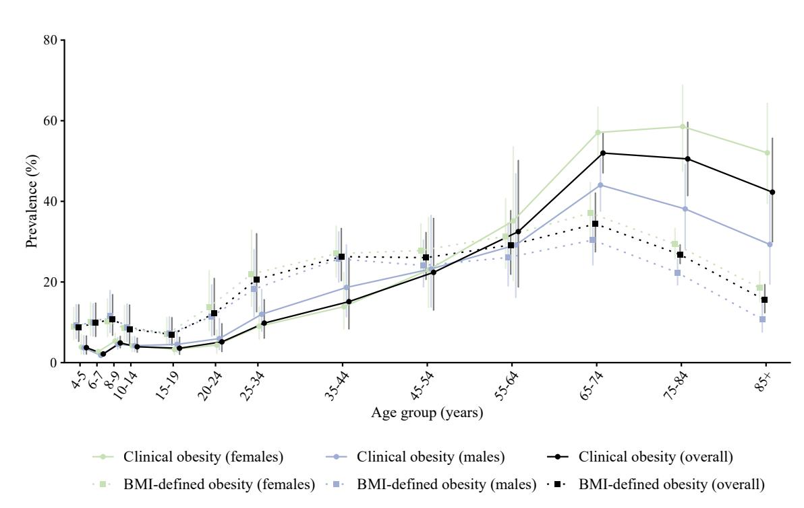
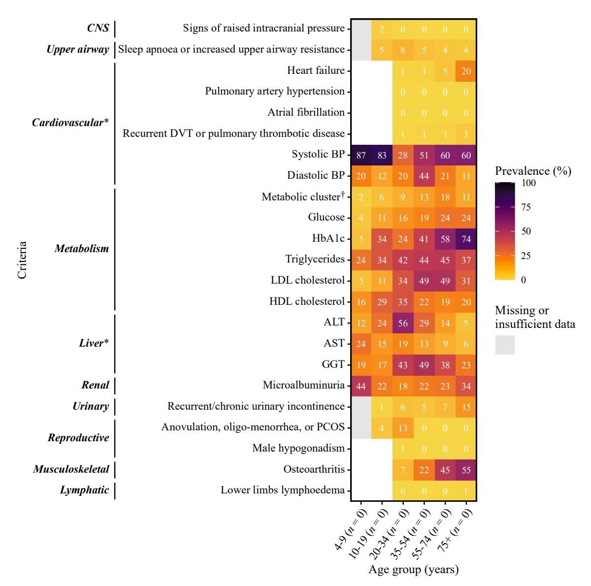
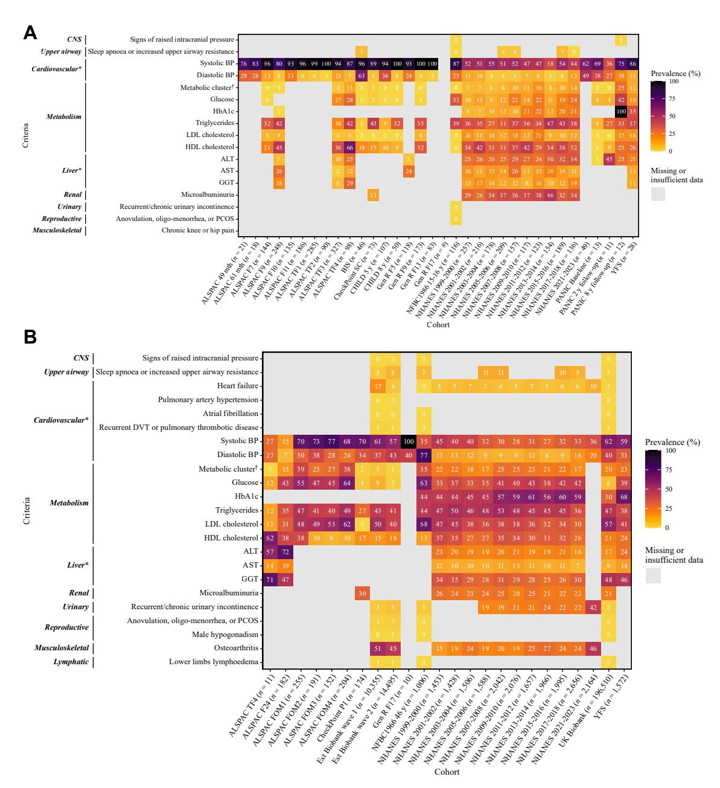
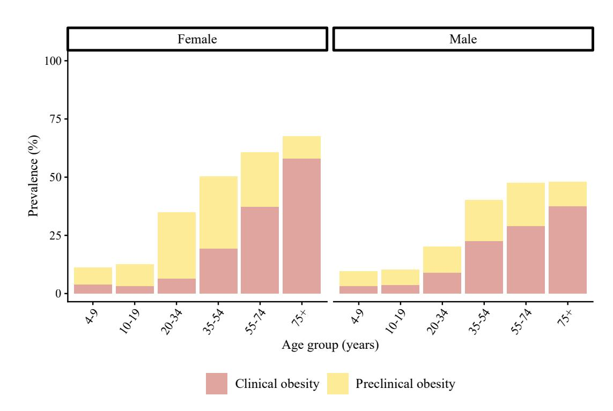
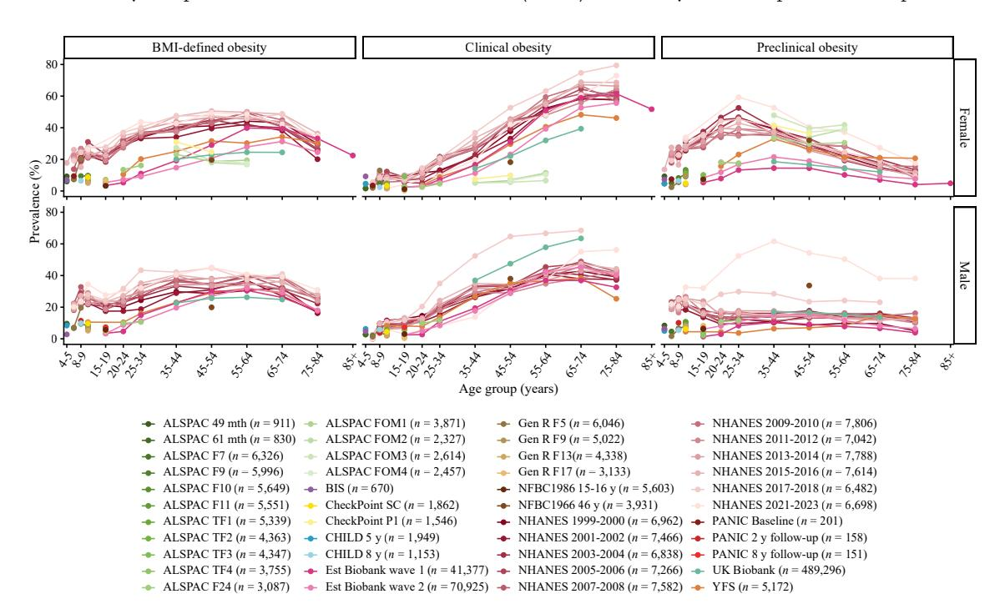
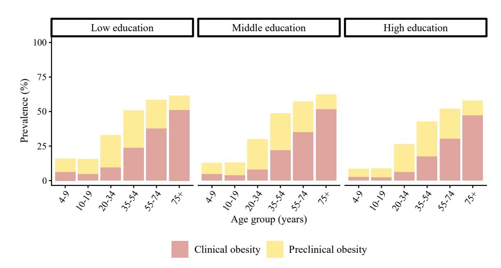
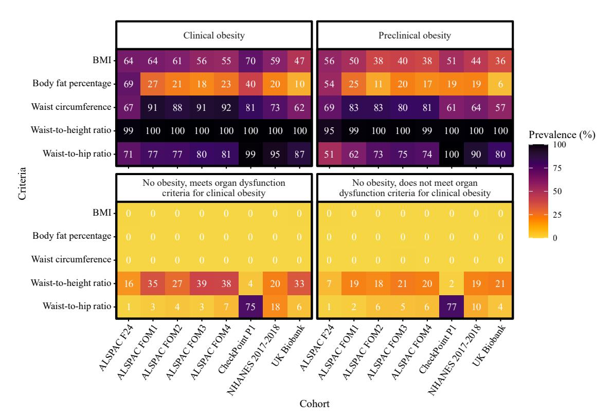
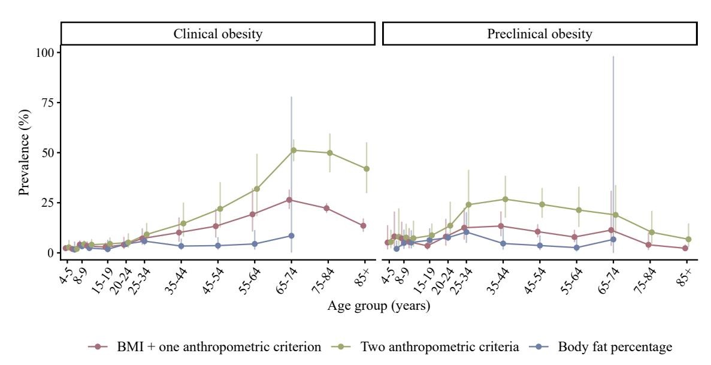

# **The Lancet commission definition of clinical obesity: a multicohort cross-sectional analysis from early childhood to older age in seven high-income countries**

*Danielle K. Longmore,a,b,c,aa,*∗ *Gabrielle PD. MacKechnie,a,aa Prue A. Huntington,a,aa Zheng Hao Chen,d Jasmin de Groot,e,f Santtu Mikkonen,g Juha Mykkänen,h,i Susanna Pätsi,j Tuuli Puusepp,k,l Krista Fischer,k,l Vincent Jaddoe,e,f Jessica A. Kerr,b,m,n Timo A. Lakka,o,p,q Terho Lehtimäki,r,s Kozeta Miliku,d,t Rozenn Nedelec,j Anne-Louise Ponsonby,u,v Sylvain Sebert,j Peter Vuillermin,w,x Melissa Wake,b,y Louise A. Baur,z,ab Toby Mansell,a,b,ab,*∗∗ *and David P. Burgner,a,b,w,ab ECOS Consortium*

a Infection Immunity and Global Health, Murdoch Children's Research Institute, Parkville, Victoria, Australia

b Department of Paediatrics, The University of Melbourne, Parkville, Victoria, Australia

c Department of Endocrinology and Diabetes, The Royal Children's Hospital, Parkville, Victoria, Australia

d Department of Nutritional Sciences, Temerty Faculty of Medicine, University of Toronto, Toronto, Ontario, M5S 1A8, Canada

e

The Generation R Study, Erasmus University Medical Center, Rotterdam, the Netherlands f Department of Pediatrics, Erasmus University Medical Center, Rotterdam, the Netherlands

g Department of Environmental and Biological Sciences, University of Eastern Finland, Kuopio Campus, Finland

h

Research Centre of Applied and Preventive Cardiovascular Medicine, University of Turku, Turku, Finland i Centre for Population Health Research, University of Turku and Turku University Hospital, Turku, Finland

Life-Course Epidemiology Team, Research Unit of Population Health, University of Oulu, Oulu, Finland

k Institute of Mathematics and Statistics, University of Tartu, Tartu, Estonia

Estonian Genome Centre, Institute of Genomics, University of Tartu, Tartu, Estonia

mCentre for Adolescent Health, Murdoch Children's Research Institute, Parkville, Victoria, Australia

n Department of Psychological Medicine, University of Otago, Christchurch, New Zealand

o Institute of Biomedicine, School of Medicine, University of Eastern Finland, Kuopio Campus, Finland

p Department of Clinical Physiology and Nuclear Medicine, Kuopio University Hospital, Kuopio, Finland

q Kuopio Research Institute of Exercise Medicine, Kuopio, Finland

r Fimlab Laboratories, Department of Clinical Chemistry, Finnish Cardiovascular Research Center – Tampere, Finland

s Faculty of Medicine and Health Technology, Tampere University, Tampere, Finland

t Department of Medicine, Faculty of Health Sciences, McMaster University, Hamilton, Ontario, Canada

u Population Allergy, Murdoch Children's Research Institute, Parkville, Victoria, Australia

v The Florey Institute for Neuroscience and Mental Health, University of Melbourne, Parkville, Victoria, Australia

wSchool of Medicine, Deakin University, Geelong, Victoria, Australia

x

Child Health Research Unit, Barwon Health, Geelong, Victoria, Australia y Population Health, Murdoch Children's Research Institute, Parkville, Victoria, Australia

z Children's Hospital Clinical School, Sydney Medical School, The University of Sydney, New South Wales, Australia

# **Summary**

**Background The** *Lancet Diabetes & Endocrinology* **Commission on Clinical Obesity established a consensus definition for clinical obesity (excess adiposity with clinical or laboratory evidence of adiposity-related sequelae). In contrast to body mass index (BMI)-based criteria, this new definition conceptualises obesity as a chronic disease to guide prevention and management. We sought to determine the age-specific cross-sectional prevalence of clinical and BMI-defined obesity from early childhood to older age.**

**Methods We analysed 11 population-derived childhood and adult cohorts in Australia, Canada, Estonia, Finland, the Netherlands, UK, and US (***n* **= 786,557) from 1996 to 2023. Cross-sectional prevalence of BMI-defined (using Centres for Disease Control and Prevention cut-points) and clinical obesity was calculated for each age group across cohorts, stratified by sex and education level.**

**Findings No cohort captured all diagnostic criteria for clinical obesity. Using available heterogeneous data spanning different epochs, the cross-sectional prevalence of clinical obesity (range 2.1–4.9%) was lower than BMI-defined** 

**eClinicalMedicine 2026;100: 104231** Published Online 6 October 2026 [https://doi.org/10.](https://doi.org/10.1016/j.eclinm.2026.104231)  [1016/j.eclinm.2026.](https://doi.org/10.1016/j.eclinm.2026.104231) [104231](https://doi.org/10.1016/j.eclinm.2026.104231)

\*Corresponding author. Inflammatory Origins Group, Murdoch Children's Research Institute, Parkville, Victoria, Australia.

\*\*Corresponding author. Inflammatory Origins Group, Murdoch Children's Research Institute, Parkville, Victoria, Australia.

*E-mail addresses:* [danielle.longmore@mcri.edu.au](mailto:danielle.longmore@mcri.edu.au) (D.K. Longmore), [toby.mansell@mcri.edu.au](mailto:toby.mansell@mcri.edu.au) (T. Mansell).

aaJoint first authors.

abJoint senior authors.

**obesity (7.0–10.8%) in childhood and adolescence, increased across adulthood, surpassed BMI-defined obesity prevalence in mid-to-late adulthood, and peaked at 65–74 years (52.0%** *vs.* **34.4% for BMI-defined obesity). Clinical obesity prevalence was higher in men compared to women in early-to-mid adulthood (e.g. 18.6%** *vs.*  **13.9%, respectively at 35–44 years), and higher in women later in adulthood (e.g. 44.1%** *vs.* **57.1%, respectively at 65–74 years). Clinical obesity was marginally less prevalent in the highest education group (range 1.3–48.2%) compared to the lowest (3.6–55.0%).**

**Interpretation We provide population-level cross-sectional prevalence data on clinical obesity, which were largely consistent across diverse high-income settings. The findings highlight challenges in operationalising the Commission's conceptual definition in epidemiological studies using large-scale, incomplete and heterogeneous real-world data. Population data capturing all diagnostic criteria of clinical obesity are essential to further improve the understanding of the prevalence and translational implications of these definitions.**

**Funding No study-specific funding to declare.**

**Copyright © 2026 The Author(s). Published by Elsevier Ltd. This is an open access article under the CC BY license (<http://creativecommons.org/licenses/by/4.0/>).**

**Keywords: Obesity; BMI; Clinical obesity; Preclinical obesity; Life course**

# **Introduction**

Obesity affects over 800 million individuals worldwide, and the prevalence is increasing.[1](#page-17-0),[2](#page-17-0) It is a multifactorial condition characterised by excess adiposity,[3](#page-17-0) arising from heritable, lifestyle and environmental factors, particularly an increasingly obesogenic environment[.4–6](#page-17-0) In high-income countries, the prevalence of obesity has more than doubled over the past four decades and now affects approximately 25–35% of adults across North America, Western Europe, and Australasia[.2,4](#page-17-0) The economic and healthcare burden is substantial; obesity-related conditions account for an estimated 2–8% of total healthcare expenditure in high-income settings, and this proportion is projected to increase.[4,6](#page-17-0) Critically, excess adiposity established in childhood and adolescence tracks strongly into adulthood, with early-onset obesity associated with a markedly greater cumulative burden of cardiometabolic disease,[7,8](#page-17-0) certain cancers,[9](#page-17-0) and premature mortality compared with obesity first arising in adulthood.[10–14](#page-17-0) Addressing obesity across the entire life course, from early childhood through to older age, is therefore essential to understanding and reducing its long-term population health impact.

Obesity has been defined by body mass index (BMI, ≥30 kg/m2 in adults, ≥95th percentile for age and sex in children)[,2](#page-17-0) a convenient population-level measure but an imperfect proxy for adiposity and individual health; BMI-defined obesity results in both over- and under-estimation of adiposity, related morbidity and future disease risks[.15](#page-17-0) Moreover, obesity has generally been considered a risk factor for adverse health outcomes, rather than a chronic disease *per se.*

The *Lancet Diabetes & Endocrinology* Commission on the *Definition and diagnostic criteria of clinical obesity*  (hereafter the Commission) recently reframed the definition of obesity to guide management and prevention, and to prioritise interventions and public health strategies. It was hoped that this reframing would overcome misconceptions contributing to size or weight-related bias and discriminatio[n16](#page-17-0) which exacerbate the adverse health effects of obesity[.17,18](#page-17-0) The Commission developed a clinically relevant and meaningful consensus definition of clinical and preclinical obesity, consistent with the emerging understanding and recognition of obesity as a chronic disease[.16](#page-17-0),[19](#page-17-0)

Clinical obesity was defined as having excess adiposity (based on either BMI and one other anthropometric measure such as waist circumference or waist-to-height ratio, two non-BMI anthropometric measures, or body fat percentage), and at least one clinical or laboratory criterion due to obesity (based on either: organ dysfunction, such as metabolic, cardiovascular, or liver dysfunction; or limitations in activities of daily living, ADL) (Figure S1). Preclinical obesity was defined as excess adiposity without evidence of adverse sequelae.

There have been no studies investigating the prevalences of clinical, preclinical, and BMI-defined obesity at various stages of the life course. Recognition of clinical and preclinical obesity from childhood and adolescence onwards is particularly important. First, the duration of exposure to excess adiposity is an independent determinant of cardiometabolic risk, with individuals who have obesity onset in childhood accumulating greater lifetime exposure with disproportionately higher risks of metabolic disease, cardiovascular disease (CVD), certain cancers, and kidney disease.[10–14](#page-17-0) Second, childhood and adolescence represent critical windows for primordial and primary prevention, during which interventions to reduce adiposity or prevent its sequelae may have the greatest long-term benefit.

Third, it remains unknown whether the Commission's criteria identifies a clinically different population of children and adolescents compared with conventional BMI-based definitions. Establishing the prevalence of clinical and preclinical obesity across the paediatric age range is therefore an essential step in evaluating the utility and implications of the Commission's framework for younger populations.

Estimating the prevalence of clinical obesity across the life course requires data spanning early childhood to older adulthood. No single cohort captured all variables across this age range. By integrating data from multiple cohorts across seven high-income countries, we were able to generate life course prevalence estimates that were not possible from any single study, while also assessing the consistency of findings across

### **Research in context**

### **Evidence before this study**

In 2025, *The Lancet Diabetes & Endocrinology* Commission on the *Definition and diagnostic criteria of clinical obesity*  (hereafter the Commission) established new diagnostic criteria for clinical obesity (excess adiposity with evidence of organ dysfunction) and preclinical obesity (excess adiposity without organ dysfunction), warranting investigation into their prevalence across different populations. We completed a literature search in PubMed, Ovid MEDLINE, and Google Scholar, using the search terms ("prevalence" OR "proportion") AND "clinical obesity", with publication date limited to between January 14, 2025—when the *Definition and diagnostic criteria of clinical obesity* paper was published—and February 23, 2026, with no restrictions on language, preprints, or publication type. Additionally, we searched for all articles that have cited the *Definition and diagnostic criteria of clinical obesity* paper by conducting a forward citation search in PubMed on February 23, 2026. We identified 22 studies that examined the prevalence of clinical obesity, including 21 published papers and one preprint. Almost all studies compared the prevalence of clinical and/or preclinical obesity with the prevalence of obesity defined by body mass index (BMI), predominantly in adult populations. To our knowledge, no studies have estimated the prevalence of clinical and preclinical obesity across the life course. Most of the identified studies analysed data from a single country (ten from US, three from UK, two from Republic of Korea, one from UAE, one from Peru, one from Mexico, and two from China). The only study of a paediatric population analysed data from 5 to 11-year-old children in Mexico in whom the prevalence of clinical obesity (3.60%) was lower than that of BMI-defined obesity (20.7%, defined as a BMI ≥95th percentile on the World Health Organisation growth charts). An adult cohort study in the US identified clinical obesity in 39.1% of all participants, which increased with age, and preclinical obesity in 28.9% of participants. The prevalence of clinical obesity varies with interpretation of the diagnostic criteria. Another study in the same US cohort reported that 68.6% of participants had clinical obesity, compared to 42.9% with BMI-defined obesity. A study of health surveys in Peru found the overall prevalence of ageadjusted clinical obesity ranged between 15.7% and 22.1% depending on criteria cut-offs. A study of 440,000 adults in Dubai, UAE found that a third of participants with excess

adiposity (based on BMI ≥40 kg/m2 ) also met organ dysfunction criteria for clinical obesity. A study of Chinese community-based adult cohorts reported that 33.8% of men and 24.1% of women had clinical obesity, lower than the prevalence of BMI-defined obesity in these populations (44.5% and 26.7% respectively) with a lower BMI cut off for obesity of ≥25 kg/m2 used as recommended for Asian populations. Another study analysed survey data from 56 countries and found substantial differences in the prevalence of clinical obesity between countries, with estimates ranging from 0% to 29%. While a range of adiposity and organ dysfunction measures were used to classify clinical obesity across the identified studies, only two studies had available data on all adiposity measures relevant to the Commission's clinical obesity definition (BMI, waist circumference, waistto-height ratio, waist-to-hip ratio, and body fat percentage).

### **Added value of this study**

We describe the cross-sectional prevalence of clinical and preclinical obesity across the life course using the new Commission clinical obesity definition. In this analysis, we integrated available cross-sectional data from 11 cohorts from different epochs across seven countries from early childhood to older age, making this study the largest clinical obesity prevalence study (*n* = 786,557) to date. We investigated variations in clinical obesity prevalence by sex and education level, and whether prevalence varied with specific excess adiposity criteria.

#### **Implications of all the available evidence**

Compared to BMI-defined obesity, the prevalence of clinical obesity is lower in childhood and markedly higher from midto-late adulthood onwards. There are no cohorts that have collected complete data on all diagnostic criteria for clinical obesity. Despite the variation in available data, recruitment epoch, geographic context, and measurement heterogeneity, the general pattern of clinical obesity prevalence across the life course was similar across the cohorts. There were marked differences in the prevalence of clinical obesity and preclinical obesity by sex, but less so by education level. Longitudinal data on all diagnostic criteria for clinical obesity are essential to understand the public health and translational implications.

diverse populations, settings, and data collection epochs. Although this approach introduces unavoidable heterogeneity, it reflects the real-world complexity of applying a novel clinical framework to existing population data, and the variation observed across cohorts is itself informative about the robustness and generalisability of the Commission's definition. We aimed to address key knowledge and translational gaps by investigating cross-sectional data from 786,557 children and adults across 44 cross-sectional waves of 11 cohorts from seven countries in the Evaluation of Clinical Obesity Across the Life Course (ECOS) study. The primary objective of ECOS was to estimate the crosssectional prevalence of clinical obesity, as defined by the Commission's criteria, across the full life course, from early childhood to older adulthood, and to compare this with the prevalence of BMI-defined obesity across the same age range. ECOS is not a study of healthcare burden or health outcomes. The secondary objective was to examine how clinical obesity prevalence varies by sex and education, and to evaluate how prevalence estimates differ depending on adiposity criteria.

# **Methods**

# **Overview**

We estimated the cross-sectional prevalence of clinical and preclinical obesity, using the Commission's criteria,[19](#page-17-0) and BMI-defined obesity (using Centres for Disease Control [CDC] cut-offs) in 11 populationderived cohorts with participants from early childhood to older age.

### **Data sources**

We included cross-sectional data collected from 44 assessments/waves in 11 cohorts between 1996 and 2023. While obesity rates have continued to increase subsequently, data collection epochs postdate the onset of the global obesity epidemic[.4](#page-17-0) Participants were ≥4 years, to exclude the dynamic changes in growth and adiposity in early childhood. Cohorts included children (4–17 years), and adults (≥18 years) from Australia, Canada, Estonia, Finland, the Netherlands, UK, and US. No populationderived cohort has previously collected complete data on all diagnostic criteria in the Commission's definitions, but all cohorts included sufficient data to diagnose clinical obesity (anthropometric measures and/ or body fat percentage to classify excess adiposity, and at least one clinical and/or laboratory criterion, see Table S1). There was heterogeneity in the availability of organ dysfunction criteria available across the cohorts.

Further detail on these cohorts is shown in Supplementary Methods and Table S2. The cohorts included were: the Avon Longitudinal Study of Parents and Children (ALSPAC)[20–22](#page-17-0); the Barwon Infant Study (BIS)[23;](#page-17-0) Child Health CheckPoint (CheckPoint)[24;](#page-17-0) the Canadian Healthy Infant Longitudinal Development (CHILD[\)25](#page-17-0),[26;](#page-17-0) the Estonian Biobank (Est Biobank[\)27](#page-17-0); Generation R (Gen R)[28;](#page-17-0) and the Northern Finland Birth Cohorts, including the NFBC1966 46-year follow-up (NFBC1966 46 y),[29,30](#page-17-0) the NFBC1986 15–16 -year follow-up (NFBC1986 15–16 y)[31–33](#page-17-0); the National Health and Nutrition Examination Survey (NHANES[\)34](#page-17-0); the Physical Activity and Nutrition in Children (PANIC) stud[y35,36](#page-17-0); UK Biobank[37;](#page-17-0) and the Cardiovascular Risk in Young Finns Study (YFS)[.38–40](#page-18-0)

# **Ethics**

This project was approved by the RCH Research Ethics and Governance committee (MCC DERP reference # 4191). All cohorts had relevant ethics approval and written consent from participants or their parents.

#### **Definitions of BMI-based obesity, clinical obesity, and preclinical obesity**

BMI-based obesity was defined as a BMI ≥30 kg/m2 for adults or ≥95th percentile for children, based on the U.S. CDC BMI-for-age growth charts.[41](#page-18-0) CDC BMI-forage growth charts were selected as they are applicable across the full paediatric age range, and are widely used in international epidemiological studies. Clinical obesity was defined by the Commission as excess adiposity with at least one sign/symptom of organ dysfunction or limitation in ADL. We defined excess adiposity using any of: BMI and one other anthropometric criterion, any two anthropometric criterion or body fat percentage, consitent with the Commission's definition ([Table 1](#page-4-0)). Preclinical obesity was defined as excess adiposity without organ dysfunction or limitations in ADL. Although the Commission recommended that 'excess adiposity['19](#page-17-0) can be pragmatically assumed for BMI >40 kg/m2 , we categorised participants based on the adiposity criteria with no BMI-based assumptions to minimise misclassification and as sufficient anthropometric data were available in all participants [\(Table 2,](#page-4-0) Figure S1). Excluding this assumption of excess adiposity constitutes a modification of the Commission's criteria. However, we performed a sensitivity analysis in multiple waves of NHANES, to evaluate if there was any change in prevalence of clinical obesity if excess adiposity was assumed with a BMI >40 kg/m2 .

As the guidelines do not provide specific thresholds for laboratory criteria for classifying clinical obesity, we used age- and sex-specific thresholds from clinical guidelines and previous literature. This represents a pragmatic operationalisation rather than a direct application of specified values. The Commission's definition does not address how to classify individuals with excess adiposity who have organ dysfunction that has been controlled by medication (e.g. antihypertensives, lipid-lowering medication, or hypoglycaemic agents). These participants were classified as having

| Diagnostic domain                                     | Diagnostic parameters                                                                                                                                | Criteria a                                                      |
|-------------------------------------------------------|------------------------------------------------------------------------------------------------------------------------------------------------------|-----------------------------------------------------------------|
| Excess adiposity                                      | Increased body mass index                                                                                                                            | Adults c                                                        |
|                                                       |                                                                                                                                                      | : ≥ 30 kg/m2                                                    |
|                                                       |                                                                                                                                                      | Children d                                                      |
|                                                       |                                                                                                                                                      | : ≥ 95th centile                                                |
| Anthropometric measures                               | Increased waist circumference                                                                                                                        | Women c                                                         |
|                                                       |                                                                                                                                                      | : ≥ 88 cm                                                       |
|                                                       |                                                                                                                                                      | Men c                                                           |
|                                                       |                                                                                                                                                      | : ≥ 102 cm                                                      |
|                                                       |                                                                                                                                                      | Children d                                                      |
|                                                       |                                                                                                                                                      | : ≥ 90th centile                                                |
|                                                       | Increased waist-to-height ratio                                                                                                                      | ≥ 0.5                                                           |
|                                                       | Increased waist-to-hip ratio                                                                                                                         | Women c                                                         |
|                                                       |                                                                                                                                                      | : ≥ 0.85                                                        |
|                                                       |                                                                                                                                                      | Men c                                                           |
|                                                       |                                                                                                                                                      | : ≥ 0.9                                                         |
|                                                       | Increased body fat percentage                                                                                                                        | ≥ 85th centile b                                                |
| Activities of Daily Living (ADL)                      | Limitations in bathing, dressing, toileting, continence, and/or                                                                                      |                                                                 |
| Central nervous system                                | Signs of raised intracranial pressure such as vision loss and/or                                                                                     |                                                                 |
| Upper airway                                          | Sleep apnoea or increased upper airway resistance                                                                                                    | Diagnosis (ICD-10 code survey) or evidence of sleep apnoea      |
| Respiratory                                           | Hypoventilations and/or breathlessness and/or wheezing due to                                                                                        |                                                                 |
| Cardiovascular                                        | Heart failure (adults only)                                                                                                                          | Diagnosis (ICD-10 code or survey)                               |
|                                                       | Elevated blood pressure                                                                                                                              | Elevated systolic and diastolic blood pressuree or hypertension |
|                                                       | Hyperglycaemia                                                                                                                                       | Elevated fasting or non-fasting blood glucosef level or blood   |
|                                                       | Increased triglycerides                                                                                                                              | Raised fasting or non-fasting blood triglycerides level         |
|                                                       | Decreased HDL cholesterol or increased LDL cholesterol                                                                                               | Low fasting or non-fasting blood HDL cholesterol level or high  |
| Liver                                                 | Abnormal liver enzymes (alanine aminotransferase, gamma                                                                                             |                                                                 |
|                                                       |                                                                                                                                                      | At least one liver enzyme elevated above normal g range         |
| Renal                                                 | Microalbuminuria                                                                                                                                     | Raised albumin-creatinine ratio                                 |
| Urinary                                               | Recurrent/chronic urinary incontinence                                                                                                               | Diagnosis (ICD-10 code) or evidence by survey                   |
| Reproductive                                          | Male hypogonadism (adults), or anovulation, oligo-menorrhea, or                                                                                      |                                                                 |
| Musculoskeletal                                       | Osteoarthritis (adults) or chronic, severe knee or hip pain with                                                                                     |                                                                 |
| Lymphatic                                             | Lower limbs lymphoedema causing chronic pain and/or reduced                                                                                          |                                                                 |
|                                                       | HbA1c: haemoglobin A1c, HDL: high-density lipoprotein, LDL: low-density lipoprotein, ICD-10: International Classification of Diseases 10th revision. | a                                                               |
| available in Table S3. b                              |                                                                                                                                                      |                                                                 |
|                                                       | Corresponds to CDC Body Composition age- and sex-matched data for non-Hispanic Whites .42 c                                                          |                                                                 |
|                                                       | Age ≥                                                                                                                                                | 18. d                                                           |
|                                                       |                                                                                                                                                      | Age 4–17. e                                                     |
| measure. f                                            |                                                                                                                                                      |                                                                 |
| Fasting used preferentially when both were available. | g                                                                                                                                                    |                                                                 |
| Table 1: Clinical diagnostic criteria used in ECOS.   |                                                                                                                                                      |                                                                 |

| Clinical obesity             | As defined by the Lancet Diabetes & Endocrinology Commission based on excess adiposity with at least        |                            |
|------------------------------|-------------------------------------------------------------------------------------------------------------|----------------------------|
| Preclinical obesity          | As defined by the Lancet Diabetes & Endocrinology Commission based on excess adiposity with no clinical     |                            |
| BMI-defined obesity          | Defined by BMI                                                                                              | Binary (present or absent) |
|                              | Does not have excess adiposity but has at least one clinical and/or laboratory criteria (not including ADL) | Binary (present or absent) |
|                              | As defined by the Lancet Diabetes & Endocrinology Commission, does not have excess adiposity and does       |                            |
| Table 2: Exposure variables. |                                                                                                             |                            |

preclinical obesity; i.e. the same category as participants with excess adiposity but with no underlying organ dysfunction. We assumed that laboratory criteria, if met, were due to adiposity. Where possible, we determined whether clinical criteria would be most likely due to adiposity. Data (questionnaire, code, or measure) were excluded if they were considered non-specific and could not be reasonably attributed to increased adiposity. A summary of the criteria used in ECOS is provided in [Table 1,](#page-4-0) with additional detail, including cut-off values, references and ICD-10 codes, in Table S3A.

#### **Definition of education as a proxy for socioeconomic position**

We used the highest level of education completed for participants aged ≥25 years, and highest level of maternal education completed for participants aged 4–24 years (except in Estonian Biobank, the participant's own education was used for ≥18 years, and in NHANES, household reference person's education was used for participants 4–24 years as maternal education data were not available). Education was classified as low, middle, and high using cohort-specific cut-offs (Table S3B). In contrast to other measures of socioeconomic position, education was collected across all cohorts and harmonisation was possible.

## **Preparation of data**

Cohorts used all available data relevant to the Commission criteria for clinical obesity[.19](#page-17-0) Where data did not directly correspond to these criteria, content expertise was used to assess the validity of using the cohort measure as a proxy. All analysts used the same analytical code.

Race and ethnicity were not harmonised or reported across cohorts, as classification systems used differed substantially across countries and individual cohorts, reflecting national census frameworks and cohortspecific recruitment contexts. Conflating these distinct classification systems would risk misrepresenting the demographic composition of individual cohorts and introducing erroneous comparisons. Cohort-specific demographic information, including race and ethnicity where collected, is available in the respective cohort profile publications (Supplementary Methods).

# **Statistical analysis**

Individual cohort analyses were performed in R (version differed by cohort, see Supplementary Methods) and combined in R version 4.4.1 using the *metafor* package for meta-analyses and the *ggplot2*  package for visualisation. For all analyses, participants were stratified into age groups (in years): 4–5, 6–7, 8–9, 10–14, 15–19, 20–24, 25–34, 35–44, 45–54, 55–64, 65–74, 75–84, and 85+ years. Narrower age groups were used in early life to account for rapid changes in growth over this period. To consider differences by sex and by socioeconomic position, participants were also stratified by sex and education level. Participants were excluded if they did not have age, sex, or education data available. Missing data were not imputed, given the heterogeneity of epoch, population, setting, and cohort-specific data availability. Missingness of adiposity data is presented in Table S4.

The majority of participants contributed crosssectional data at a single time point. In a minority of longitudinal cohorts (CHILD, ALSPAC, PANIC, and GenR), some participants will have contributed data from more than one time point. Accordingly, each cohort wave was treated as a separate cross-sectional sample in within-cohort analyses, and clustering between cohort waves in meta-analyses was accounted for through random intercepts by cohort. Prevalences with a denominator less than 100 were excluded from all figures of individual cohort results, except for figures showing the prevalence of adiposity or organ dysfunction criteria. To mitigate the risk of participant identification, we masked obesity category results in subgroups where reported frequency of any obesity category was <5 and only included these frequencies in overall results.

In each cohort, we calculated the prevalence and corresponding 95% confidence interval (CI, based on the normal approximation) for each of the four categories (clinical obesity; preclinical obesity; no obesity, meets organ dysfunction criteria for clinical obesity; and no obesity, does not meets organ dysfunction criteria for clinical obesity), and for BMI-defined obesity. Combined prevalence estimates within each age group were synthesised using a three-level metaanalysis, with models including random intercepts at the wave and cohort level to account for hierarchical clustering. The meta-analysis was fitted using the restricted maximum likelihood method with confidence intervals based on the t-distribution to approximate the Knapp-Hartung adjustment. Subgroup difference tests were performed to estimate the differences between sex and education level groups within the meta-analysis models, with an additional random intercept included at the estimate level. We conducted sensitivity analyses for prevalences excluding data from cohorts with substantial sex imbalance (ALSPAC FOM 1–4, CheckPoint parents, Estonian Biobank). These cohort waves were retained in the main analyses as they represent best available population-derived data for respective age ranges and exclusion would considerably reduce the data available for the mid-adulthood age range. In sensitivity analyses, we considered the prevalence of clinical obesity using different thresholds for liver function measures (alanine aminotransferase [ALT], aspartate aminotransferase [AST], or gamma-glutamyl transferase [GGT] ≥50 U/L and ≥60 U/L) as the upper limit of normal differs by jurisdiction, with no universally accepted normal range. In further sensitivity analyses, we also considered abnormal results for any component of the metabolic cluster (glucose, haemoglobin A1c, triglycerides, high-density lipoprotein cholesterol, and low-density lipoprotein cholesterol) as sufficient to meet this criterion.

In adults and children with clinical obesity, we determined the proportion who met each organ dysfunction criterion, to investigate the relative contribution of each to the classification. The denominator for each criterion was restricted to participants with available data for that criterion. To summarise across the cohorts with data from the same age group, we synthesised cohort-level estimates in a three-level metaanalysis with hierachical clustering by cohort. To investigate multi-morbidity of organ dysfunction measures in clinical obesity, we quantified the number of different organ dysfunction criteria met for each participant with clinical obesity. In a subset of cohorts that had all relevant adiposity measures, we investigated the proportion of participants who met each adiposity criterion, both overall and by sex. We conducted sensitivity analyses for the definition of excess adiposity, considering estimates that would arise overall and by sex if the definition was restricted to just one of the following criteria: (a) BMI and one anthropometric criterion, (b) any two anthropometric criteria, and (c) body fat percentage.

# **Role of funding source**

There was no specific study funding for this project.

# **Results**

A summary of each assessment/wave included in ECOS is shown in [Table 3](#page-8-0). Across all cohorts, minimum data for assessment of clinical obesity status, age, sex, and education was available for 786,557 participants, but no participants had data on all diagnostic criteria for clinical obesity.

#### **Prevalence of BMI-defined, clinical, and preclinical obesity**

The cross-sectional prevalence of clinical obesity in overall meta-analyses was 3.7% in early childhood (4–5 years), and 52.0% in older adulthood (65–74 years) [\(Fig. 1](#page-8-0), Table S5). The prevalence of BMI-defined obesity was higher than clinical obesity across childhood (e.g. 8.8% in early childhood), and early and mid adulthood (e.g. 26.3% at 35–44 years, *vs.* 15.1% for clinical obesity), with prevalence of clinical obesity higher than BMI-defined obesity from age 55–64 years onwards. There was pattern of higher prevalence of clinical obesity in males compared to females from age 15–19 to age 35–44 (e.g. men 18.6% *vs.* women 13.9% at 35–44 years, 95% confidence interval for difference 1.4–8.1%, p < 0.001), and higher in women from age 55–64 onwards (e.g. men 44.1% *vs.* women 57.1% at 65–74 years, 95% CI for difference −19.6 to −6.4%, p < 0.001) (Table S6). Clinical obesity prevalence peaked for males at 65–74 years (44.1%, 95% CI 37.5–50.8%) and females at 75–84 years (58.5%, 95% CI 47.3– 68.9%). Between early adulthood and mid-late adulthood, the clinical obesity prevalence overall for sex tracked more closely to female clinical obesity prevalence than the male prevalence, likely reflecting the sex balance in the included cohorts. However, the observed trends in clinical obesity and BMI-defined obesity prevalence remained when cohorts with a large proportion of female participants were excluded (Figure S2). In sensitivity analyses, with varying liver function thresholds, there were minimal changes in clinical obesity prevalence (Figures S3–S6). When we considered any abnormal result in the metabolic cluster as sufficient to meet this diagnostic criterion, the prevalence of clinical obesity was substantially higher from early adulthood onwards, peaking at 62.7% (at 65–74 years) (Figure S7). Males and females had a similar age-dependent pattern of BMI-defined obesity, with prevalence consistently higher in females from age 45–54 years onwards, and prevalence peaking at 65–74 years for both men and women (men 30.4% *vs.* women 37.1%, 95% CI for difference −9.4 to −3.9%, p < 0.001). Preclinical obesity prevalence was highest in midadulthood (27.5% at 35–44 years; Figure S8). The prevalence of organ dysfunction criteria within participants without obesity increased throughout adulthood, peaking at 77.2% of all participants with no obesity by 75+ years (Figure S9).

In most cohorts, cross-sectional clinical obesity prevalence increased with age and peaked in late adulthood. For example, in NHANES 2005–2006, the prevalence peaked at at 55.5% at 65–74 years (Figures S10–S13). In most cohorts, cross-sectional preclinical obesity prevalence increased during childhood, peaked in early-to-mid adulthood (25–34 or 35–44 years), and then reduced. In CheckPoint P1 (age range 28–71 years) and ALSPAC FOM2–4 (age range 36–67 years), clinical obesity prevalence was low relative to other cohorts (5.1%–11.1%), but the prevalence of preclinical obesity was high (34.0%–47.9%). In paediatric cohorts, clinical obesity prevalence was generally lower than BMI-defined obesity; for example, in 8–9-year-olds in Gen R F5, clinical obesity prevalence was 9.1% compared to 19.9% for BMI-defined obesity (Figures S14–S16).

### **Prevalence of organ dysfunction criteria among participants with clinical obesity**

Among participants with clinical obesity, raised systolic blood pressure—the most frequently collected clinical measure—was prevalent in all age groups, particularly at age 4–9 years (87.3%, [Fig. 2](#page-9-0)). Liver dysfunction was prevalent in early-to-mid-adulthood, particularly

| Cohort name and wave a ALSPAC (GBR) | Age (range)                               | Number of participants | Year(s) of b assessment | Sex (% female) | Education (own/maternal, low, %) | BMI adult (median, IQR) c | BMI Z-score children (mean) c | Adiposity measures available (BMI +) | Diagnostic domains— clinical     | Diagnostic domains— laboratory |
|-------------------------------------|-------------------------------------------|------------------------|-------------------------|----------------|----------------------------------|---------------------------|-------------------------------|--------------------------------------|----------------------------------|--------------------------------|
| 49 mth                              | 4                                         | 911                    | 1996                    | 45.1           | 20.2                             | NA                        | 0.627                         | wc, wth                              | CVD                              |                                |
| 61 mth                              | 4–5                                       | 830                    | 1997                    | 46.3           | 21.6                             | NA                        | 0.456                         | wc, wth                              | CVD                              |                                |
| F7                                  | 6–9                                       | 6462                   | 1998–2000               | 49.1           | 21.6                             | NA                        | 0.248                         | wc, wth                              | CVD                              | MET                            |
| F9                                  | 8–11                                      | 5996                   | 2001–2002               | 50.8           | 19.1                             | NA                        | 0.366                         | wc, wth, %a                          | CVD                              | MET, LIV                       |
| F10                                 | 9–12                                      | 5652                   | 2002–2003               | 51.2           | 19.1                             | NA                        | 0.365                         | wc, wth                              | CVD                              |                                |
| F11                                 | 10–13                                     | 5551                   | 2003–2004               | 51.3           | 18.7                             | NA                        | 0.373                         | wc, wth, %a                          | CVD                              |                                |
| TF1                                 | 11–14                                     | 5339                   | 2004–2005               | 51.3           | 18.0                             | NA                        | 0.317                         | wc, wth, %a                          | CVD                              |                                |
| TF2                                 | 12–15                                     | 4367                   | 2005–2006               | 51.0           | 17.7                             | NA                        | 0.223                         | wc, wth, %a                          | CVD                              |                                |
| TF3                                 | 14–17                                     | 4360                   | 2006–2008               | 52.4           | 17.2                             | NA                        | 0.217                         | wc, wth, %a                          | CVD                              | MET, LIV                       |
| TF4                                 | 16–19                                     | 3755                   | 2009–2011               | 55.2           | 16.2                             | NA                        | 0.265                         | %a                                   | CVD                              | MET, LIV                       |
| F24                                 | 22–26                                     | 3087                   | 2015–2017               | 61.4           | 16.0                             | 23.8 (5.5)                | NA                            | wc, wth, whr,                        |                                  |                                |
|                                     |                                           |                        |                         |                |                                  |                           |                               |                                      | CVD                              | MET, LIV                       |
| FOM1                                | 33–62                                     | 3875                   | 2009–2011               | 100.0          | 15.8                             | 25.5 (6.3)                | NA                            | wc, wth, whr,                        |                                  |                                |
|                                     |                                           |                        |                         |                |                                  |                           |                               |                                      | CVD                              | MET                            |
| FOM2                                | 36–65                                     | 2519                   | 2011–2013               | 100.0          | 12.4                             | 25.3 (6.1)                | NA                            | wc, wth, whr,                        |                                  |                                |
|                                     |                                           |                        |                         |                |                                  |                           |                               |                                      | CVD                              | MET                            |
| FOM3                                | 38–66                                     | 2618                   | 2013–2014               | 100.0          | 12.4                             | 25.3 (6.2)                | NA                            | wc, wth, whr,                        |                                  |                                |
|                                     |                                           |                        |                         |                |                                  |                           |                               |                                      | CVD                              | MET                            |
| FOM4                                | 39–67                                     | 2534                   | 2014–2015               | 100.0          | 12.6                             | 25.4 (6.3)                | NA                            | wc, wth, whr,                        |                                  |                                |
|                                     |                                           |                        |                         |                |                                  |                           |                               |                                      | CVD                              | MET                            |
| BIS (AUS) CheckPoint (AUS)          | 4–5                                       | 670                    | 2014–2016               | 46.9           | 4.8                              | NA                        | 0.075                         | wc, wth, %a                          | UA, CVD                          | MET                            |
| SC                                  | 11–12                                     | 1862                   | 2015–2016               | 49.0           | 5.3                              | NA                        | 0.369                         | wc, wth, %a                          | CVD, ADL                         | MET, REN                       |
| P1                                  | 28–71                                     | 1851                   | 2015–2016               | 87.7           | 5.1                              | 26.5 (7.5)                | NA                            | wc, wth, whr,                        |                                  |                                |
| CHILD (CAN)                         |                                           |                        |                         |                |                                  |                           |                               |                                      | CVD                              | MET, REN                       |
| 5 y                                 | 4–6                                       | 1954                   | 2013–2017               | 46.1           | 0.4                              | NA                        | 0.338                         | wc, wth                              | CVD                              | MET                            |
| 8 y Estonian Biobank (EST)          | 6–11                                      | 1248                   | 2018–2021               | 47.0           | 0.2                              | NA                        | 0.233                         | wc, wth, %a                          | CVD                              | MET                            |
| Wave 1                              | 18–100                                    | 41,450                 | 2002–2017               | 65.7           | 16.2                             | 25.4 (6.9)                | NA                            | wc, wth                              | CNS, UA, CVD, URI, REP, MSK, LYM | MET                            |
| Wave 2 Generation R (NLD)           | 18–94                                     | 70,986                 | 2018–2022               | 67.3           | 4.1                              | 25.0 (6.4)                | NA                            | wc, wth                              | CNS, UA, CVD, URI, REP, MSK, LYM | MET                            |
| F5                                  | 5–9                                       | 6088                   | 2008–2012               | 49.8           | 6.5                              | NA                        | 0.449                         | %a                                   | CVD                              | LIV                            |
| F9                                  | 9–12                                      | 5383                   | 2012–2016               | 50.5           | 5.2                              | NA                        | 0.354                         | %a                                   | CVD                              | MET                            |
| F13                                 | 13–17                                     | 4480                   | 2015–2019               | 50.7           | 5.0                              | NA                        | 0.115                         | %a                                   | CVD                              |                                |
| F17                                 | 16–22 Northern Finland Birth Cohort (FIN) | 3263                   | 2018–2022               | 53.0           | 3.9                              | 22.0 (4.4)                | 0.031                         | %a                                   | CVD                              |                                |
| NFBC1986 15–16 y                    | 15–17                                     | 5603                   | 2001–2002               | 50.9           | 10.1                             | NA                        | 0.025                         | wc, wth                              | CNS, UA, CVD, URI, REP           | MET                            |
| NFBC1966 46 y                       | 45–48                                     | 3931                   | 2012                    | 62.8           | 9.6                              | 26.1 (5.8)                | NA                            | wc, wth, whr                         | CNS, UA, CVD, URI, REP, LYM      | MET                            |
| NHANES (US)                         | 6–85                                      | 7371                   | 1999–2000               | 51.4           | 41.0                             | 27.0 (7.6)                | 0.834                         | wc, wth, %a                          | CVD, MSK, ADL                    | MET, LIV, REN                  |
|                                     | 5–85                                      | 7923                   | 2001–2002               | 51.6           | 32.6                             | 26.9 (7.3)                | 0.750                         | wc, wth, %a                          | CVD, MSK, ADL                    | MET, LIV, REN                  |
|                                     | 6–85                                      | 7431                   | 2003–2004               | 51.1           | 30.9                             | 27.1 (7.7)                | 0.838                         | wc, wth, %a                          | CVD, MSK, ADL                    | MET, LIV, REN                  |
|                                     | 6–85                                      | 7537                   | 2005–2006               | 51.5           | 29.0                             | 27.4 (7.9)                | 0.825                         | wc, wth                              | UA, CVD, URI, MSK, ADL           | MET, LIV, REN                  |
|                                     | 6–80                                      | 7582                   | 2007–2008               | 50.1           | 30.9                             | 27.8 (7.9)                | 0.842                         | wc, wth                              | UA, CVD, URI, MSK, ADL           | MET, LIV, REN                  |
|                                     | 6–80                                      | 7992                   | 2009–2010               | 50.5           | 29.4                             | 27.9 (8.1)                | 0.856                         | wc, wth                              | CVD, URI, MSK, ADL               | MET, LIV, REN                  |
|                                     | 6–80                                      | 7261                   | 2011–2012               | 49.7           | 24.9                             | 27.4 (8.2)                | 0.850                         | wc, wth, %a                          | CVD, URI, MSK, ADL               | MET, LIV, REN                  |
|                                     | 5–80                                      | 7968                   | 2013–2014               | 51.1           | 22.1                             | 27.6 (8.4)                | 0.826                         | wc, wth, %a                          | CVD, URI, MSK, ADL               | MET, LIV, REN                  |
|                                     | 4–80                                      | 7780                   | 2015–2016               | 51.0           | 24.4                             | 28.3 (8.7)                | 0.878                         | wc, wth, %a                          | UA, CVD, URI, MSK, ADL           | MET, LIV, REN                  |

(Table 3 continues on next page)

# **Articles**

elevated ALT (56.3% at 20–34 years) and GGT (48.8% at 35–54 years). Renal dysfunction was most prevalent in childhood (44.2% at 4–9 years) and late adulthood (33.9% at 75+ years), while the prevalence of musculoskeletal dysfunction was highest at older ages (55.1% at 75+ years). Similar trends were observed for both females and males (Figure S17).

In most individual cohorts, raised systolic blood pressure was common in children and adults with clinical obesity; e.g. in YFS 85.7% of children and 59.1% of adults met this criterion [\(Fig. 3](#page-10-0)). Trends were consistent across females and males for both adults and children (Figure S18). However, it was relatively less common in the NHANES continuous waves, ranging from 26.9%

| Cohort name Age Number of Year(s) of Sex                                | Education | BMI adult                                              | BMI      | Adiposity     | Diagnostic                  | Diagnostic    |
|-------------------------------------------------------------------------|-----------|--------------------------------------------------------|----------|---------------|-----------------------------|---------------|
| and wave a                                                              |           |                                                        |          |               |                             |               |
| participants b (range) assessment                                       |           | (median,                                               |          | measures      | domains—                    | domains—      |
|                                                                         |           | IQR) c                                                 |          | available     | clinical                    | laboratory    |
| (Continued from previous page)                                          |           |                                                        | (mean) c | (BMI +)       |                             |               |
| 4–80 7150 2017–2018 51.1                                                | 19.5      | 28.4 (8.8)                                             | 0.878    | wc, wth, whr, | UA, CVD, URI, MSK, ADL      | MET, LIV, REN |
| 5–80 7716 2021–2023 53.6 PANIC (FIN)                                    | 12.9      | 28.3 (8.8)                                             | 0.909    | wc, wth, whr  | CVD, URI, MSK, ADL          |               |
| Baseline 6–9 504 2007–2009 48.2                                         | 21.4      | NA                                                     | 0.150    | wc, wth, %a   | CVD, ADL                    | MET, LIV      |
| 2 y follow-up 8–11 437 2009–2011 49.0                                   | 16.5      | NA                                                     | 0.203    | wc, wth, %a   | CVD, ADL                    | MET, LIV      |
| 8 y follow-up 15–17 276 2016–2017 45.3                                  | 21.7      | NA                                                     | −0.005   | wc, wth, %a   | CNS, CVD, ADL               | MET, LIV      |
| 37–73 489,296 2006–2010 54.5 UK Biobank (GBR)                           | 34.2      | 26.8 (5.8)                                             | NA       | wc, wth, whr, | CNS, UA, CVD, URI, REP, LYM | MET, LIV, REN |
| YFS (FIN) 4–93 5708 2018–2020 57.6                                      | 51.6      | 26.5 (6.5)                                             | 0.264    | wc, wth       | CVD                         | MET, LIV      |
| living. Prevalence of BMI-defined, clinical, and preclinical obesity. a |           |                                                        |          |               |                             |               |
|                                                                         |           | Waves named according to cohort-specific nomenclature. | b        |               |                             |               |
| cohorts. c                                                              |           |                                                        |          |               |                             |               |
| Based on n = 816,373 (includes those without education data).           |           |                                                        |          |               |                             |               |
| Table 3: Participant characteristics in each cohort.                    |           |                                                        |          |               |                             |               |

*Fig. 1:* Prevalence of clinical obesity and BMI-defined obesity the life course for all cohorts combined, with 95% confidence intervals.

(NHANES 2013–2014) to 44.8% (NHANES 1999–2000) for adults. Liver dysfunction was especially prevalent in ALSPAC F24 (72.1% with elevated ALT, 47.1% with elevated GGT) and TF4 adults (57.1% with elevated ALT, 71.4% with elevated GGT). In a sensitivity analysis of UK Biobank participants with clinical obesity who only met one organ dysfunction criterion, liver dysfunction was common, particularly GGT (39.3%, Figure S19). Renal dysfunction was common among children with clinical obesity in NHANES (e.g. 46.4% of children in NHANES 2013–2014). Although the metabolic cluster prevalence was not striking for many cohorts, abnormalities in the individual metabolic cluster components were common (e.g. Est Biobank wave 2, metabolic cluster prevalence was 1.1%, whereas 40.7% had raised triglycerides and 39.7% had raised LDL cholesterol).

*Fig. 2:* Prevalence of organ dysfunction criteria among participants with clinical obesity across the life course for all cohorts combined. \*Some criteria based on ICD-10 codes are not shown here; † Additionally includes participants who met an ICD-10 code for this criterion. CNS: central nervous system, DVT: deep-vein thrombosis, BP: blood pressure, HbA1c: haemoglobin A1c, LDL: high-density lipoprotein, HDL: low-density lipoprotein, ALT: alanine aminotransferase, AST: aspartate aminotransferase, GGT: gamma-glutamyl transferase, PCOS: polycystic ovarian syndrome. Respiratory dysfunction, specifically in relation to clinical obesity, is not shown here as it was not measured in any of the included cohorts. Cell values indicate the prevalence (%) of a criterion in an age group, among participants with clinical obesity who were measured for that criterion. Denominators vary with completeness of the data. White cells indicate criteria that are not applicable to that age group.

#### **Prevalence of BMI-defined, clinical, and preclinical obesity by sex**

In meta-analyses, the cross-sectional prevalence of clinical obesity in females and males increased with age, peaking for both females and males at 75+ years, while prevalence of preclinical obesity was highest across early and mid-adulthood [\(Fig. 4\)](#page-11-0).

In most individual cohorts the prevalence of clinical obesity was higher in males earlier in life, however in mid-late adulthood clinical obesity prevalence was

*Fig. 3:* Prevalence of organ dysfunction criteria in **A)** children and **B)** adults with clinical obesity in each cohort. \*Some criteria based on ICD-10 codes are not shown here. † Additionally includes participants who met an ICD-10 code for this criterion. # Less than five participants, results have been masked. CNS: central nervous system, DVT: deep-vein thrombosis, BP: blood pressure, HbA1c: haemoglobin A1c, LDL: high-density lipoprotein, HDL: low-density lipoprotein, ALT: alanine aminotransferase, AST: aspartate aminotransferase, GGT: gamma-glutamyl transferase, PCOS: polycystic ovarian syndrome. Respiratory dysfunction, specifically in relation to clinical obesity, is not shown here as it was not measured in any of the included cohorts. Cell values indicate the prevalence (%) of a criterion in a cohort, among participants with clinical obesity who were measured for that criterion. Denominators vary with completeness of the data. Panel A) excludes Gen R F17 as there was a small number of children with clinical obesity, however adults with clinical obesity in this cohort were included in panel B).

generally higher in females than in males (Fig. 5, Figure S20). For example, of participants aged 55–64 years in Est Biobank wave 1, 50.9% of females had clinical obesity compared to 36.9% of males. The most notable exception was the UK Biobank–the largest study–where the prevalence of clinical obesity was considerably higher in males (57.9%) than females (32.0%) at 55–64 years. The prevalence of preclinical

*Fig. 4:* Prevalence of clinical obesity; preclinical obesity by sex across the life course for all cohorts combined.

*Fig. 5:* Prevalence of BMI-defined obesity, clinical obesity, and preclinical obesity by sex across the life course in each cohort.

obesity varied markedly by sex; in females, crosssectional prevalence increased until peaking in earlyto-mid-adulthood, whereas in males, cross-sectional prevalence remained constant across the life course in most cohorts. In sensitivity analyses, removing cohorts that had substantial sex imbalance (ALSPAC FOM1–4, CheckPoint parents, Estonian Biobank) from the metaanalyses resulted in similar trends to the main results (Figures S2), however the prevalence of clinical obesity exceeded BMI-defined obesity at an earlier age.

### **Prevalence of BMI-defined, clinical, and preclinical obesity by education level**

In meta-analyses of prevelances stratified by education level, there were similar age-dependent patterns in both clinical and preclinical obesity seen across all three education groups (Fig. 6). Across all age groups, prevalence of clinical obesity was higher for low and middle education groups compared to the high education group (e.g. 46.8% for high, 53.9% for middle, 55.0% for low at 65–74 years, p-value for difference < 0.001) (Table S7). Of those with neither clinical nor preclinical obesity, the proportion of participants with no obesity but who met organ dysfunction criteria for clinical obesity was tended to be lower in those with a higher education level across most age groups (Figure S21).

Across many cohorts, clinical obesity prevalence was slightly lower in participants with a high level of education compared to those with a middle or low level of education (Figures S22–S23). For example, in CHILD, 5.0% of 4–5-year-olds with a high maternal education level had clinical obesity compared to 10.9% of those with a middle maternal education level. In some cohorts, this education gradient was also observed for BMI-defined obesity and preclinical obesity, particularly in childhood.

#### **Prevalence of adiposity criteria in a subgroup analysis of cohorts with data on all relevant adiposity criteria**

In subgroup analysis of cohorts with available data on all adiposity criteria, Almost all participants with clinical obesity (98.9%–100.0% depending on the cohort) or preclinical obesity (95.4%–99.9%) met the criterion for waist-to-height ratio [\(Fig. 7\)](#page-13-0). The waist circumference (61.9%–91.6%) and waist-to-hip ratio (70.6%–99.4%) criteria were also frequently met by participants with clinical obesity. Body fat percentage was generally the least common adiposity criterion met by participants (e.g. only 9.6% of UK Biobank participants with clinical obesity). Similar patterns for adiposity measures among those with clinical obesity were seen in males and females (Figure S24).

#### **Prevalence of clinical and preclinical obesity in a sensitivity analysis for the definition of excess adiposity**

The prevalence of clinical obesity was highest when excess adiposity was defined by meeting any two anthropometric criteria [\(Fig. 8](#page-13-0), Figures S25–S26). This was particularly pronounced in adults, where the crosssectional prevalence of clinical obesity increased from 5.2% at age 20–24 years to 51.2% at age 65–74 years. Clinical and preclinical obesity prevalences were

*Fig. 6:* Prevalence of clinical obesity; preclinical obesity by education across the life course for all cohorts combined.

*Fig. 7:* Prevalence of high adiposity measures (meets excess adiposity threshold) in adult participants with available data on all adiposity criteria (BMI, waist circumference, waist-to-height ratio, waist-to-hip ratio, and body fat percentage), by category. BMI: body mass index. Cell values indicate the prevalence (%) of a criterion in a cohort.

*Fig. 8:* Prevalence of clinical obesity and preclinical obesity by measures used for adiposity criteria across the life course for all cohorts combined, with 95% confidence intervals. Denominators vary with completeness of the data. Cohorts included for each adiposity criteria differ with availability of adiposity data. Anthropometric criterion; waist circumference, waist-to-height ratio or waist-to-hip ratio.

substantially lower across most ages when BMI with one anthropometric criterion or body fat percentage only was used as the definition of excess adiposity. This pattern was also evident in sex-stratified analyses (Figure S27). The prevalence of clinical and preclinical obesity remained the same when including the assumption of excess adiposity if BMI >40 kg/m2 in adults, in addition to the three adiposity criteria (Figure S28).

# **Discussion**

In this multi-cohort collaboration, we examined the recently proposed Commission framework for preclinical and clinical obesity in large-scale, population-based data spanning childhood to older adulthood. We compared cross-sectional prevalences of BMI-defined, clinical, and preclinical obesity using data from 11 cohorts from seven high-income countries (*n* = 786,557). No cohort had complete and contemporaneous information across all anthropometric, body composition, and multi-system organ dysfunction domains specified by the Commission, and cohorts were heterogeneous with respect to the data collected. The Commission diagnostic criteria were developed to guide individual clinical assessment, rather than population-level epidemiological classification, hence applying them to large cohort data requires a pragmatic adaption. However, estimating population level prevalence using the Commission criteria, albeit imperfectly, is necessary to understand the public health implications of the new definition. We therefore analysed a harmonised and pragmatic operationalisation of the definitions using available and comparable measures across studies. Our data provide preliminary rather than definitive prevalence estimates of clinical obesity compared to BMI-defined obesity. In addition, as most data were cross-sectional, findings cannot be interpreted as individual trajectories or life course transitions. These analyses highlight the challenges in operationalising the Commission's conceptual definition in epidemiological studies, and the urgent need for harmonised and complete longitudinal data in diverse settings and populations to inform clinical practice and public health strategies.

There were marked age-related differences in the cross-sectional prevalence depending on how obesity was defined. Cross-sectional prevalences of BMIdefined and preclinical obesity were higher than clinical obesity in early childhood until mid-life. Thereafter, the cross-sectional prevalence of clinical obesity increased with age until late adulthood. In adults, the prevalence ranged from 5.2% to 52.0%. In older age groups, the prevalence of clinical obesity exceeded the prevalence reported in most previous studies[.43–48](#page-18-0)

The prevalence of clinical obesity in adults in our study was similar to previous cohort studies in the Republic of Korea, US, and UK.[47–52](#page-18-0) The lower prevalence estimates reported by some studies may reflect lack of data on non-BMI anthropometric measures.[43,44](#page-18-0),[53–55](#page-18-0) As in our analyses, most previous cohort studies did not measure all clinical and laboratory diagnostic criteria.[43,44,46–49,51–59](#page-18-0) Importantly, studies varied markedly in how they operationalised the Commission definition of clinical obesity, which could potentially under- or overestimate the prevalence.[60,61](#page-18-0) In our study, throughout childhood and early adulthood, BMI-defined obesity prevalence was higher than clinical obesity; from 55 to 64 years clinical obesity was more prevalent, with this difference in cross-sectional prevalence increasing with age. These results align with the only previous paediatric study, in which BMI-defined obesity (20.7%) was more prevalent than clinical obesity (3.6%) in 111 Mexican children aged 6–11 years.[53](#page-18-0)

There were striking sex differences in the prevalence of clinical and preclinical obesity, which may partly reflect sex differences in data availability in specific cohorts. Sex differences were less evident for BMIdefined obesity. Males had a higher cross-sectional prevalence of clinical obesity from 15 to 19 years with sex differences widening until older age. Higher prevalence of clinical obesity in women from 65 to 74 years onwards may indicate survival bias, and reflect limitations in available data, with the largest cohort (UK Biobank) only including participants ≤73 years. In sensitivity analyses excluding data from sexpredominant cohorts and single sex ALSPAC waves, similar patterns of sex differences were observed, with an earlier age at which the prevalence of clinical obesity exceeded BMI-defined obesity. This likely reflects welldescribed sex differences in BMI across the lifecourse, in addition to the lower prevalence of clinical obesity among women earlier in life.

There were also sex differences in the cross-sectional prevalence of preclinical obesity with age. In women, preclinical obesity prevalence was highest in early adulthood, then decreased. In men, prevalence remained constant beyond childhood. Clinical obesity prevalence exceeded preclinical obesity at a younger age in men than women. It may be that excess adiposity results in fewer clinical sequelae in women than men at a given age. Further evaluation of populationrepresentative cohorts and consideration of pregnancy, offspring health and intergenerational health outcomes are needed to fully appreciate sex differences and their clinical implications across the life course.

The patterns of prevalence of BMI-defined, clinical, and preclinical obesity were similar across education levels. In most cohorts, there was limited evidence of a lower prevalence of clinical obesity in those with a high level of education. There is likely a complex relationship between socioeconomic position and prevention, onset, prevalence, progression, and outcomes of BMI-defined and clinical obesity across the life course. In the ECOS analyses, it was possible to harmonise only one measure of socioeconomic position. Detailed cohort specific analysis of the relationship between multiple socioeconomic factors and obesity outcomes would be informative.

We explored the prevalence of specific excess adiposity criteria in a subset of cohorts with available data. There were substantial differences in the prevalence of clinical obesity and preclinical obesity depending on the non-BMI adiposity measure. We found lower prevalence of excess adiposity defined by body fat percentage compared to other adiposity criteria. This may reflect the lack of universally accepted normative body fat percentage thresholds. We used a cut-off above the 85th centile, which approximates a body fact percentage of 34.3% in non-Hispanic White men aged 40–59 years and 47.2% in women[.42](#page-18-0) Such population-specific differences between criteria may have important implications for diagnosis, which in turn will impact risk prediction and treatment eligibility.

Our study has several strengths. We leveraged 11 cohorts in the largest such study to date. Apart from sparser data at the extremes of age, where estimates were less precise, we generated preliminary crosssectional prevalence estimates of BMI-defined and (pre)clinical obesity across diverse settings and populations from high-income countries. A key strength is the inclusion of 97,071 children aged 4–17 years; previous paediatric data on clinical obesity are limited to a single study of 111 children[.53](#page-18-0)

We acknowledge significant but unavoidable limitations, most intrinsic to using historical data from cohorts that were enrolled prior to the definition of clinical obesity, and which all lack complete data on all proposed diagnostic criteria for clinical obesity. The data were from multiple study types, including observational cohorts and biobanks that vary in their population representativeness and span different epochs. To account for changing prevalence of obesity, we only included data from 1996 onwards, but we acknowledge the increasing prevalence of obesity and its drivers over the study period.

For children and adolescents, BMI-defined obesity was classified using CDC growth charts (≥95th percentile), which may yield different prevalence estimates compared with WHO growth standards or IOTF cut-offs. The choice of paediatric reference system can meaningfully influence obesity prevalence estimates, particularly in non-US populations and in younger age groups[.62](#page-18-0),[63](#page-18-0) However, as the primary focus of this study was the Commission's clinical obesity definition rather than BMI-defined obesity, this decision is unlikely to have had a substantial effect on the main findings regarding clinical obesity prevalence.

Cohorts were largely cross-sectional, although some cohorts had repeated measures on the same individuals, and some collected different information at different time points. These cross-sectional data precluded interpretations regarding trajectories and life course transitions in prevalences, and we therefore provide cross-sectional age-specific prevalence estimates across heterogeneous cohorts. We have accounted for cohort-specific differences. We acknowledge that there is potential for non-random missingness, for example, if participants with more severe obesity were less likely to have data on certain diagnostic criteria, this may have influenced prevalence estimates in some cohorts. As no cohort collected data on all 13 diagnostic domains, clinical obesity prevalence was likely underestimated. Data relating to CNS, respiratory, lymphatic, and reproductive diagnostic criteria were sparse or unavailable. In this study, organ dysfunction or limitations in ADL were generally included, but it was not possible to verify whether these were due to adiposity. We excluded a limited number of diagnostic criteria data such as questionnaire data relating to headaches for CNS criteria, and wheeze for respiratory criteria, as these are symptoms of many common conditions and could not be attributed to increased adiposity with confidence. For other diagnostic criteria, such as musculoskeletal parameters, hypertension, and obstructive sleep apnoea, the high population prevalence in later adulthood, irrespective of obesity, may have resulted in an overestimation of clinical obesity prevalence if these were the sole organ dysfunction criterion. The heterogeneity of organ dysfunction criteria and assessment of functional limitation across the cohorts reflects the use of studies designed prior to the publication of the Commission's definition of clinical obesity.

There was also considerable variation across cohorts in how data on individual diagnostic criteria were determined; for example, osteoarthritis was defined by ICD-10 codes in the Estonian Biobank and by questionnaire in NHANES. Similarly, specific methodology for laboratory assays varied; for example in Child Health CheckPoint, LDL cholesterol was measured using a NMR metabolomics platform, whereas in the UK Biobank it was measured via enzymatic protective selection analysis. These differences reflect the availability of real-world data that were collected prior to the Commission's definition of clinical obesity in cohorts designed to address different research questions, and are likely to impact the prevalence estimates. We used clinical guidelines and published literature to determine the thresholds used for laboratory criteria cut offs for organ dysfunction, and represent pragmatic operationalisation of the Commission criteria. We acknowledge that variation in threshold may alter estimates of clinical obesity prevalence.

The Commission's diagnostic criteria do not specify how to approach those on medications for diagnostic criteria. Medication data were either unavailable or inconsistently collected across cohorts. In this analysis, medication use did not qualify individuals for the treated diagnostic criterion, potentially underestimating prevalence. Conversely, if a diagnosis was in the dataset, an individual may meet criteria for clinical obesity, even if the condition is well-controlled. This consideration is relevant for analyses of clinical obesity and long-term health outcomes. Ethnicity-based cut-offs were not used in ECOS and specific global reference ranges were used for all diagnostic criteria, potentially misclassifying some subgroups. Race and ethnicity data were recorded in individual cohorts using countryspecific classification frameworks that cannot be meaningfully harmonised across the seven countries in ECOS, reflecting the socially constructed and nationally variable nature of these categories. The cohorts are predominantly from high-income, majority-White populations, which limits generalisability to more racially and ethnicially diverse settings and populations with different obesity risk profiles[.64](#page-18-0) Studies in more diverse populations, including those from low- and middle-income countries, are clearly warranted given the disproportionate and growing burden of obesity[2,6](#page-17-0) and associated health outcomes in these settings.[65](#page-18-0)

We used (maternal/household reference) education as the sole SEP parameter, given its consistent association with diverse health outcomes[66](#page-18-0) and its availability in all cohorts. Stratified analyses by other SEP parameters, including area-level disadvantage, occupation, and income may identify important additional associations with policy implications, but these data were not consistently available across cohorts. Finally, cohort participants in observational studies tend to be healthier and less socioeconomically deprived[,64](#page-18-0) potentially underestimating obesity prevalence, however defined.

Many of these limitations could be overcome by prospective longitudinal studies with standardised data collection that capture the breadth of the diagnostic criteria. Such studies are critical to define the true population prevalence of clinical obesity across diverse populations, and the relevance of the definition to health outcomes. Understanding morbidity and mortality arising from clinical or preclinical obesity is essential to inform targeted prevention, management and policy, especially for children and young adults who have longer exposure to excess adiposity and would benefit most from early interventions.

In conclusion, this multi-cohort study provides agerelated cross-sectional prevalence estimates of (pre)clinical obesity across multiple high-income countries. These findings are to be considered in the context of heterogeneity of available data and other acknowledged limitations. Evaluating the prevalence of clinical obesity, changes over the life course, and variations by sex and socioeconomic position are vital to informing the Commission's goals. Clinical obesity prevalence was lower in childhood and higher in mid-adulthood onwards compared to BMI-defined obesity. Sex differences in clinical and preclinical obesity prevalence warrant further exploration, as health outcomes may differ both by sex and age.

#### **Contributors**

LAB, DPB, DKL, and TM conceptualised the study. GPDM, PAH, LAB, DKL, TM, and DPB wrote the original draft. DKL, GPDM, PAH, LAB, TM, and DPB were part of the project team responsible for analysis, data curation, revising the initial manuscript, preparing data and figures, and project administration. GPDM, ZHC, JG, SM, JM, SP, and TP had access to raw individual participant data for relevant cohorts and ran the analysis code as often data had to be securely hosted locally. GPDM and TM accessed and verified the underlying data. KF, JFF, VJ, TAL, OR, MJ, KM, RN, and SS provided supervision for analysis and provided cohort specific expertise. GPDM combined all analysis results for the manuscript. DKL, LAB, TM, and DPB provided supervision for all the mentioned activities, conceptualisation, and methodology. KF, VJ, JAK, TAL, TL, KM, RN, ALP, SS, PV, MW, and members of the ECOS Consortium provided cohort specific data and resources, were involved in data curation for their cohort, and were invited to review and contribute to results from formal analysis and visualisation. All authors had responsibility for the final decision to submit the manuscript for publication and contributed to the writing and revision.

#### **Data sharing statement**

The study is secondary analysis of previously collected data and no new data were collected. Data from the NHANES cohort are publicly available from the Centre for Disease Control and Prevention, National Center for Health Statistics. Data from other cohorts used in this study, and derived variables from this study, may be independently requested from cohorts through applications to relevant cohort data custodians. Additional documents related to this study are available upon reasonable request to the corresponding authors.

#### **Declaration of interests**

No study specific conflicts of interest to declare. A Clinical Science Fellowship from the Royal Children's Hospital provided salary support for DKL. A philanthropic fellowship from DHB Foundation, as managed by Equity Trustees, provided salary support for TM. LAB has received an Investigator grant from the National Health and Medical Research Council, and received funds from the speakers' bureau Novo Nordisk and Lilly, all funds directed to institutional cost centre to support research team. LAB also has an honorary (unpaid) role as Past President for the World Obesity Federation (2024–2026). DPB was an invited speaker at a Nova Nordisk Foundation Science Cluster in 2026 and received travel support to present at 'Prevention of Childhood Obesity' March 2026. DPB also received an Investigator grant from the National Health and Medical Research Council. DPB is co–lead (unpaid) for Victorian Cardiovascular Research Network, Research Advisory Committee (unpaid) for Heart Foundation (Australia) and Committee for Research (unpaid) for European Society for Paediatric Infectious Diseases. KF received grant PRG1197 "Models for risk prediction in complex data structures" and grant PRG3105 from the Estonian Research Council, with payments made to their institution. ALP received funds from the National Health and Mecial Research Council of Australia, payments to the Florey Institute of Neuroscience and Mental Health for child health research and related neuroepidemiology research. MW was supported by NHMRC Investigator Grant Leadership 3 (#2035040) over five years (2025–2029) and Novo Nordisk Foundation, to present at the 34th Novo Nordisk Foundation Science Cluster Conference in March 2026. JFF was supported for

- travel to a conference as an invited speaker by Novo Nordisk two years zenca, Boehringer Ingelheim, Novartis. TPL is a board member of the Scandinavian Society of Clinical Physiology and Nuclear Medicine. **Acknowledgements** We are grateful to all the participants in respective cohort studies (ALSPAC, BIS, CheckPoint, CHILD Cohort Study, YFS, Estonian Biobank, Generation R, NFBC studies, NHANES, PANIC, and UK Biobank). We also acknowledge all the staff involved in recruitment, and the study teams, which includes data collection staff, data and administration staff, technical managers and technical staff. **Appendix A. Supplementary data** Supplementary data related to this article can be found at [https://doi.](https://doi.org/10.1016/j.eclinm.2026.104231)  [org/10.1016/j.eclinm.2026.104231](https://doi.org/10.1016/j.eclinm.2026.104231). **References** 1 Childhood obesity facts. [https://www.cdc.gov/obesity/childhood](https://www.cdc.gov/obesity/childhood%2Dobesity%2Dfacts/childhood%2Dobesity%2Dfacts.html)[obesity-facts/childhood-obesity-facts.html](https://www.cdc.gov/obesity/childhood%2Dobesity%2Dfacts/childhood%2Dobesity%2Dfacts.html). Accessed December 5, 2025. 2 World Obesity Federation. World Obesity Atlas. [https://data.](https://data.worldobesity.org/publications/?cat%3D19)  [worldobesity.org/publications/?cat=19](https://data.worldobesity.org/publications/?cat%3D19); 2024. Accessed October 3, 2025. 3 Obesity and Overweight. World Health Organization. [https://](https://www.who.int/news%2Droom/fact%2Dsheets/detail/obesity%2Dand%2Doverweight)  [www.who.int/news-room/fact-sheets/detail/obesity-and](https://www.who.int/news%2Droom/fact%2Dsheets/detail/obesity%2Dand%2Doverweight)[overweight](https://www.who.int/news%2Droom/fact%2Dsheets/detail/obesity%2Dand%2Doverweight); 2024. Accessed December 5, 2025. 4 Swinburn BA, Sacks G, Hall KD, et al. The global obesity pandemic: shaped by global drivers and local environments. *Lancet*. 2011;378:804–814. [https://doi.org/10.1016/s0140-6736\(11\)60813-1.](https://doi.org/10.1016/s0140%2D6736%2811%2960813%2D1) 5 Ansari S, Haboubi H, Haboubi N. Adult obesity complications: challenges and clinical impact. *Ther Adv Endocrinol Metab*. 2020;11: 2042018820934955. [https://doi.org/10.1177/2042018820934955.](https://doi.org/10.1177/2042018820934955) 6 Obesity: health consequences of being overweight. World Health Organization. [https://www.who.int/news-room/questions-and](https://www.who.int/news%2Droom/questions%2Dand%2Danswers/item/obesity%2Dhealth%2Dconsequences%2Dof%2Dbeing%2Doverweight)[answers/item/obesity-health-consequences-of-being-overweight](https://www.who.int/news%2Droom/questions%2Dand%2Danswers/item/obesity%2Dhealth%2Dconsequences%2Dof%2Dbeing%2Doverweight); 2024. Accessed December 4, 2025. 7 Klein S, Gastaldelli A, Yki-Järvinen H, Scherer PE. Why does obesity cause diabetes? *Cell Metab*. 2022;34:11–20. [https://doi.](https://doi.org/10.1016/j.cmet.2021.12.012)  [org/10.1016/j.cmet.2021.12.012.](https://doi.org/10.1016/j.cmet.2021.12.012) 8 Powell-Wiley TM, Poirier P, Burke LE, et al. Obesity and cardiovascular disease: a scientific statement from the American heart Association. *Circulation*. 2021;143:e984–e1010. [https://doi.](https://doi.org/10.1161/cir.0000000000000973)  [org/10.1161/cir.0000000000000973](https://doi.org/10.1161/cir.0000000000000973). 9 Pati S, Irfan W, Jameel A, Ahmed S, Shahid RK. Obesity and cancer: a current overview of epidemiology, pathogenesis, outcomes, and management. *Cancers (Basel)*. 2023;15:485. <https://doi.org/10.3390/cancers15020485>. 10 Reis JP, Allen N, Gunderson EP, et al. Excess body mass index- and waist circumference-years and incident cardiovascular disease: the CARDIA study. *Obesity (Silver Spring)*. 2015;23(4):879–885. [https://doi.org/10.1002/oby.21023.](https://doi.org/10.1002/oby.21023) 11 Abdullah A, Amin FA, Stoelwinder J, et al. Estimating the risk of cardiovascular disease using an obese-years metric. *BMJ Open*. 2014;4(9):e005629. [https://doi.org/10.1136/bmjopen-2014-00](https://doi.org/10.1136/bmjopen%2D2014%2D005629)  [5629.](https://doi.org/10.1136/bmjopen%2D2014%2D005629) 12 Arnold M, Jiang L, Stefanick ML, et al. Duration of adulthood overweight, obesity, and cancer risk in the women's health initiative: a longitudinal study from the United States. *PLoS Med*. 2016;13(8):e1002081. [https://doi.org/10.1371/journal.pmed.1002081.](https://doi.org/10.1371/journal.pmed.1002081) 13 Hawwash NK, Sperrin M, Martin GP, et al. Excess weight by degree and duration and cancer risk (ABACus2 consortium): a cohort study and individual participant data meta-analysis. *EClinicalMedicine*. 2024;78:102921. [https://doi.org/10.1016/j.](https://doi.org/10.1016/j.eclinm.2024.102921)  [eclinm.2024.102921](https://doi.org/10.1016/j.eclinm.2024.102921). 14 Ghazy F, Ebrahimi N, Ebadinejad A, et al. Association of obesity severity and duration with incidence of chronic kidney disease. *BMC Nephrol*. 2024;25(1):320. [https://doi.org/10.1186/s12882-](https://doi.org/10.1186/s12882%2D024%2D03757%2Dx)  [024-03757-x.](https://doi.org/10.1186/s12882%2D024%2D03757%2Dx) 15 Sweatt K, Garvey WT, Martins C. Strengths and limitations of BMI in the diagnosis of obesity: what is the path forward? *Curr Obes Rep*. 2024;13:584–595. [https://doi.org/10.1007/s13679-024-00580-1](https://doi.org/10.1007/s13679%2D024%2D00580%2D1). 16 Rubino F, Batterham RL, Koch M, et al. Lancet diabetes & endocrinology commission on the definition and diagnosis of clinical obesity. *Lancet Diabetes Endocrinol*. 2023;11:226–228. [https://doi.org/10.1016/s2213-8587\(23\)00058-x](https://doi.org/10.1016/s2213%2D8587%2823%2900058%2Dx). 17 Wu YK, Berry DC. Impact of weight stigma on physiological and psychological health outcomes for overweight and obese adults: a systematic review. *J Adv Nurs*. 2018;74:1030–1042. [https://doi.](https://doi.org/10.1111/jan.13511) [org/10.1111/jan.13511](https://doi.org/10.1111/jan.13511). 18 Puhl R, Suh Y. Health consequences of weight stigma: implications for obesity prevention and treatment. *Curr Obes Rep*. 2015;4:182–190. [https://doi.org/10.1007/s13679-015-0153-z.](https://doi.org/10.1007/s13679%2D015%2D0153%2Dz) 19 Rubino F, Cummings DE, Eckel RH, et al. Definition and diagnostic criteria of clinical obesity. *Lancet Diabetes Endocrinol*. 2025;13(3):221–262. [https://doi.org/10.1016/S2213-8587\(24\)00](https://doi.org/10.1016/S2213%2D8587%2824%2900316%2D4) [316-4](https://doi.org/10.1016/S2213%2D8587%2824%2900316%2D4). 20 Boyd A, Golding J, Macleod J, et al. Cohort profile: the 'children of the 90s'–the index offspring of the avon longitudinal study of parents and children. *Int J Epidemiol*. 2013;42(1):111–127. <https://doi.org/10.1093/ije/dys064>. 21 Fraser A, Macdonald-Wallis C, Tilling K, et al. Cohort profile: the avon longitudinal study of parents and children: ALSPAC mothers cohort. *Int J Epidemiol*. 2013;42(1):97–110. [https://doi.](https://doi.org/10.1093/ije/dys066) [org/10.1093/ije/dys066.](https://doi.org/10.1093/ije/dys066) 22 Northstone K, Lewcock M, Groom A, et al. The avon longitudinal study of Parents and Children (ALSPAC): an update on the enrolled sample of index children in 2019. *Wellcome Open Res*. 2019;4:51. [https://doi.org/10.12688/wellcomeopenres.15132.1.](https://doi.org/10.12688/wellcomeopenres.15132.1) 23 Vuillermin P, Saffery R, Allen KJ, et al. Cohort profile: the barwon infant study. *Int J Epidemiol*. 2015;44(4):1148–1160. [https://doi.](https://doi.org/10.1093/ije/dyv026) [org/10.1093/ije/dyv026](https://doi.org/10.1093/ije/dyv026). 24 Clifford SA, Davies S, Wake M, Child Health CheckPoint Team. Child health CheckPoint: cohort summary and methodology of a physical health and biospecimen module for the longitudinal study of Australian children. *BMJ Open*. 2019;9(Suppl 3):3–22. [https://doi.org/10.1136/bmjopen-2017-020261.](https://doi.org/10.1136/bmjopen%2D2017%2D020261) 25 Subbarao P, Anand SS, Becker AB, et al. The canadian Healthy Infant Longitudinal Development (CHILD) study: examining developmental origins of allergy and asthma. *Thorax*. 2015;70(10):998–1000. [https://doi.org/10.1136/thoraxjnl-2015-](https://doi.org/10.1136/thoraxjnl%2D2015%2D207246) [207246.](https://doi.org/10.1136/thoraxjnl%2D2015%2D207246) 26 Miliku K, Reyna ME, Medeleanu M, et al. From fetus to eight: the CHILD cohort study. *Am J Epidemiol*. 2024;194(7):1984–1998. <https://doi.org/10.1093/aje/kwae397>. 27 Leitsalu L, Haller T, Esko T, et al. Cohort profile: estonian biobank of the Estonian genome center, university of Tartu. *Int J Epidemiol*. 2015;44(4):1137–1147. [https://doi.org/10.1093/ije/](https://doi.org/10.1093/ije/dyt268)  [dyt268.](https://doi.org/10.1093/ije/dyt268) 28 Jaddoe VW, van Duijn CM, Franco OH, et al. The generation R study: design and cohort update 2012. *Eur J Epidemiol*. 2012;27(9):739–756. [https://doi.org/10.1007/s10654-012-9735-1.](https://doi.org/10.1007/s10654%2D012%2D9735%2D1) 29 University of Oulu. "Northern Finland Birth Cohort 1966". Version
  - 1. University of Oulu. [http://urn.fi/urn:nbn:fi:att:bc1e5408-980e-](http://urn.fi/urn%3Anbn%3Afi%3Aatt%3Abc1e5408%2D980e%2D4a62%2Db899%2D43bec3755243)[4a62-b899-43bec3755243;](http://urn.fi/urn%3Anbn%3Afi%3Aatt%3Abc1e5408%2D980e%2D4a62%2Db899%2D43bec3755243) 2020. 30 Nordström T, Miettunen J, Auvinen J, et al. Cohort profile: 46 years of follow-up of the northern Finland Birth Cohort 1966 (NFBC1966). *Int J Epidemiol*. 2022;50(6):1786–1787j. [https://doi.](https://doi.org/10.1093/ije/dyab109) [org/10.1093/ije/dyab109.](https://doi.org/10.1093/ije/dyab109) 31 University of Oulu. "Northern Finland Birth Cohort 1986". Version
  - 1. University of Oulu. [http://urn.fi/urn:nbn:fi:att:f5c10eef-3d25-](http://urn.fi/urn%3Anbn%3Afi%3Aatt%3Af5c10eef%2D3d25%2D4bd0%2Dbeb8%2Df2d59df95b8e) [4bd0-beb8-f2d59df95b8e;](http://urn.fi/urn%3Anbn%3Afi%3Aatt%3Af5c10eef%2D3d25%2D4bd0%2Dbeb8%2Df2d59df95b8e) 2020. 32 Järvelin MR, Elliott P, Kleinschmidt I, et al. Ecological and individual predictors of birthweight in a northern Finland birth cohort 1986. *Paediatr Perinat Epidemiol*. 1997;11(3):298–312. [https://doi.org/10.1111/j.1365-3016.1997.tb00007.x.](https://doi.org/10.1111/j.1365%2D3016.1997.tb00007.x) 33 [Finnish Institute for Health and Welfare.](http://refhub.elsevier.com/S2589-5370(26)00484-0/sref33) *Statistics and Data, Tilastot Ja Data - THL*[; 2025. . Accessed May 30, 2025](http://refhub.elsevier.com/S2589-5370(26)00484-0/sref33). 34 [Zipf G, Chiappa M, Porter KS, Ostchega Y, Lewis BG, Dostal J.](http://refhub.elsevier.com/S2589-5370(26)00484-0/sref34) [National health and nutrition examination survey: plan and](http://refhub.elsevier.com/S2589-5370(26)00484-0/sref34) [operations, 1999–2010.](http://refhub.elsevier.com/S2589-5370(26)00484-0/sref34) *Vital Health Stat 1*. 2013;56:1–37. 35 Lakka TA, Lintu N, Väistö J, et al. A 2 year physical activity and dietary intervention attenuates the increase in insulin resistance in a general population of children: the PANIC study. *Diabetologia*. 2020;63(11):2270–2281. [https://doi.org/10.1007/](https://doi.org/10.1007/s00125%2D020%2D05250%2D0) [s00125-020-05250-0](https://doi.org/10.1007/s00125%2D020%2D05250%2D0). 36 Sallinen T, Viitasalo A, Lintu N, et al. The effects of an 8-year individualised lifestyle intervention on food consumption and nutrient intake from childhood to adolescence: the PANIC study. *J Nutr Sci*. 2022;11:e40. <https://doi.org/10.1017/jns.2022.13>. 37 Sudlow C, Gallacher J, Allen N, et al. UK biobank: an open access resource for identifying the causes of a wide range of complex

prior to this work. MJ has received lecture fees from Amgen, Astra-

diseases of middle and old age. *PLoS Med*. 2015;12(3):e1001779. [https://doi.org/10.1371/journal.pmed.1001779.](https://doi.org/10.1371/journal.pmed.1001779) 38 Akerblom HK, Uhari M, Pesonen E, et al. Cardiovascular risk in young finns. *Ann Med*. 1991;23(1):35–39. [https://doi.org/10.3109/](https://doi.org/10.3109/07853899109147928) [07853899109147928.](https://doi.org/10.3109/07853899109147928) 39 Raitakari OT, Juonala M, Rönnemaa T, et al. Cohort profile: the cardiovascular risk in young finns study. *Int J Epidemiol*. 2008;37(6):1220–1226. [https://doi.org/10.1093/ije/dym225.](https://doi.org/10.1093/ije/dym225) 40 Pahkala K, Rovio S, Auranen K, et al. Cohort profile update: expanding the cardiovascular risk in young finns study into a multigenerational cohort. *medRxiv*. 2024. [https://doi.org/10.1101/](https://doi.org/10.1101/2024.11.11.24.24317769) [2024.11.11.24.24317769](https://doi.org/10.1101/2024.11.11.24.24317769). 41 CDC Extended BMI-for-age. Growth charts national center for health statistics CDC. [https://www.cdc.gov/growthcharts/](https://www.cdc.gov/growthcharts/Extended%2DBMI%2DCharts.html) [Extended-BMI-Charts.html](https://www.cdc.gov/growthcharts/Extended%2DBMI%2DCharts.html); 2024. Accessed August 27, 2025. 42 [Borrud LG, Flegal KM, Looker AC, Everhart JE, Harris TB,](http://refhub.elsevier.com/S2589-5370(26)00484-0/sref42) [Shepherd JA. Body composition data for individuals 8 years of](http://refhub.elsevier.com/S2589-5370(26)00484-0/sref42) [age and older: U.S. population, 1999-2004.](http://refhub.elsevier.com/S2589-5370(26)00484-0/sref42) *Vital Health Stat*. [2010;\(250\):1–87.](http://refhub.elsevier.com/S2589-5370(26)00484-0/sref42) 43 Shen Y, Hu G. Prevalence of clinical obesity in US adults, 2017- 2020. *Obesity (Silver Spring)*. 2025;33:1968–1976. [https://doi.org/](https://doi.org/10.1002/oby.24352) [10.1002/oby.24352](https://doi.org/10.1002/oby.24352). 44 Carrillo-Larco RM, Guzman-Vilca WC, Tarazona-Meza C, Xu X, Bernabe-Ortiz A. Prevalence of pre-clinical and clinical obesity in adults: pooled analysis of 56 population-based national health surveys. *PLOS Glob Public Health*. 2025;5(7):e0004838. [https://](https://doi.org/10.1371/journal.pgph.0004838) [doi.org/10.1371/journal.pgph.0004838.](https://doi.org/10.1371/journal.pgph.0004838) 45 Abdelgadir E, Rashid F, Bashier A, Zidan M, McGowan B, Alawadi F. Prevalence of overweight and obesity in adults from the Middle East: a large-scale population-based study. *Diabetes Obes Metab*. 2025;27(7):3676–3685. [https://doi.org/10.1111/dom.](https://doi.org/10.1111/dom.16389) [16389.](https://doi.org/10.1111/dom.16389) 46 Guerra Valencia J, Hernández-Vásquez A, Mayta-Tristán P, Saavedra-Garcia L, Vargas-Fernández R. The new definition of obesity: an analysis of a population-based survey in an Andean country. *Lancet Reg Health, Am*. 2025;50:101217. [https://doi.org/](https://doi.org/10.1016/j.lana.2025.101217) [10.1016/j.lana.2025.101217](https://doi.org/10.1016/j.lana.2025.101217). 47 Zahid S, Yao Z, Grimes SN, et al. Epidemiology and natural history of preclinical and clinical obesity: insights from the UK biobank. *Obesity (Silver Spring)*. 2026;34:738–747. [https://doi.org/10.1002/](https://doi.org/10.1002/oby.70126) [oby.70126.](https://doi.org/10.1002/oby.70126) 48 Kim JY, Ahn SJ, Lee C, Kim C, Kim MJ, Kim HJ. Age-dependent performance of anthropometric thresholds for clinical obesity: validation of the lancet commission framework in Korean adults. Available at SSRN: <https://doi.org/10.2139/ssrn.5559349> or <https://doi.org/10.2139/ssrn.5559349>. 49 Choe HJ, Després JP, Wilding JPH, Ryan DH, Lim S. Clinical and preclinical obesity in Korean adults from 2014 to 2023. *Diabetes Metab J*. 2026;50(1):127–138. [https://doi.org/10.4093/dmj.2025.](https://doi.org/10.4093/dmj.2025.0697) [0697](https://doi.org/10.4093/dmj.2025.0697). 50 Fourman LT, Awwad A, Gutiérrez-Sacristán A, et al. Implications of a new obesity definition among the all of us cohort. *JAMA Netw Open*. 2025;8(10):e2537619. [https://doi.org/10.1001/jamanetworkopen.2025.](https://doi.org/10.1001/jamanetworkopen.2025.37619) [37619](https://doi.org/10.1001/jamanetworkopen.2025.37619). 51 Lui DTW, Fong CHY, Zou X, et al. The impact of the lancet commission definition of obesity on its prevalence and implications on long-term cardiovascular-kidney-metabolic outcomes in East Asians: observational study of two communitybased cohorts. *PLoS Med*. 2026;23(2):e1004749. [https://doi.org/](https://doi.org/10.1371/journal.pmed.1004749) [10.1371/journal.pmed.1004749.](https://doi.org/10.1371/journal.pmed.1004749) 52 Schiborn C, Hu FB, Stefan N, Schulze MB. Preclinical and clinical obesity: prevalence, associations to cardiometabolic risk and response to lifestyle intervention in NHANES and the EPICpotsdam and TULIP studies. *Nat Commun*. 2026;17(1):1935. [https://doi.org/10.1038/s41467-026-69738-w](https://doi.org/10.1038/s41467%2D026%2D69738%2Dw). 53 [Ayuzo Del Valle NC, Pérez-Treviño P, Cepeda Lopez AC, et al.](http://refhub.elsevier.com/S2589-5370(26)00484-0/sref53) [Beyond BMI: a comprehensive approach to pediatric obesity](http://refhub.elsevier.com/S2589-5370(26)00484-0/sref53) assessment. *Front Pediatr*[. 2025;13:1597309.](http://refhub.elsevier.com/S2589-5370(26)00484-0/sref53) 54 VanKim NA, Putnam N, Chipkin SR. Prevalence of clinical obesity based on updated definitions among women by sexual identity: results from 2001 to 2016 national health and nutrition examination survey. *J Womens Health*. 2026;35:396–404. [https://](https://doi.org/10.1177/15409996251401467) [doi.org/10.1177/15409996251401467.](https://doi.org/10.1177/15409996251401467) 55 Kranjac AW, Kranjac D. Updated prevalence estimates of obesity among adults in the United States, 2005-2018. *BMC Res Notes*. 2025;19(1):2. [https://doi.org/10.1186/s13104-025-07591-8.](https://doi.org/10.1186/s13104%2D025%2D07591%2D8) 56 Park D, Lee DH, Kim R, Shin M, Subramanian SV. Prevalence of clinical obesity in US adults based on a newly proposed definition. *JAMA Netw Open*. 2025;8(9):e2533806. [https://doi.org/10.1001/](https://doi.org/10.1001/jamanetworkopen.2025.33806) [jamanetworkopen.2025.33806](https://doi.org/10.1001/jamanetworkopen.2025.33806). 57 Gómez Fernández C, Magee L, Charakida M, et al. Prevalence of clinical and pre-clinical obesity at six months postpartum following gestational diabetes mellitus. *Nutrients*. 2026;18(2):212. <https://doi.org/10.3390/nu18020212>. 58 Chumakova M, Finucane FM, Chen YJ, Juo YY. Impact of the 2025 lancet diagnostic criteria on obesity treatment in the United States. *Clin Obes*. 2026;16(1):e70050. [https://doi.org/10.1111/cob.70050.](https://doi.org/10.1111/cob.70050) 59 Heeren FAN, Ruddiman KR, Simmons C, et al. Application of the lancet commission criteria for the diagnosis of obesity to a clinical trials population: the LEAP trial. *Obesity (Silver Spring)*. 2026;34(1):58–64. [https://doi.org/10.1002/oby.70070.](https://doi.org/10.1002/oby.70070) 60 Yao Z, Dardari ZA, Razavi AC, et al. Prevalence of clinical obesity versus BMI-defined obesity among US adults: a cohort study. *Lancet Diabetes Endocrinol*. 2025;13(8):647–649. [https://doi.org/10.](https://doi.org/10.1016/S2213%2D8587%2825%2900159%2D7) [1016/S2213-8587\(25\)00159-7.](https://doi.org/10.1016/S2213%2D8587%2825%2900159%2D7) 61 Hsu R, Wu C, Dukes L, Hong M. Estimated pre-clinical and clinical obesity prevalence in US adults in an employersponsored preventive check-up programme. *Diabetes Obes Metab*. 2025;27(11):6767–6770. <https://doi.org/10.1111/dom.70045>. 62 Yackobovitch-Gavan M, Phillip M, Shalitin S. Comparison of WHO and CDC growth charts for defining weight status in the young population in Israel: a population-based cross-sectional study. *Isr J Health Policy Res*. 2025;14(1):37. [https://doi.org/10.](https://doi.org/10.1186/s13584%2D025%2D00699%2Dz) [1186/s13584-025-00699-z](https://doi.org/10.1186/s13584%2D025%2D00699%2Dz). 63 Oliveira MH, Pereira DDS, Melo DS, Silva JC, Conde WL. Accuracy of international growth charts to assess nutritional status in children and adolescents: a systematic review. *Rev Paul Pediatr*. 2022;40:e2021016. [https://doi.org/10.1590/1984-0462/](https://doi.org/10.1590/1984%2D0462/2022/40/2021016) [2022/40/2021016](https://doi.org/10.1590/1984%2D0462/2022/40/2021016). 64 Fry A, Littlejohns TJ, Sudlow C, et al. Comparison of sociodemographic and health-related characteristics of UK biobank participants with those of the general population. *Am J Epidemiol*. 2017;186(9):1026–1034. [https://doi.org/10.1093/aje/kwx246.](https://doi.org/10.1093/aje/kwx246) 65 Mocumbi AO. Cardiovascular health care in Low- and middleincome countries. *Circulation*. 2024;149(8):557–559. [https://doi.](https://doi.org/10.1161/CIRCULATIONAHA.123.065717) [org/10.1161/CIRCULATIONAHA.123.065717.](https://doi.org/10.1161/CIRCULATIONAHA.123.065717) 66 Zajacova A, Lawrence EM. The relationship between education and health: reducing disparities through a contextual approach. *Annu Rev Public Health*. 2018;39:273–289. [https://doi.org/10.1146/](https://doi.org/10.1146/annurev%2Dpublhealth%2D031816%2D044628) [annurev-publhealth-031816-044628.](https://doi.org/10.1146/annurev%2Dpublhealth%2D031816%2D044628)